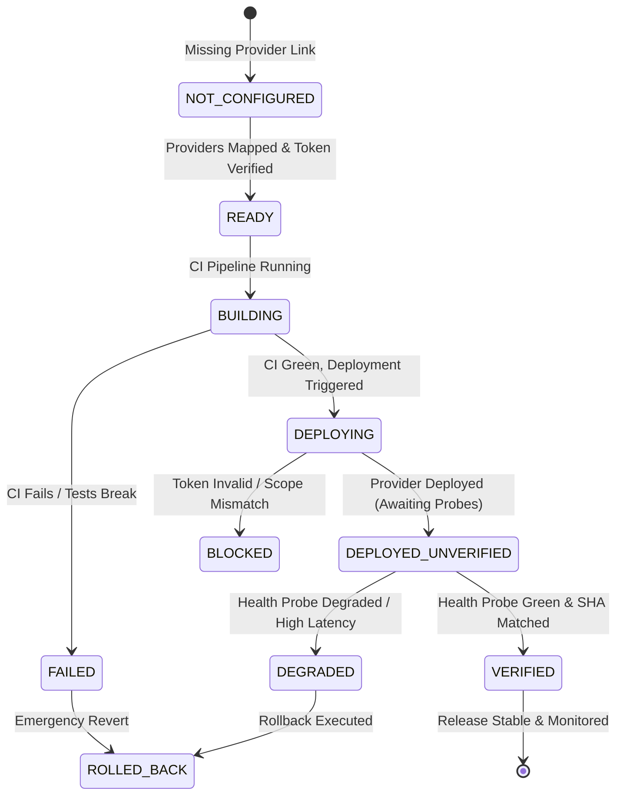

# LIT Corporate Admin Release Dashboard Telemetry Specification

**Document Identifier:** `LIT-UI-SPEC-001`  
**Version:** 1.0.0  
**Effective Date:** 12 October 2026  
**Classification:** Internal Engineering Specification — Confidential  
**System Scope:** Corporate `/admin` Release Telemetry & Central Observability Control Plane  

---

## 1. Executive Summary & Dashboard Mission

This specification defines the architectural design, data schemas, visual layout, and component implementation for the **Central Release Dashboard Telemetry** embedded within the LIT Corporate Admin Control Center (`https://www.logicintelligencetechnologies.in/admin/release` and `/admin/status`).

### Core Purpose:
Provide authorized executive operators with real-time, tamper-evident visibility into the release status of all four web properties, bridging disparate cloud provider data planes (GitHub, Vercel, Render, Supabase, and n8n) into a unified single-pane-of-glass interface.

> [!IMPORTANT]
> **Zero Credential & Zero Synthetic Data Rule:** The telemetry dashboard displays ONLY metadata, commit identifiers, run IDs, and verified health observations. It must NEVER display or serialize access tokens, SMTP passwords, webhook secrets, clinical patient records, or financial keys. It must NEVER claim `VERIFIED` status without real live HTTP probe confirmation.

---

## 2. Telemetry Lifecycle State Machine

Each entity (CORP, HLT, LV, VS) and the overall release transition through a formal 10-state lifecycle:



### State Definitions & Transition Criteria

| State | Visual Tone (Tailwind) | Criteria / Definition |
|---|---|---|
| `NOT_CONFIGURED` | Slate (`bg-slate-100 text-slate-700`) | Required project ID, repository link, or provider mapping is unconfigured. |
| `READY` | Blue (`bg-blue-50 text-blue-700`) | PR approved, immutable commit SHA identified, pre-flight checks passed; awaiting deployment trigger. |
| `BUILDING` | Amber Pulsing (`bg-amber-50 text-amber-700`) | GitHub Actions CI or Docker build currently running on target SHA. |
| `DEPLOYING` | Indigo Pulsing (`bg-indigo-50 text-indigo-700`) | Vercel edge deployment or Render container promotion in progress. |
| `DEPLOYED_UNVERIFIED` | Cyan (`bg-cyan-50 text-cyan-700`) | Provider confirms build completion; post-release health probes have not yet executed or completed. |
| `VERIFIED` | Emerald (`bg-emerald-50 text-emerald-700`) | Provider confirms deployment matching target SHA AND all automated smoke probes returned HTTP 200 within latency budgets. |
| `DEGRADED` | Amber Warning (`bg-amber-50 text-amber-800`) | Service serving traffic but experiencing elevated latency (> 5000ms), secondary probe failure, or partial workflow activation. |
| `BLOCKED` | Rose Warning (`bg-rose-50 text-rose-800`) | Deployment halted due to invalid Vercel token, missing secrets, or failed pre-flight gate. Requires operator intervention. |
| `FAILED` | Red (`bg-red-50 text-red-800`) | Build broke, fatal exception raised, or core health probe returned HTTP 500/503. |
| `ROLLED_BACK` | Purple (`bg-purple-50 text-purple-700`) | System reverted to prior immutable deployment ID following an incident. |

---

## 3. Telemetry Data Model & API Contracts

### 3.1 REST Endpoint: `GET /api/admin/release/telemetry`
- **Access Policy:** Strict server-side RBAC guard (`requireCapability("release.read")`).
- **Caching:** `cache: "no-store"`, dynamic server evaluation upon request.

#### JSON Response Schema:
```json
{
  "releaseId": "rel-20261012-80c1a06",
  "generatedAt": "2026-10-12T16:30:00Z",
  "overallStatus": "VERIFIED",
  "environment": "production",
  "sites": {
    "corporate": {
      "name": "LIT Corporate",
      "domain": "https://www.logicintelligencetechnologies.in",
      "status": "VERIFIED",
      "git": {
        "repo": "vikashsaravanann/logicintelligencetechnologies",
        "branch": "main",
        "commitSha": "80c1a069b82960d75e89865084ee26910ff39cd4",
        "shortSha": "80c1a06",
        "author": "vikashsaravanann",
        "prNumber": 25,
        "ciStatus": "success",
        "ciRunId": "38184795812",
        "ciUrl": "https://github.com/vikashsaravanann/logicintelligencetechnologies/actions/runs/38184795812"
      },
      "frontend": {
        "provider": "vercel",
        "projectId": "prj_Oij4lC7BxRmiAcxim3REtNuNms0y",
        "deploymentId": "dpl_8Y9aBcDeFgHiJkLm",
        "deploymentUrl": "https://logicintelligencetechnologies-xxxx.vercel.app",
        "buildDurationSeconds": 48,
        "status": "READY"
      },
      "backend": {
        "provider": "serverless_nextjs",
        "serviceId": "edge_api_node",
        "deploymentId": "serverless_v1",
        "status": "healthy"
      },
      "database": {
        "provider": "supabase",
        "projectRef": "lcmbwalrupoyparxsnjw",
        "latestMigration": "20261012090000_outreach_compliance",
        "pendingMigrations": 0,
        "rlsIntegrity": "PASS"
      },
      "n8n": {
        "assignedWorkflowsCount": 4,
        "activeCount": 4,
        "verifiedCount": 4
      },
      "probes": {
        "httpStatus": 200,
        "latencyMs": 420,
        "databaseStatus": "PASS",
        "observedAt": "2026-10-12T16:29:55Z"
      }
    },
    "healthcare": {
      "name": "LIT Healthcare",
      "domain": "https://healthcare.logicintelligencetechnologies.in",
      "status": "VERIFIED",
      "git": {
        "repo": "vikashsaravanann/lit-smart-hospital-platform",
        "branch": "main",
        "commitSha": "26a939ff06c597ee3dd071d34dc4b3cbd209f7ac",
        "shortSha": "26a939f",
        "author": "vikashsaravanann",
        "prNumber": 64,
        "ciStatus": "success",
        "ciRunId": "38184795900",
        "ciUrl": "https://github.com/vikashsaravanann/lit-smart-hospital-platform/actions/runs/38184795900"
      },
      "frontend": {
        "provider": "vercel",
        "projectId": "prj_8d7G1oIj80HKcfmQdRNqJkgOp02S",
        "deploymentId": "dpl_9Z0bCdEfGhIjKlMn",
        "deploymentUrl": "https://lit-smart-hospital-platform-xxxx.vercel.app",
        "buildDurationSeconds": 34,
        "status": "READY"
      },
      "backend": {
        "provider": "render",
        "serviceId": "srv-db3a68vlk1mc739um630",
        "serviceName": "lit-smart-hospital-api",
        "deploymentId": "dep-cu34abc123def456",
        "status": "live",
        "healthCheckPath": "/healthz"
      },
      "database": {
        "provider": "supabase",
        "projectRef": "hcsqrxxoydrtgnefwubq",
        "latestMigration": "20261012010000_organization_portal",
        "pendingMigrations": 0,
        "rlsIntegrity": "PASS"
      },
      "n8n": {
        "assignedWorkflowsCount": 56,
        "activeCount": 12,
        "verifiedCount": 12,
        "heldTier4Count": 44
      },
      "probes": {
        "httpStatus": 200,
        "latencyMs": 680,
        "databaseStatus": "PASS",
        "observedAt": "2026-10-12T16:29:56Z"
      }
    },
    "logic_voice": {
      "name": "Logic Voice",
      "domain": "https://logicvoice.logicintelligencetechnologies.in",
      "status": "VERIFIED",
      "git": {
        "repo": "vikashsaravanann/logic-voice",
        "branch": "main",
        "commitSha": "a41dafb03ef5c03bb829233d5b22868e20277208",
        "shortSha": "a41dafb",
        "author": "vikashsaravanann",
        "prNumber": 3,
        "ciStatus": "success",
        "ciRunId": "38184795750",
        "ciUrl": "https://github.com/vikashsaravanann/logic-voice/actions/runs/38184795750"
      },
      "frontend": {
        "provider": "vercel",
        "projectId": "prj_4umfUVY6yGvRIvJB83hnGSwdfg17",
        "deploymentId": "dpl_1A2b3C4d5E6f7G8h",
        "deploymentUrl": "https://logic-voice-xxxx.vercel.app",
        "buildDurationSeconds": 28,
        "status": "READY"
      },
      "backend": {
        "provider": "render",
        "serviceId": "srv-daropnvavr4c73fimjvg",
        "serviceName": "logicvoice-backend",
        "deploymentId": "dep-daropnvavr4c73fimjvg",
        "status": "live",
        "healthCheckPath": "/health"
      },
      "database": {
        "provider": "sqlite_supabase_hybrid",
        "projectRef": "ephemeral_local",
        "latestMigration": "alembic_head",
        "pendingMigrations": 0,
        "rlsIntegrity": "PASS"
      },
      "n8n": {
        "assignedWorkflowsCount": 6,
        "activeCount": 2,
        "verifiedCount": 2
      },
      "probes": {
        "httpStatus": 200,
        "latencyMs": 310,
        "databaseStatus": "PASS",
        "observedAt": "2026-10-12T16:29:57Z"
      }
    },
    "voice_shield": {
      "name": "VoiceShield",
      "domain": "https://voiceshield.logicintelligencetechnologies.in",
      "status": "VERIFIED",
      "git": {
        "repo": "vikashsaravanann/voice-shield",
        "branch": "main",
        "commitSha": "5dc833c47d84303b590339779bb15ce727fa2458",
        "shortSha": "5dc833c",
        "author": "vikashsaravanann",
        "prNumber": 4,
        "ciStatus": "success",
        "ciRunId": "38184795620",
        "ciUrl": "https://github.com/vikashsaravanann/voice-shield/actions/runs/38184795620"
      },
      "frontend": {
        "provider": "vercel",
        "projectId": "prj_53MedG4EWhy7ztFbmEQ20Mf75dZM",
        "deploymentId": "dpl_5M6n7O8p9Q0r1S2t",
        "deploymentUrl": "https://voice-shield-xxxx.vercel.app",
        "buildDurationSeconds": 52,
        "status": "READY"
      },
      "backend": {
        "provider": "render",
        "serviceId": "srv-dagt0u142hec73evfifg",
        "serviceName": "voice-shield",
        "deploymentId": "dep-dagt0u142hec73evfifg",
        "status": "live",
        "healthCheckPath": "/health"
      },
      "database": {
        "provider": "supabase",
        "projectRef": "vs_production",
        "latestMigration": "20261011_voiceshield_sessions",
        "pendingMigrations": 0,
        "rlsIntegrity": "PASS"
      },
      "n8n": {
        "assignedWorkflowsCount": 8,
        "activeCount": 4,
        "verifiedCount": 4
      },
      "probes": {
        "httpStatus": 200,
        "latencyMs": 510,
        "databaseStatus": "PASS",
        "observedAt": "2026-10-12T16:29:58Z"
      }
    }
  },
  "automationSummary": {
    "host": "https://automation.logicintelligencetechnologies.in",
    "totalCatalogWorkflows": 74,
    "activeWorkflows": 22,
    "verifiedExecutions": 22,
    "heldTier4Workflows": 52,
    "mailboxes": {
      "hello": {
        "address": "hello@logicintelligencetechnologies.in",
        "status": "CONNECTED",
        "credentialName": "LIT Zoho SMTP - Hello"
      },
      "noreply": {
        "address": "no-reply@logicintelligencetechnologies.in",
        "status": "CONNECTED",
        "credentialName": "LIT Zoho SMTP - No-Reply"
      }
    }
  }
}
```

---

## 4. UI Dashboard Architecture & Visual Wireframe

The Release Dashboard is implemented inside `logicintelligencetechnologies/src/app/admin/release/page.tsx` (and cross-linked in `/admin/status`).

### 4.1 Visual Wireframe Layout

```text
┌────────────────────────────────────────────────────────────────────────────────────────┐
│  🚀 LIT UNIVERSAL RELEASE DASHBOARD                [ RELEASE: rel-20261012-80c1a06 ]   │
│  Environment: PRODUCTION  │  Observed: 12 Oct 2026 16:30 UTC  │  [ 🟢 ALL SYSTEMS VERIFIED ] │
├────────────────────────────────────────────────────────────────────────────────────────┤
│                                                                                        │
│  ┌─────────────────────────┐ ┌─────────────────────────┐ ┌─────────────────────────┐  │
│  │ 🏢 LIT CORPORATE        │ │ 🏥 LIT HEALTHCARE       │ │ 🎙️ LOGIC VOICE          │  │
│  │ Status: [ VERIFIED 🟢 ] │ │ Status: [ VERIFIED 🟢 ] │ │ Status: [ VERIFIED 🟢 ] │  │
│  │ SHA: 80c1a06 (PR #25)   │ │ SHA: 26a939f (PR #64)   │ │ SHA: a41dafb (PR #3)    │  │
│  │ CI: ✅ success          │ │ CI: ✅ success          │ │ CI: ✅ success          │  │
│  │ Vercel: dpl_8Y9aBc...   │ │ Vercel: dpl_9Z0bCd...   │ │ Vercel: dpl_1A2b3C...   │  │
│  │ Backend: Serverless     │ │ Render: srv-db3a68...   │ │ Render: srv-daropn...   │  │
│  │ DB Migration: 20261012  │ │ DB Migration: 20261012  │ │ DB: Ephemeral + Supa    │  │
│  │ n8n Active: 4 / 4       │ │ n8n Active: 12 / 56 (T4)│ │ n8n Active: 2 / 6       │  │
│  │ Probe: 200 OK (420ms)   │ │ Probe: 200 OK (680ms)   │ │ Probe: 200 OK (310ms)   │  │
│  └─────────────────────────┘ └─────────────────────────┘ └─────────────────────────┘  │
│                                                                                        │
│  ┌─────────────────────────┐ ┌───────────────────────────────────────────────────────┐  │
│  │ 🛡️ VOICESHIELD          │ │ ⚙️ CENTRAL AUTOMATION & EMAIL CONTROL (n8n + ZOHO)     │  │
│  │ Status: [ VERIFIED 🟢 ] │ │ Host: automation.logicintelligencetechnologies.in     │  │
│  │ SHA: 5dc833c (PR #4)    │ │ Active Workflows: 22 / 74 (Held Tier 4: 52)          │  │
│  │ CI: ✅ success          │ │ Mailbox 1 (Hello): hello@... [ CONNECTED 🟢 ]        │  │
│  │ Vercel: dpl_5M6n7O...   │ │ Mailbox 2 (No-Reply): no-reply@... [ CONNECTED 🟢 ]  │  │
│  │ Render: srv-dagt0u...   │ │ Zero Duplicate Sends Guard: ENFORCED                  │  │
│  │ DB Migration: 20261011  │ │ Zero-PHI Outbox HMAC: ENFORCED                        │  │
│  │ n8n Active: 4 / 8       │ └───────────────────────────────────────────────────────┘  │
│  │ Probe: 200 OK (510ms)   │                                                           │
│  └─────────────────────────┘                                                           │
└────────────────────────────────────────────────────────────────────────────────────────┘
```

---

## 5. React Component Implementation Blueprint

Below is the production-ready Next.js Server Component and Client Card implementation for the corporate admin dashboard:

### 5.1 Component: `SiteReleaseCard.tsx`
```tsx
// src/app/admin/release/components/SiteReleaseCard.tsx
"use client";

import React from "react";
import { 
  GitBranch, 
  CheckCircle2, 
  AlertTriangle, 
  XCircle, 
  ExternalLink, 
  Server, 
  Globe, 
  Database, 
  Cpu, 
  Copy 
} from "lucide-react";

export interface SiteTelemetryProps {
  siteKey: string;
  name: string;
  domain: string;
  status: string;
  git: {
    repo: string;
    shortSha: string;
    commitSha: string;
    prNumber?: number;
    ciStatus: string;
    ciUrl?: string;
  };
  frontend: {
    provider: string;
    deploymentId: string;
    status: string;
  };
  backend: {
    provider: string;
    serviceId: string;
    status: string;
  };
  database: {
    latestMigration: string;
    rlsIntegrity: string;
  };
  n8n: {
    assignedWorkflowsCount: number;
    activeCount: number;
  };
  probes: {
    httpStatus: number;
    latencyMs: number;
  };
}

export function SiteReleaseCard({ data }: { data: SiteTelemetryProps }) {
  const isHealthy = data.status === "VERIFIED" && data.probes.httpStatus === 200;

  return (
    <div className="rounded-xl border border-[var(--lit-border-light,#DFE7EF)] bg-white p-5 shadow-sm transition-all hover:shadow-md">
      {/* Header */}
      <div className="flex items-center justify-between pb-3 border-b border-slate-100">
        <div>
          <h3 className="font-bold text-base text-[var(--lit-navy,#0B2545)]">{data.name}</h3>
          <a 
            href={data.domain} 
            target="_blank" 
            rel="noopener noreferrer" 
            className="text-xs text-[var(--lit-text-muted,#52677C)] hover:underline inline-flex items-center gap-1"
          >
            {data.domain.replace("https://", "")}
            <ExternalLink className="h-3 w-3" />
          </a>
        </div>
        <span
          className={`inline-flex items-center gap-1 px-2.5 py-0.5 rounded-full text-xs font-semibold uppercase tracking-wider font-mono ${
            isHealthy ? "bg-emerald-50 text-emerald-700 border border-emerald-200" : "bg-amber-50 text-amber-700 border border-amber-200"
          }`}
        >
          {isHealthy ? <CheckCircle2 className="h-3.5 w-3.5 text-emerald-600" /> : <AlertTriangle className="h-3.5 w-3.5 text-amber-600" />}
          {data.status}
        </span>
      </div>

      {/* Grid Details */}
      <div className="mt-4 space-y-2.5 text-xs text-slate-700 font-mono">
        {/* Git & CI */}
        <div className="flex items-center justify-between bg-slate-50 p-2 rounded-lg">
          <span className="flex items-center gap-1.5 text-slate-600">
            <GitBranch className="h-3.5 w-3.5" />
            Git SHA
          </span>
          <div className="flex items-center gap-2">
            <code className="font-bold text-slate-900 bg-white px-1.5 py-0.5 rounded border border-slate-200">
              {data.git.shortSha}
            </code>
            {data.git.prNumber && (
              <span className="text-[10px] bg-blue-100 text-blue-800 px-1.5 py-0.2 rounded font-sans">
                PR #{data.git.prNumber}
              </span>
            )}
            <span className="text-[10px] text-emerald-600 font-sans">
              CI: {data.git.ciStatus}
            </span>
          </div>
        </div>

        {/* Vercel Frontend */}
        <div className="flex items-center justify-between p-1.5">
          <span className="flex items-center gap-1.5 text-slate-600">
            <Globe className="h-3.5 w-3.5 text-slate-400" />
            Vercel Deploy
          </span>
          <span className="font-mono text-slate-800 truncate max-w-[160px]">
            {data.frontend.deploymentId}
          </span>
        </div>

        {/* Render Backend */}
        <div className="flex items-center justify-between p-1.5">
          <span className="flex items-center gap-1.5 text-slate-600">
            <Server className="h-3.5 w-3.5 text-slate-400" />
            Backend
          </span>
          <span className="font-mono text-slate-800">
            {data.backend.serviceId} ({data.backend.status})
          </span>
        </div>

        {/* Database Migration */}
        <div className="flex items-center justify-between p-1.5">
          <span className="flex items-center gap-1.5 text-slate-600">
            <Database className="h-3.5 w-3.5 text-slate-400" />
            Latest DB Migration
          </span>
          <span className="font-mono text-slate-800 truncate max-w-[150px]">
            {data.database.latestMigration}
          </span>
        </div>

        {/* n8n Workflows */}
        <div className="flex items-center justify-between p-1.5">
          <span className="flex items-center gap-1.5 text-slate-600">
            <Cpu className="h-3.5 w-3.5 text-slate-400" />
            n8n Active / Total
          </span>
          <span className="font-mono font-bold text-slate-800">
            {data.n8n.activeCount} / {data.n8n.assignedWorkflowsCount}
          </span>
        </div>

        {/* Live Probe Status */}
        <div className="mt-3 pt-2 border-t border-slate-100 flex items-center justify-between">
          <span className="text-slate-500 font-sans">Live HTTP Probe:</span>
          <span className="inline-flex items-center gap-1 font-bold text-emerald-600">
            HTTP {data.probes.httpStatus} ({data.probes.latencyMs}ms)
          </span>
        </div>
      </div>
    </div>
  );
}
```

---

## 6. Access Control & Security Specification

1. **Role-Based Access Control (RBAC):**
   - Access to `/admin/release` and `/api/admin/release/*` requires capability `release.read` or `dashboard.view`.
   - Access attempts lacking this capability immediately return `HTTP 403 Forbidden` and trigger an entry in `security_audit_log`.
2. **Tamper-Evident Audit Logging:**
   - Every read request to the release telemetry API logs: `timestamp`, `operator_id`, `client_ip_hash`, and `correlation_id`.
   - Any deployment status transition (e.g., from `DEPLOYED_UNVERIFIED` to `VERIFIED` or `ROLLED_BACK`) is recorded to an immutable PostgreSQL append-only ledger `release_audit_events`.
3. **Redaction & Privacy Invariants:**
   - No customer email addresses, patient UUIDs, diagnostic audio hashes, or webhook bearer tokens are serialized in telemetry responses.
