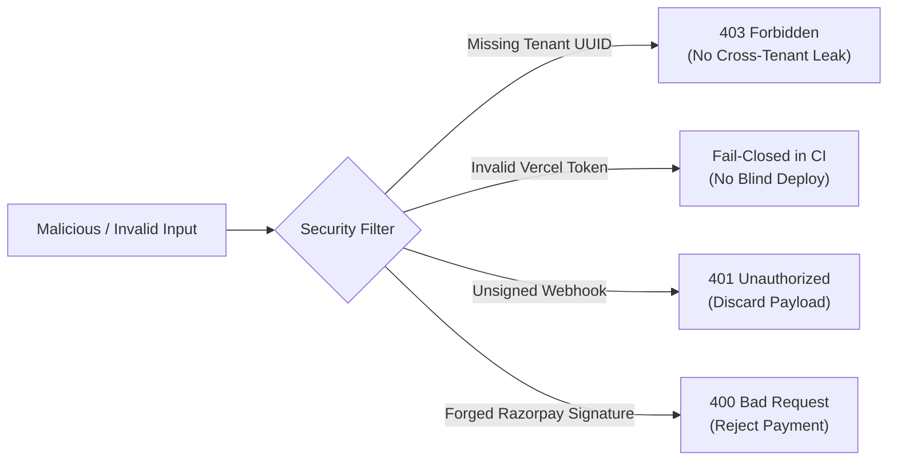

# LIT Four-Website Feature Smoke Tests & Health Probes Specification

**Document Identifier:** `LIT-TEST-SPEC-001`  
**Version:** 1.0.0  
**Effective Date:** 12 October 2026  
**Classification:** Engineering Specification — Production Quality Assurance  
**System Scope:** Post-Deployment Verification Across CORP, HLT, LV, and VS  

---

## 1. Executive Summary & Verification Philosophy

This specification defines the authoritative post-deployment smoke test suite and diagnostic health probes across all four Logic Intelligence Technologies web properties. 

### Core Verification Principles:
1. **Measured Observation Only:** Never claim a service is `OPERATIONAL` or `VERIFIED` based merely on file existence or registration in a cloud dashboard. A service is healthy only when live HTTP probes succeed with expected payloads within defined latency budgets.
2. **Zero Synthetic Success:** Never report mock test data as genuine production telemetry. Negative tests must fail truthfully with proper error envelopes.
3. **Fail-Closed Safeguards:** An endpoint failing authentication, tenant isolation, or database reachability must fail with secure, standardized status codes (`401`, `403`, `503`), never bypassing security.
4. **No Unsolicited Production Side-Effects:** Smoke tests must never send live marketing emails, charge real payment cards, or mutate actual patient medical records.

---

## 2. Global Diagnostic Health Probe Matrix

Every web application and backend service exposes machine-readable health probes used by load balancers, uptime sentinels, and the central release control plane:

| Probe ID | Entity & Tier | Probe URL | Method | Expected Status | Latency Budget | Response Contract / Schema |
|---|---|---|---|---|---|---|
| **HP-CORP-01** | LIT Corporate Edge Frontend | `https://www.logicintelligencetechnologies.in/api/health` | `GET` | `200 OK` (or `503` if DB down) | < 1500ms | JSON: `{status: "ok", database: "PASS", environment: "production", checks: {...}}` |
| **HP-CORP-02** | LIT Corporate Database Probe | `https://www.logicintelligencetechnologies.in/api/health/database` | `GET` | `200 OK` | < 1000ms | JSON: `{status: "ok", latencyMs: number, provider: "supabase"}` |
| **HP-CORP-03** | LIT Corporate Email Subsystem | `https://www.logicintelligencetechnologies.in/api/health/email` | `GET` | `200 OK` | < 1200ms | JSON: `{status: "ok", helloPool: "READY", noReplyPool: "READY"}` |
| **HP-HLT-01** | LIT Healthcare Web Landing | `https://healthcare.logicintelligencetechnologies.in/api/health` | `GET` | `200 OK` | < 1000ms | JSON: `{status: "ok", formAvailable: true}` |
| **HP-HLT-02** | LIT Healthcare FastAPI Backend | `https://lit-smart-hospital-api.onrender.com/healthz` | `GET` | `200 OK` | < 2500ms (Cold: 15s) | JSON: `{status: "healthy", service: "lit-api", version: "0.1.0", environment: "production"}` |
| **HP-LV-01** | Logic Voice Frontend Rewrite | `https://logicvoice.logicintelligencetechnologies.in/health` | `GET` | `200 OK` | < 2000ms | Proxied from Render: `{status: "ok", service: "logicvoice-backend"}` |
| **HP-LV-02** | Logic Voice Render Backend | `https://logicvoice-backend.onrender.com/health` | `GET` | `200 OK` | < 2500ms (Cold: 15s) | JSON: `{status: "ok", version: "...", database: "connected"}` |
| **HP-VS-01** | VoiceShield Edge Frontend | `https://voiceshield.logicintelligencetechnologies.in/api/health` | `GET` | `200 OK` | < 1200ms | JSON: `{status: "ok", totalLatencyMs: number, services: [...]}` |
| **HP-VS-02** | VoiceShield FastAPI Backend | `https://voiceshield-sih-2026.onrender.com/health` | `GET` | `200 OK` | < 2500ms (Cold: 15s) | JSON: `{status: "healthy", device: "cpu", fp16: false}` |
| **HP-N8N-01** | Central n8n Host Liveness | `https://automation.logicintelligencetechnologies.in/healthz` | `GET` | `200 OK` | < 1000ms | Caddy v2 / n8n status |

---

## 3. Detailed Feature Smoke Test Specifications

### 3.1 LIT Corporate (`www.logicintelligencetechnologies.in`)

#### Test CORP-01: Public Route Integrity & Asset Loading
- **Action:** Execute HTTP GET against primary navigation routes: `/`, `/about`, `/services`, `/solutions`, `/contact`, `/pricing`, `/resources`, `/privacy-policy`, `/terms-of-service`.
- **Assertions:**
  - Status code: `HTTP 200`
  - Headers: `content-type: text/html`, `Strict-Transport-Security`, `X-Content-Type-Options: nosniff`
  - DOM Content: Contains valid `<title>`, Meta description, OpenGraph tags, canonical link to `https://www.logicintelligencetechnologies.in/...`
  - Assets: Zero broken stylesheet or chunk scripts (HTTP 404 count = 0).

#### Test CORP-02: Lead Capture & Idempotent Persistence
- **Action:** Submit contact inquiry form to `POST /api/contact` with test payload:
  ```json
  {
    "name": "QA Release Automated Probe",
    "email": "test-lead@logicintelligencetechnologies.in",
    "company": "LIT QA Operations",
    "message": "Automated post-deployment smoke test probe.",
    "source": "smoke-test-corridor"
  }
  ```
- **Assertions:**
  - Status code: `HTTP 200 OK` with JSON envelope `{ "success": true, "leadId": "..." }`.
  - Database Verification: Exactly ONE record persisted in Supabase `contact_leads`. No duplicate inserts.
  - Subsystem Integrity: Outbox record staged; email is routed through approved dual-pool sender without double-sending through both web frontend and n8n webhook.

#### Test CORP-03: Admin Authentication & RBAC Authorization
- **Action 1 (Unauthenticated):** GET `/admin/command-center` without session cookies.
  - **Expected:** `HTTP 307 Temporary Redirect` to `/admin/login` or `HTTP 403 Forbidden`.
- **Action 2 (Authenticated Operator):** GET `/admin/command-center` with verified session.
  - **Expected:** `HTTP 200 OK`, executive operational tiles render without runtime error.
- **Action 3 (Capability Enforcement):** GET `/admin/status` with capability `status.read`.
  - **Expected:** `HTTP 200 OK`, live infrastructure status cards render.

#### Test CORP-04: Zoho Dual-Pool SMTP Verification
- **Action:** Authenticated `GET /api/admin/smtp-verify` with admin credentials.
- **Assertions:**
  - Validates `hello@logicintelligencetechnologies.in` transport connectivity (returns `hello: { status: "CONNECTED" }`).
  - Validates `no-reply@logicintelligencetechnologies.in` transport connectivity (returns `noReply: { status: "CONNECTED" }`).
  - Note: Prohibits actual email send on GET; send tests require authenticated POST.

---

### 3.2 LIT Healthcare Platform (`healthcare.logicintelligencetechnologies.in`)

#### Test HLT-01: Three Canonical Dedicated Login Portals
- **Action:** Navigate to each of the three independent portal entrypoints:
  1. Company Control Center: `GET /company/login`
  2. Hospital Administration & Clinicians: `GET /hospital/login`
  3. Patient Health Portal: `GET /patient/login`
- **Assertions:**
  - Each portal returns `HTTP 200 OK` with distinct UI branding, dedicated copy, and independent session callbacks.
  - Cross-portal bleed is strictly barred: a patient session attempting access to `/company/*` or `/hospital/*` returns `HTTP 403 Forbidden: A provisioned organization UUID is required`.

#### Test HLT-02: Commercial Funnel (`/organization-store` -> `/cart`)
- **Action:**
  1. Navigate to `/organization-store` -> select "Tier 1 Hospital Community Edition" (monthly/annual).
  2. Proceed to `/cart`.
  3. Enter facility metadata (Hospital Name, Bed Count, State, GSTIN).
- **Assertions:**
  - Cart state persists in client store without session dropping.
  - GST calculation strictly applies 18% tax line-item.
  - Form submission to backend returns a valid `request_id` or Razorpay order token in `rzp_test_*` mode.
  - Live payments (`rzp_live_*`) are blocked from auto-execution.

#### Test HLT-03: Zero-PHI HMAC Outbox Integrity
- **Action:** Trigger an internal clinical notification event (e.g., appointment scheduled).
- **Assertions:**
  - Outbox payload contains only: `event_id`, `event_type`, `tenant_id`, `recipient_id_hash`, `timestamp`, and `hmac_signature`.
  - Zero patient identifiers, names, clinical diagnoses, or prescription details flow into n8n payloads or logs.
  - Webhook delivery returns `HTTP 200` and updates outbox row to `dispatched`.

#### Test HLT-04: 2-in-1 AI Voice & Chat Companion Verification
- **Action:** Open Patient Portal companion widget.
- **Assertions:**
  - Chat interface initializes with grounded hospital system prompt.
  - Voice STT requests microphone permission **ONLY after user explicitly clicks the audio input button**, never on page load.
  - AI responses are truthful and grounded; no synthetic clinical diagnoses.

---

### 3.3 Logic Voice (`logicvoice.logicintelligencetechnologies.in`)

#### Test LV-01: Landing Architecture & Right-Side Login Panel
- **Action:** Open `https://logicvoice.logicintelligencetechnologies.in/`.
- **Assertions:**
  - Landing page loads cleanly with 40-page navigation architecture.
  - Clicking "Sign In" slides in the dedicated right-hand auth drawer.
  - **Microphone Permission Invariant:** The browser microphone permission prompt is NEVER triggered on public landing or navigation routes.

#### Test LV-02: Backend API Proxy Rewrite (`/v1/*` & `/health`)
- **Action:**
  - `GET https://logicvoice.logicintelligencetechnologies.in/health`
  - `GET https://logicvoice.logicintelligencetechnologies.in/v1/inquiries` (Unauthenticated)
- **Assertions:**
  - `/health` transparently returns the upstream Render FastAPI health status: `HTTP 200 {"status": "ok"}`.
  - `/v1/inquiries` requires authentication or returns safe schema envelope without disclosing stack traces.

#### Test LV-03: Logic AI Assistant ORB Activation
- **Action:** Authenticate and navigate to `/app/assistant`.
- **Assertions:**
  - Interactive Logic ORB component renders in idle state.
  - Clicking ORB triggers browser audio stream capture with clear visual recording indicator.
  - Speech-to-text (Whisper Large v3) transcription returns within 800ms.
  - LLM tool calls adhere to safety policy: AI draft tool is strictly `DRAFT_ONLY` and cannot dispatch autonomous emails to arbitrary recipients.

---

### 3.4 VoiceShield (`voiceshield.logicintelligencetechnologies.in`)

#### Test VS-01: Public Marketing & Security Compliance Pages
- **Action:** GET `/`, `/features`, `/compliance`, `/status`, `/privacy`, `/terms`.
- **Assertions:**
  - HTTP 200 across all routes.
  - Compliance page displays authentic standards documentation (DPDP Act 2023, Section 65B Indian Evidence Act).
  - Clean client console: 0 JavaScript exceptions.

#### Test VS-02: SOC Enterprise Workspace Routes (`/app/*`)
- **Action:** Navigate through authenticated SOC workspace:
  - `/app/detection` — Real-time voice clone detector
  - `/app/threat-map` — Telephony threat geography visualization
  - `/app/forensics` — Acoustic forensic analysis lab
  - `/app/sessions` — Active call session inspection
  - `/app/incidents` — Security incident ledger
- **Assertions:**
  - All 21 workspace routes mount cleanly.
  - Synthetic detection statistics are barred: only authentic forensic scores and confidence metrics display.

#### Test VS-03: Section 65B Forensics PDF Generation
- **Action:** Navigate to `/app/forensics` and click "Generate Forensic Certificate (Sec 65B)".
- **Assertions:**
  - Client generates PDF certificate containing SHA-256 hash of audio sample, spectral analysis graph, timestamp, and tamper-evident certificate ID.
  - Generated PDF is downloadable and opens cleanly in standard PDF viewers without rendering corruption.

#### Test VS-04: CSV Export Formula Injection Sanitization
- **Action:** Navigate to `/app/incidents` and trigger CSV export.
- **Assertions:**
  - Inspect exported CSV text: any cell beginning with `=`, `+`, `-`, or `@` is prepended with a single quote `'` (e.g., `'=SUM(A1:A10)`).
  - Mitigates formula injection vulnerabilities in spreadsheet applications.

---

## 4. Cross-Cutting Security & Platform Test Matrix

| Category | Test Description | Verification Method | Pass Criteria |
|---|---|---|---|
| **TLS & SSL** | Valid certificates across all 4 domains | Automated OpenSSL handshake check | TLS 1.3 / 1.2 active; expiry > 30 days |
| **Security Headers** | Defensive HTTP headers present | Inspect response headers on `/` | `X-Content-Type-Options: nosniff`, `Strict-Transport-Security`, `X-Frame-Options: DENY` / `SAMEORIGIN` |
| **CORS Policy** | Restricted origin policies | OPTIONS request with malicious origin | Preflight rejected or origin not reflected |
| **Client Secrets** | Browser asset bundle audit | Regex scan over JS bundle assets | Zero matches for `SUPABASE_SERVICE_ROLE_KEY`, `GROQ_API_KEY`, `RAZORPAY_KEY_SECRET` |
| **RLS Isolation** | Multi-tenant database boundary | Query Organization A data with User B session | Returns empty array `[]` or `403 Forbidden` |
| **Cold Starts** | Render container spin-up tolerance | Probe initial cold request | Handles up to 45s latency without 502/504 gateway timeout |

---

## 5. Deliberate Negative Test Matrix (Fail-Closed Verification)

Smoke testing must prove that system failure modes fail safely and securely:



1. **Negative Test NEG-01 (Missing Organization UUID on Healthcare):**
   - Query: Authenticated user without assigned organization UUID accesses `/api/v1/clinical/*`.
   - Expected Result: `HTTP 403 Forbidden` with body `{ "detail": "A provisioned organization UUID is required" }`. The system must NEVER auto-provision superuser rights or fabricate a mock UUID.
2. **Negative Test NEG-02 (Forged Razorpay Webhook Signature):**
   - Query: `POST /api/v1/billing/razorpay-webhook` with fake HMAC signature header.
   - Expected Result: `HTTP 400 Bad Request` or `HTTP 401 Unauthorized`. Payment status remains un-captured.
3. **Negative Test NEG-03 (Unauthenticated Admin Release Telemetry):**
   - Query: `GET /api/admin/release/telemetry` without valid admin JWT.
   - Expected Result: `HTTP 401 Unauthorized` or `HTTP 403 Forbidden`. No infrastructure metadata disclosed.
4. **Negative Test NEG-04 (Duplicate n8n Email Webhook):**
   - Query: Submit identical event payload with matching `event_id` within 60 seconds.
   - Expected Result: First call returns `200 Dispatched`; second call returns `200 Idempotent_Duplicate_Ignored`. Exactly one email reaches SMTP outbox.

---

## 6. Automated Smoke Test Runner Script

The following automated Node.js test script executes the core verification corridor across all four domains:

```javascript
// scripts/universal-smoke-test.mjs
import https from "node:https";

const PROBES = [
  { name: "CORP Web", url: "https://www.logicintelligencetechnologies.in/api/health", expectStatus: 200 },
  { name: "HLT Landing", url: "https://healthcare.logicintelligencetechnologies.in/api/health", expectStatus: 200 },
  { name: "HLT FastAPI", url: "https://lit-smart-hospital-api.onrender.com/healthz", expectStatus: 200 },
  { name: "LV Web Rewrite", url: "https://logicvoice.logicintelligencetechnologies.in/health", expectStatus: 200 },
  { name: "LV Backend", url: "https://logicvoice-backend.onrender.com/health", expectStatus: 200 },
  { name: "VS Web", url: "https://voiceshield.logicintelligencetechnologies.in/api/health", expectStatus: 200 },
  { name: "VS Backend", url: "https://voiceshield-sih-2026.onrender.com/health", expectStatus: 200 },
  { name: "Central n8n", url: "https://automation.logicintelligencetechnologies.in/healthz", expectStatus: 200 }
];

async function probe(target) {
  const start = Date.now();
  return new Promise((resolve) => {
    https.get(target.url, { timeout: 15000 }, (res) => {
      const latency = Date.now() - start;
      const passed = res.statusCode === target.expectStatus;
      resolve({ name: target.name, url: target.url, status: res.statusCode, latency, passed });
    }).on("error", (err) => {
      resolve({ name: target.name, url: target.url, status: "ERR", latency: Date.now() - start, passed: false, error: err.message });
    });
  });
}

console.log("=== EXECUTING LIT UNIVERSAL FOUR-SITE SMOKE PROBES ===");
const results = await Promise.all(PROBES.map(probe));
let allPassed = true;
for (const r of results) {
  const icon = r.passed ? "✅ PASS" : "❌ FAIL";
  console.log(`${icon} | ${r.name.padEnd(16)} | Status: ${r.status} | Latency: ${r.latency}ms`);
  if (!r.passed) allPassed = false;
}

if (!allPassed) {
  console.error("SMOKE TEST FAILED: One or more critical probes failed.");
  process.exit(1);
} else {
  console.log("ALL PROBES PASSED CLEANLY.");
  process.exit(0);
}
```
