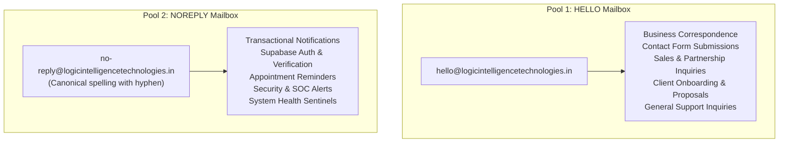

# LIT Production Release — Owner Configuration & Credentials Checklist

**Document Identifier:** `LIT-OPS-CHECKLIST-001`  
**Version:** 1.0.0  
**Effective Date:** 12 October 2026  
**Classification:** Confidential — Owner Setup Guide  
**System Scope:** Four-Website Ecosystem Configuration & Secure Credential Provisioning  

---

## 1. Executive Summary & Compliance Mandate

This checklist specifies the exact manual configuration steps required from the **Executive Project Owner** to authorize, unblock, and securely connect third-party provider accounts (Vercel, Zoho, Render, Supabase, Razorpay, n8n) across all four Logic Intelligence Technologies repositories.

> [!CRITICAL]
> **Zero Secrets Policy:** Never commit secret values, API keys, SMTP passwords, database connection strings, or private tokens to Git repositories or markdown documentation. All secrets must be entered directly into encrypted provider dashboards (GitHub Secrets, Vercel Environment Variables, Render Environment Variables, Supabase Dashboard, or n8n Credentials Vault).

---

## 2. Section 1: Vercel Project Token & Scoped Access Configuration

### 2.1 Diagnosis of Previous Vercel Token Failure
During previous automated deployment runs on `logicintelligencetechnologies`, GitHub Actions failed at the Vercel environment pull stage with the error:
```text
Error: The provided Vercel token is invalid or expired.
```
**Root Cause:** The `VERCEL_TOKEN` secret in GitHub Actions was either generated with an expiration date that lapsed, lacked access to the organization team scope `team_mmKBzYcmZkj4Y6aELMLU3Jen`, or was created under an individual personal account rather than the team owning the projects.

### 2.2 Step-by-Step Vercel Token Provisioning
1. Log in to [Vercel Dashboard](https://vercel.com) using the owner account.
2. Ensure you are operating within the team context: **`team_mmKBzYcmZkj4Y6aELMLU3Jen`**.
3. Navigate to **Account Settings** (or Team Settings) -> **Tokens**.
4. Click **Create Token**:
   - **Name:** `lit-universal-release-token`
   - **Scope:** Select team `team_mmKBzYcmZkj4Y6aELMLU3Jen` (Full Access / Deploy permissions)
   - **Expiration:** Set according to your rotation policy (e.g., 90 days or No Expiration for production service accounts).
5. Copy the newly generated token immediately (starts with `vck_...` or alphanumeric string).

### 2.3 Repository GitHub Secrets Configuration Matrix
For each of the four repositories on GitHub, navigate to **Settings** -> **Secrets and variables** -> **Actions** -> **Repository secrets**, and configure the following:

| Repository | Secret Name | Value Description | Verified Project ID |
|---|---|---|---|
| `logicintelligencetechnologies` | `VERCEL_TOKEN` | Newly generated Vercel token | — |
| | `VERCEL_ORG_ID` | `team_mmKBzYcmZkj4Y6aELMLU3Jen` | — |
| | `VERCEL_PROJECT_ID` | Project ID for Corporate Next.js | `prj_Oij4lC7BxRmiAcxim3REtNuNms0y` |
| `lit-smart-hospital-platform` | `VERCEL_TOKEN` | Newly generated Vercel token | — |
| | `VERCEL_ORG_ID` | `team_mmKBzYcmZkj4Y6aELMLU3Jen` | — |
| | `VERCEL_PROJECT_ID` | Project ID for Healthcare Landing/Web | `prj_8d7G1oIj80HKcfmQdRNqJkgOp02S` |
| `logic-voice` | `VERCEL_TOKEN` | Newly generated Vercel token | — |
| | `VERCEL_ORG_ID` | `team_mmKBzYcmZkj4Y6aELMLU3Jen` | — |
| | `VERCEL_PROJECT_ID` | Project ID for Logic Voice Web | `prj_4umfUVY6yGvRIvJB83hnGSwdfg17` |
| `voice-shield` | `VERCEL_TOKEN` | Newly generated Vercel token | — |
| | `VERCEL_ORG_ID` | `team_mmKBzYcmZkj4Y6aELMLU3Jen` | — |
| | `VERCEL_PROJECT_ID` | Project ID for VoiceShield Next.js | `prj_53MedG4EWhy7ztFbmEQ20Mf75dZM` |

### 2.4 Verify CLI Access Locally
Validate that the token has access to the four target projects:
```bash
export VERCEL_TOKEN="<PASTE_NEW_TOKEN>"
vercel projects ls --scope team_mmKBzYcmZkj4Y6aELMLU3Jen
```
**Pass Criteria:** The output must list all 4 projects:
- `logicintelligencetechnologies` (`prj_Oij4lC7BxRmiAcxim3REtNuNms0y`)
- `lit-smart-hospital-platform` (`prj_8d7G1oIj80HKcfmQdRNqJkgOp02S`)
- `logic-voice` (`prj_4umfUVY6yGvRIvJB83hnGSwdfg17`)
- `voice-shield` (`prj_53MedG4EWhy7ztFbmEQ20Mf75dZM`)

### 2.5 Deployment Strategy Disambiguation
To prevent duplicate competing builds (Vercel Native Git Auto-Deploy vs GitHub Actions CLI workflow):
- **Decision Rule:** For repositories linked with the native Vercel GitHub App, merges to `main` automatically initiate builds. Disable or remove redundant `vercel deploy --prebuilt` CLI steps in GitHub Actions workflows to eliminate double deployments.

---

## 3. Section 2: Zoho Mailbox Dual-Pool SMTP Configuration

### 3.1 Two Authorized Company Mailbox Identities
Logic Intelligence Technologies standardizes all outbound email on **two authorized Zoho Mail accounts**, serving distinct business and system functions across all four web properties:



> [!IMPORTANT]
> **Exact Spelling Invariant:** The canonical system mailbox is spelled `no-reply@logicintelligencetechnologies.in` (with a hyphen), NEVER `noreply@...`. Silently substituting or dropping the hyphen causes SPF/DKIM alignment failure and bounced deliveries.

### 3.2 Zoho Mail Admin Console Setup
1. Log in to [Zoho Mail Admin Console](https://mailadmin.zoho.in) (or `zoho.com` depending on tenant region).
2. Confirm both user mailboxes exist and are licensed:
   - Account 1: `hello@logicintelligencetechnologies.in`
   - Account 2: `no-reply@logicintelligencetechnologies.in`
3. Confirm SMTP Server Parameters:
   - **SMTP Host:** `smtppro.zoho.in` (for Zoho Professional / Workplace paid accounts) or `smtp.zoho.in`
   - **SMTP Port:** `465` (SSL) or `587` (TLS / STARTTLS)
   - **Authentication:** Required (User + App-Specific Password)

### 3.3 Two-Factor Authentication & App-Specific Password Generation
For **both** mailboxes independently:
1. Log in to the respective Zoho account at `accounts.zoho.in`.
2. Navigate to **Security** -> **App Passwords**.
3. Click **Generate New Password**:
   - For `hello`: App Name = `LIT Production - Hello Pool (Vercel & n8n)`
   - For `no-reply`: App Name = `LIT Production - NoReply Pool (Vercel & n8n)`
4. Copy the 16-character generated application password. (Never use the owner's master login password).

### 3.4 DNS Deliverability Authentication (SPF, DKIM, DMARC)
Verify that DNS records on domain `logicintelligencetechnologies.in` contain valid records:
- **SPF Record (TXT):**
  ```text
  v=spf1 include:zoho.in ~all
  ```
- **DKIM Record (TXT):**
  Host/Selector: `zoho._domainkey.logicintelligencetechnologies.in`  
  Value: Provided by Zoho Mail Admin Console.
- **DMARC Record (TXT):**
  Host: `_dmarc.logicintelligencetechnologies.in`  
  Value: `v=DMARC1; p=reject; rua=mailto:no-reply@logicintelligencetechnologies.in`

### 3.5 Environment Variables Matrix on Vercel & Render
Configure the following environment variables in Vercel for `logicintelligencetechnologies` (Server-Side Scope only):

```bash
# --- HELLO Mailbox Credential Pool ---
SMTP_HELLO_HOST="smtppro.zoho.in"
SMTP_HELLO_PORT="465"
SMTP_HELLO_SECURE="true"
SMTP_HELLO_USER="hello@logicintelligencetechnologies.in"
SMTP_HELLO_PASS="<16_CHAR_ZOHO_APP_PASSWORD_HELLO>"

# --- NOREPLY Mailbox Credential Pool ---
SMTP_NOREPLY_HOST="smtppro.zoho.in"
SMTP_NOREPLY_PORT="465"
SMTP_NOREPLY_SECURE="true"
SMTP_NOREPLY_USER="no-reply@logicintelligencetechnologies.in"
SMTP_NOREPLY_PASS="<16_CHAR_ZOHO_APP_PASSWORD_NOREPLY>"

# --- Default Fallback Aliases (Points to Verified Pools) ---
SMTP_HOST="smtppro.zoho.in"
SMTP_PORT="465"
SMTP_SECURE="true"
SMTP_USER="hello@logicintelligencetechnologies.in"
SMTP_PASS="<16_CHAR_ZOHO_APP_PASSWORD_HELLO>"
```

### 3.6 Central n8n SMTP Credentials Setup
In the n8n Dashboard (`https://automation.logicintelligencetechnologies.in/`):
1. Navigate to **Settings** -> **Credentials**.
2. Click **Add Credential** -> Select **SMTP**:
   - **Name:** `LIT Zoho SMTP - Hello`
   - **User:** `hello@logicintelligencetechnologies.in`
   - **Password:** `<16_CHAR_ZOHO_APP_PASSWORD_HELLO>`
   - **Host:** `smtppro.zoho.in`
   - **Port:** `465`
   - **SSL/TLS:** Enabled
3. Repeat for No-Reply:
   - **Name:** `LIT Zoho SMTP - No-Reply`
   - **User:** `no-reply@logicintelligencetechnologies.in`
   - **Password:** `<16_CHAR_ZOHO_APP_PASSWORD_NOREPLY>`
   - **Host:** `smtppro.zoho.in`
   - **Port:** `465`
   - **SSL/TLS:** Enabled
4. Save and run the built-in credential test for both accounts.

### 3.7 Verification via Production Endpoint
Once configured, execute the non-destructive status probe:
```bash
curl -s -H "Authorization: Bearer $ADMIN_SESSION_TOKEN" \
  https://www.logicintelligencetechnologies.in/api/admin/smtp-verify
```
**Pass Criteria:** Returns HTTP 200 with `hello_status: "CONNECTED"` and `noreply_status: "CONNECTED"`.

---

## 4. Section 3: Render Workspace & Auto-Deploy Services

1. Log in to [Render Dashboard](https://dashboard.render.com/).
2. Confirm active workspace is **`tea-d9vchsu7bikc73d6srv0`**.
3. Verify the three production web services are present and linked to GitHub repository `main` branch:
   - **Healthcare API:** Service ID `srv-db3a68vlk1mc739um630` (`lit-smart-hospital-api`)
   - **Logic Voice Backend:** Service ID `srv-daropnvavr4c73fimjvg` (`logicvoice-backend`)
   - **VoiceShield API:** Service ID `srv-dagt0u142hec73evfifg` (`voiceshield-api`)
4. Confirm **Auto-Deploy** is enabled on each service:
   - `Auto-Deploy: Yes`
   - `Trigger: Commit`
   - `Branch: main`
5. Verify that backend secrets (e.g., `SUPABASE_SERVICE_ROLE_KEY`, `GROQ_API_KEY`, `RAZORPAY_KEY_SECRET`) are set with `sync: false` inside the Render Environment tab and are NOT missing.

---

## 5. Section 4: Supabase Production Databases & Auth URLs

### 5.1 Project References
Confirm access to the three Supabase production projects:
- **Corporate DB:** Project Reference `lcmbwalrupoyparxsnjw` (`lcmbwalrupoyparxsnjw.supabase.co`)
- **Healthcare DB:** Project Reference `hcsqrxxoydrtgnefwubq` (`hcsqrxxoydrtgnefwubq.supabase.co`)
- **VoiceShield DB:** VoiceShield Production Supabase Project

### 5.2 Supabase Auth Redirect URLs Configuration
In the Supabase Dashboard for each project, navigate to **Authentication** -> **URL Configuration**:
1. **Site URL:** Set to canonical production domain (e.g., `https://www.logicintelligencetechnologies.in`).
2. **Redirect URLs (Allowlist):**
   - `https://www.logicintelligencetechnologies.in/auth/callback`
   - `https://healthcare.logicintelligencetechnologies.in/auth/callback`
   - `https://healthcare.logicintelligencetechnologies.in/company/login`
   - `https://logicvoice.logicintelligencetechnologies.in/auth/callback`
   - `https://voiceshield.logicintelligencetechnologies.in/auth/callback`
   - `http://localhost:*` (for approved local development only)

---

## 6. Section 5: Razorpay Payment Gateway Configuration

1. Log in to [Razorpay Dashboard](https://dashboard.razorpay.com/).
2. **Pre-Release Safe Mode Verification:**
   - Confirm active mode is **Test Mode** (`rzp_test_...`).
   - Do NOT toggle to Live Mode (`rzp_live_...`) until full staging commercial verification is complete and explicit financial sign-off is granted.
3. **Webhook Secret Setup:**
   - Navigate to **Settings** -> **Webhooks**.
   - Ensure webhook endpoint points to: `https://lit-smart-hospital-api.onrender.com/api/v1/billing/razorpay-webhook`
   - Ensure secret matches `RAZORPAY_WEBHOOK_SECRET` in Render environment variables.
   - Events subscribed: `payment.captured`, `subscription.activated`, `subscription.cancelled`.

---

## 7. Section 6: Central n8n Host & Secret Management

1. Access the central n8n instance at `https://automation.logicintelligencetechnologies.in/`.
2. Confirm Caddy v2 TLS reverse proxy is healthy (SSL certificate valid, HTTP/2 supported).
3. Confirm API access:
   - Navigate to **Settings** -> **n8n API**.
   - Confirm an active API Key exists and is stored securely as `N8N_API_KEY` in deployment tools.
4. Confirm webhook HMAC verification secret:
   - Verify that all inbound webhooks from Healthcare (`/outbox`), Corporate (`/leads`), and VoiceShield validate HMAC SHA-256 signatures before executing workflow steps.

---

## 8. Owner Sign-Off & Verification Matrix

Before granting production release authorization, the owner must complete this checklist:

- [ ] **1. Vercel Token Generated & Scoped:** Token created under team `team_mmKBzYcmZkj4Y6aELMLU3Jen` and tested with `vercel projects ls`.
- [ ] **2. GitHub Secrets Configured:** `VERCEL_TOKEN`, `VERCEL_ORG_ID`, `VERCEL_PROJECT_ID` updated on all 4 GitHub repositories.
- [ ] **3. Zoho HELLO Mailbox Active:** App password generated for `hello@logicintelligencetechnologies.in` and added to Vercel/Render.
- [ ] **4. Zoho NOREPLY Mailbox Active:** App password generated for `no-reply@logicintelligencetechnologies.in` (exact spelling) and added to Vercel/Render.
- [ ] **5. n8n SMTP Credentials Saved:** Both Zoho accounts tested green in n8n Credentials Vault.
- [ ] **6. Render Services Verified:** Auto-deploy active on `main` for services `srv-db3a68vlk1mc739um630`, `srv-daropnvavr4c73fimjvg`, `srv-dagt0u142hec73evfifg`.
- [ ] **7. Supabase Auth Redirects Updated:** Canonical domain callbacks allowlisted.
- [ ] **8. Razorpay Gated in Test Mode:** No real charges enabled without explicit release ticket.
- [ ] **9. Formal Release Sign-Off:** Execute production release command with approved `$RELEASE_ID`.
