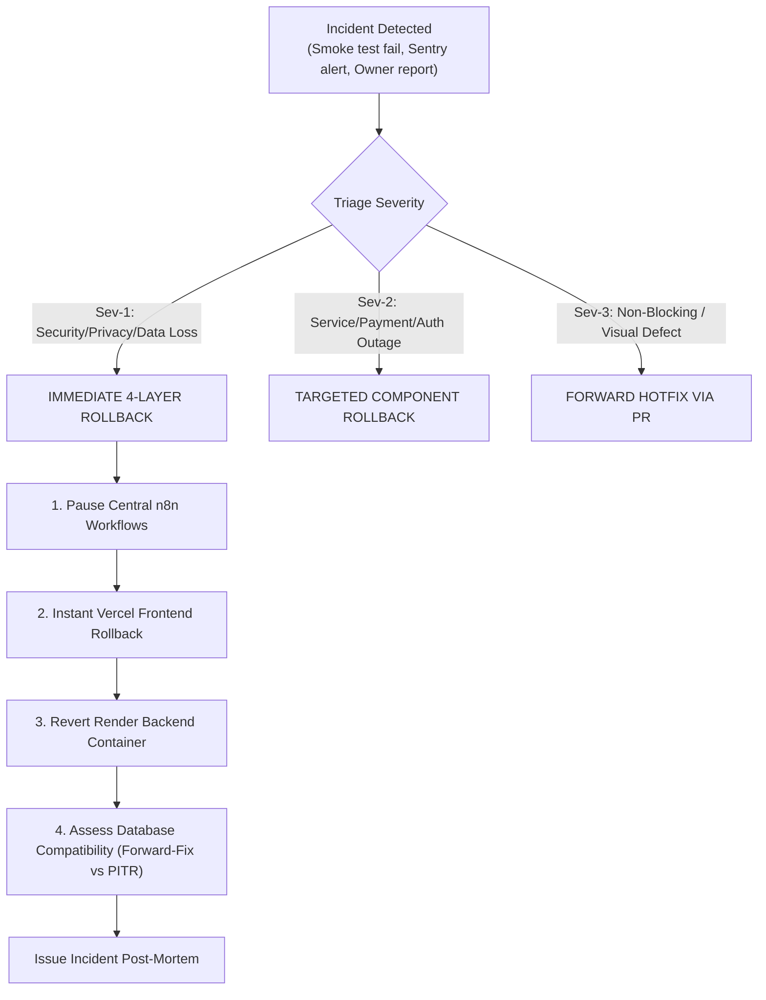
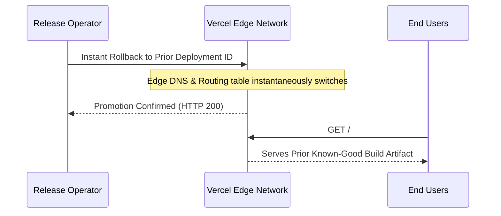

# LIT Universal Four-Site Incident Response & Rollback Runbook

**Document Identifier:** `LIT-OPS-RUNBOOK-002`  
**Version:** 1.0.0  
**Effective Date:** 12 October 2026  
**Classification:** Internal Engineering Operations — Confidential  
**System Scope:** Four-Website Production Ecosystem (CORP, HLT, LV, VS)  

---

## 1. Incident Severity & Rollback Triggers

When a critical defect, security breach, or operational failure is detected following a production deployment, the release team must immediately halt forward progress and evaluate rollback criteria.



### 1.1 Severity Classification Matrix

| Severity Level | Definition | Impact Thresholds | Required Action |
|---|---|---|---|
| **Sev-1 (Critical)** | Compromise of security, cross-tenant confidentiality, data integrity, or total platform failure. | - Cross-tenant data leakage between hospital tenants or user accounts.<br>- Unauthenticated access to clinical records or admin routes.<br>- Live credentials / service keys exposed in client bundles.<br>- Rapid data corruption or destructive database mutation.<br>- Outbound email loop blasting duplicate messages to customers. | **Immediate Full Rollback.** Initiate Layer 1-4 procedures within 5 minutes. No waiting for patch code. |
| **Sev-2 (High)** | Degradation of core business functions without cross-tenant security compromise. | - HTTP 500 error rate exceeding 1% over a 5-minute rolling window.<br>- Inability to sign in across Passkey, Google OAuth, or password auth.<br>- Failure of hospital commercial funnel (`/organization-store` -> `/cart`).<br>- Real-time audio STT stream failure affecting all users.<br>- Background Render service crash-looping. | **Targeted Component Rollback.** Roll back affected frontend or backend service to prior immutable deployment ID. |
| **Sev-3 (Medium)** | Minor functional impairment or non-blocking UI/UX regression. | - Visual layout defects on non-critical pages.<br>- Non-blocking analytics telemetry dropped.<br>- Slow response times (< 5000ms) without outright timeout.<br>- Unapproved workflow pending manual activation. | **Forward Fix via Expedited PR.** Do not roll back entire release if core platform is stable. |

---

## 2. Layer-by-Layer Rollback Protocol

When a rollback is triggered, execute operations in order from outermost automation/traffic layers down to core data stores to prevent state corruption:

### Layer 1: Pause Central n8n Automation Workflows (Immediate)

Pausing active automation workflows halts any queued tasks from dispatching incorrect webhook payloads or generating duplicate customer emails.

1. **Deactivate High-Impact Workflows via n8n API:**
   ```bash
   # Deactivate affected workflows using central n8n API
   N8N_URL="https://automation.logicintelligencetechnologies.in"

   # Fetch active workflows
   curl -s -H "X-N8N-API-KEY: $N8N_API_KEY" "$N8N_URL/api/v1/workflows" | jq '.data[] | {id: .id, name: .name, active: .active}'

   # Immediately deactivate outbox and notification workflows
   for WF_ID in $AFFECTED_WORKFLOW_IDS; do
     echo "Deactivating workflow $WF_ID..."
     curl -s -X POST -H "X-N8N-API-KEY: $N8N_API_KEY" "$N8N_URL/api/v1/workflows/$WF_ID/deactivate"
   done
   ```

2. **Purge Volatile Retry Queues:**
   Inspect and clear stuck execution queues in n8n Dashboard to avoid retry storms against rolled-back backends.

---

### Layer 2: Vercel Frontend Instant Rollback (< 15 Seconds)

Vercel provides instant traffic rerouting to previously deployed immutable build artifacts with zero build delay.



#### Method A: Vercel Dashboard (Fastest UI Path)
1. Open [Vercel Dashboard](https://vercel.com) and switch to team: `team_mmKBzYcmZkj4Y6aELMLU3Jen`.
2. Select the affected project:
   - CORP: `logicintelligencetechnologies`
   - HLT: `lit-smart-hospital-platform`
   - LV: `logic-voice`
   - VS: `voice-shield`
3. Click the **Deployments** tab.
4. Locate the last known-good production deployment (marked with prior stable Git commit).
5. Click the context menu (`...`) and select **Instant Rollback**.
6. Edge traffic immediately points to the safe deployment within seconds.

#### Method B: Vercel CLI (Scriptable Operational Path)
```bash
# Rollback specific project to known-good deployment
export VERCEL_ORG_ID="team_mmKBzYcmZkj4Y6aELMLU3Jen"

# Example: Rollback Corporate website
cd /Users/vikash/lit-infrastructure/logicintelligencetechnologies
vercel rollback <PRIOR_KNOWN_GOOD_DEPLOYMENT_ID> --token "$VERCEL_TOKEN" --yes

# Example: Rollback Healthcare landing
cd /Users/vikash/lit-infrastructure/lit-smart-hospital-platform/apps/landing
vercel rollback <PRIOR_KNOWN_GOOD_DEPLOYMENT_ID> --token "$VERCEL_TOKEN" --yes
```

---

### Layer 3: Render Backend Container Rollback

Render web services maintain immutable Docker container images from previous builds.

#### Target Render Web Services:
- **HLT API:** Service ID `srv-db3a68vlk1mc739um630` (`lit-smart-hospital-api`)
- **LV Backend:** Service ID `srv-daropnvavr4c73fimjvg` (`logicvoice-backend`)
- **VS API:** Service ID `srv-dagt0u142hec73evfifg` (`voiceshield-api`)

#### Method A: Render Dashboard
1. Open [Render Dashboard](https://dashboard.render.com/) within workspace `tea-d9vchsu7bikc73d6srv0`.
2. Select the affected Web Service.
3. Navigate to **Deploys**.
4. Identify the previous successful deployment corresponding to the stable Git SHA.
5. Click **Rollback to this deploy**.
6. Render immediately provisions the previous immutable Docker container.

#### Method B: Render API Rollback
```bash
# Execute rollback via Render REST API
RENDER_API_KEY="$RENDER_API_KEY"
SERVICE_ID="srv-db3a68vlk1mc739um630"
TARGET_DEPLOY_ID="dep-xxxxxxxxxxxxxxxxxxxx"

curl -s -X POST "https://api.render.com/v1/services/$SERVICE_ID/deploys/$TARGET_DEPLOY_ID/rollback" \
  -H "Authorization: Bearer $RENDER_API_KEY" \
  -H "Accept: application/json"
```

7. **Poll Backend Liveness:**
   ```bash
   curl -s -f https://lit-smart-hospital-api.onrender.com/healthz
   ```

---

### Layer 4: Supabase Database Strategy (Forward-Fix vs PITR)

> [!WARNING]
> **Destructive Database Rollback Guard:** Never execute blind `supabase db reset` or restore a full database backup over an active production system that has continued to accept user writes, customer bookings, or payments during the incident window.

#### Strategy A: Backward-Compatible Forward Migration (Recommended)
Since all release migrations follow the **expand-contract pattern**, database schema changes must be strictly additive:
- New tables, nullable columns, and non-blocking indexes do not break prior application code.
- If a new column or table contains a logic bug, disable application usage of that column in the rolled-back code; leave the table intact.
- If an erroneous RLS policy was applied, surgically patch the policy without dropping user tables:
  ```sql
  -- Example: Re-enable restrictive tenant boundary
  ALTER POLICY "tenant_isolation_policy" ON lit_private.organizations
  USING (id = auth.jwt() ->> 'organization_id');
  ```

#### Strategy B: Supabase Point-in-Time Recovery (PITR) (Disaster Recovery Only)
If catastrophic data corruption occurred (e.g., accidental bulk update or table truncation):
1. In the Supabase Dashboard, navigate to **Project Settings** -> **Database** -> **Backups**.
2. Select **Point in Time Recovery (PITR)**.
3. Select the exact recovery timestamp immediately preceding the release execution window (e.g., `2026-10-12T16:00:00Z`).
4. Execute recovery to a staging instance first to verify data integrity before promoting to production.

---

## 3. Git Source Control Remediation

To ensure that future CI/CD runs do not inadvertently redeploy the broken commit, the Git branch history must be corrected permanently:

> [!CRITICAL]
> **Never Force Push (`git push --force`) to `main`:** Deleting history on protected production branches violates audit compliance and breaks active developer clones.

1. **Create an Explicit Revert Commit:**
   ```bash
   git checkout main
   git pull origin main
   git revert -m 1 <MERGE_COMMIT_SHA> -m "revert: Rollback release $RELEASE_ID due to incident INC-XXXX"
   ```

2. **Open an Emergency Revert Pull Request:**
   ```bash
   git checkout -b fix/revert-release-$RELEASE_ID
   git push origin fix/revert-release-$RELEASE_ID
   gh pr create --title "EMERGENCY REVERT: Release $RELEASE_ID" --body "Reverts merge commit $MERGE_COMMIT_SHA to resolve incident."
   ```

3. **Merge the Revert PR:**
   Merging the revert PR restores `main` to the verified stable state, ensuring Vercel and Render native triggers stay synchronized.

---

## 4. Post-Rollback Verification Matrix

Immediately following execution of the rollback procedures, perform the following validation checks:

| System | Verification Target | Probe Command | Pass Criteria |
|---|---|---|---|
| **CORP** | Homepage & Health API | `curl -sI https://www.logicintelligencetechnologies.in/api/health` | HTTP 200, DB `PASS`, response latency < 1500ms |
| **HLT** | Landing & Render API | `curl -sI https://healthcare.logicintelligencetechnologies.in`<br>`curl -s https://lit-smart-hospital-api.onrender.com/healthz` | HTTP 200, FastAPI returns `{"status": "healthy"}` |
| **LV** | Voice Assistant & Backend | `curl -s https://logicvoice-backend.onrender.com/health` | HTTP 200 `{"status": "ok"}` |
| **VS** | SOC App & Backend | `curl -s https://voiceshield-sih-2026.onrender.com/health` | HTTP 200 `{"status": "healthy"}` |
| **n8n** | Automation Queue | `curl -sI https://automation.logicintelligencetechnologies.in/` | HTTP 200 via Caddy; zero failed webhook storm |

---

## 5. Incident Communication & Post-Mortem Template

### 5.1 Communication Timeline
- **T+0m (Detection):** Release Lead declares incident in internal coordination channel.
- **T+5m (Decision):** Severity classified; Owner confirms Rollback authorization.
- **T+10m (Execution):** Layer 1-3 rollbacks completed; traffic rerouted to prior deployments.
- **T+20m (Verification):** Post-rollback verification matrix green; system declared stable.
- **T+24h (Post-Mortem):** Blameless root cause analysis (RCA) authored and reviewed.

### 5.2 Post-Mortem Incident Report Template

```markdown
# Incident Post-Mortem Report

**Incident ID:** INC-20261012-001  
**Release ID:** rel-xxxxxxxx  
**Date & Time:** 2026-10-12 HH:MM UTC  
**Severity:** Sev-1 / Sev-2  
**Incident Commander:** [Name/Role]  

## 1. Summary
[Brief description of what went wrong, impact on users, and when service was restored.]

## 2. Root Cause Analysis (5 Whys)
1. Why did the failure occur?
2. Why was it not caught in staging CI?
3. Why did the health probe not fail early?
4. Why was the configuration mismatch present?
5. Root cause: [Underlying technical or process failure]

## 3. Timeline of Events
- 16:00 UTC: PR merged to main.
- 16:05 UTC: Vercel production build completed.
- 16:08 UTC: Smoke test detected [Failure].
- 16:12 UTC: Rollback initiated to Deployment ID [dep-xxxx].
- 16:14 UTC: Traffic restored to stable build.

## 4. Remediation Action Items
- [ ] Action item 1 (Owner: [Person], Target: [Date])
- [ ] Action item 2 (Owner: [Person], Target: [Date])
```
