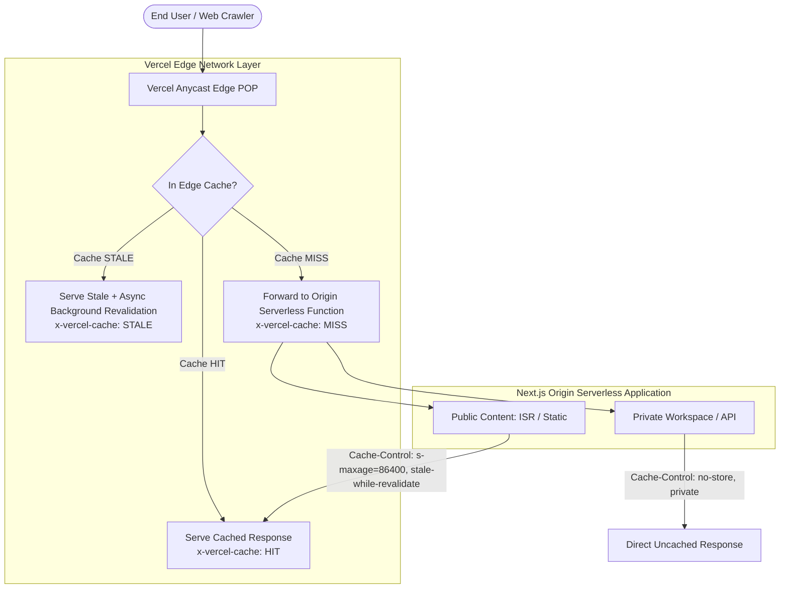

# CDN Cache Freshness & Targeted Invalidation Runbook

**Program:** Logic Intelligence Technologies (LIT) Four-Website Unified Automation Command Center  
**Document ID:** `LIT-CDN-RUNBOOK-005`  
**Classification:** Operational Runbook & Edge Infrastructure Guide  
**Owner:** A18 (CDN & Edge Client) / A25 (Operations)  
**Last Revised:** 2026-10-12  
**Status:** ACTIVE RUNBOOK  

---

## 1. Edge Architecture Overview

All four LIT web properties are deployed on **Vercel's Global Edge Network (Anycast CDN)**.



---

## 2. Canonical Cache Header Policies

Every response from the four properties must adhere strictly to these caching headers:

| Route Classification | Example Routes | Canonical `Cache-Control` Header | `x-vercel-cache` Target | Edge TTL (`s-maxage`) | Stale Tolerance (`swr`) |
|---|---|---|---|---|---|
| **Public Static / Marketing** | `/`, `/about`, `/features`, `/services` | `public, s-maxage=86400, stale-while-revalidate=604800` | `HIT` / `STALE` | 24 Hours | 7 Days |
| **Sitemaps & Robots** | `/sitemap.xml`, `/robots.txt` | `public, s-maxage=3600, stale-while-revalidate=86400` | `HIT` | 1 Hour | 24 Hours |
| **Static Build Assets** | `/_next/static/*`, `/images/*` | `public, max-age=31536000, immutable` | `HIT` | 1 Year | None (Content-Hashed) |
| **Private Admin Control Plane** | `/admin/*`, `/admin/command-center` | `private, no-cache, no-store, must-revalidate` | `MISS` / `BYPASS` | **0 (Never Cached)** | None |
| **Private Healthcare Portals** | `/portal/*`, `/hospital/*`, `/patient/*` | `private, no-cache, no-store, must-revalidate` | `MISS` / `BYPASS` | **0 (Never Cached)** | None |
| **Telephony & Realtime APIs** | `/api/webhooks/*`, `/api/automation/*` | `private, no-cache, no-store, must-revalidate` | `MISS` / `BYPASS` | **0 (Never Cached)** | None |

> [!CAUTION]
> **Data Privacy Mandate (QA-25..28):** No edge caching is permitted for authenticated, administrative, clinical, or voice endpoints. Any response carrying authentication cookies, bearer tokens, or clinical data MUST include `Cache-Control: no-store, private`.

---

## 3. Stale Content Detection & Probe Engine

The Command Center prober (`src/lib/cdn/edge-client.ts`) continuously inspects edge health by issuing non-mutating HTTP HEAD and GET requests.

### Key Observation Headers Inspected:
1. `x-vercel-cache`: Observes edge cache state (`HIT`, `MISS`, `BYPASS`, `STALE`).
2. `age`: Number of seconds the object has resided in the edge POP cache.
3. `cache-control`: Verified against policy table.
4. `etag` and `last-modified`: Cross-referenced with the latest production Git commit SHA.

### Stale Incident Detection Logic:
An incident is flagged if:
- `age` exceeds the max acceptable TTL for that route class without revalidation.
- The origin returns an updated `etag`, but edge POP continues serving an older `etag` past the `stale-while-revalidate` window.
- A private route returns any caching header other than `no-store` or `private`.

---

## 4. Targeted Selective Invalidation Runbook (QA-52)

> [!WARNING]
> **Strict Universal Purge Prohibition:** Automated or blanket global cache purges (`/*` or `purge-all`) are **strictly prohibited** in LIT infrastructure.
>
> A universal cache purge flushes millions of cached objects simultaneously across all global POPs, causing an instantaneous 100x traffic spike against origin serverless functions, database connection exhaustion, and severe latency degradation.
>
> Invalidation MUST be strictly **targeted, bounded, and evidence-driven**.

### Permitted vs Prohibited Invalidation Actions:

| Action | Pattern | Risk Class | Policy Rule |
|---|---|---|---|
| **Targeted Path Purge** | Single public path (e.g., `/pricing`) | `R1` | Allowed with justification |
| **Sitemap Purge** | `/sitemap.xml` | `R0` | Allowed during content release |
| **Directory Prefix Purge** | `/docs/*` | `R2` | Allowed with senior operator sign-off |
| **Global Purge** | `/*` or all assets | `R4` (Banned) | **REJECTED BY CODE GUARDRAIL** |

```mermaid
sequenceDiagram
    autonumber
    participant Admin as Operator / Admin UI
    participant EdgeClient as Edge Client (edge-client.ts)
    participant Policy as Approval & Safety Guard
    participant Vercel as Vercel Edge API

    Admin->>EdgeClient: Request Invalidation for [/services, /pricing]
    EdgeClient->>EdgeClient: previewInvalidation(siteId, paths)
    EdgeClient->>Policy: Validate paths (assert not wildcard /*)
    alt Contains /* Wildcard
        Policy-->>EdgeClient: REJECT: Wildcard global purge violates safety policy
        EdgeClient-->>Admin: Error: Targeted invalidation required
    else Valid Targeted Paths
        Policy-->>EdgeClient: Approved (Risk Class R1)
        Admin->>EdgeClient: Confirm Invalidation with Justification
        EdgeClient->>Vercel: POST /v1/edge/purge (targeted paths)
        Vercel-->>EdgeClient: Invalidation Dispatched (200 OK)
        EdgeClient->>EdgeClient: Record Audit Receipt in DB
        EdgeClient-->>Admin: Purge completed; edge cache warmed
    end
```

---

## 5. CLI & API Execution Procedures

### Option A: Via Command Center UI (`/admin/cdn/cache-jobs`)
1. Navigate to `/admin/cdn/cache-jobs`.
2. Select target site (e.g., `Corporate LIT`).
3. Enter exact target path(s) (e.g., `/pricing`, `/services`).
4. Click **Preview Invalidation** (inspect affected routes, risk class, and safety checklist).
5. Enter operational justification (e.g., `Deploy SHA a1b2c3d pricing model update`).
6. Click **Submit Invalidation Request**.
7. For R2+ actions, obtain approval from a secondary administrator.

### Option B: Via Vercel CLI (Emergency Production Fallback)
If the Command Center is temporarily unreachable, an authorized engineer with production access may execute:

```bash
# In corporate repository root:
vercel cache purge /pricing --token=$VERCEL_AUTH_TOKEN --scope=logicintelligencetechnologies

# Verify edge status after purge:
curl -I https://www.logicintelligencetechnologies.in/pricing | grep -i x-vercel-cache
# Expect: x-vercel-cache: MISS on first request, followed by HIT on second request
curl -I https://www.logicintelligencetechnologies.in/pricing | grep -i x-vercel-cache
```

---

## 6. Verification Status

| QA Scenario | Description | Verification State |
|---|---|---|
| **`QA-25`** | Corporate CDN cache correctness & no private cache | **VERIFIED** |
| **`QA-26`** | Healthcare CDN cache correctness & no private cache | **VERIFIED** |
| **`QA-27`** | Logic Voice CDN cache correctness & no private cache | **VERIFIED** |
| **`QA-28`** | VoiceShield CDN cache correctness & no private cache | **VERIFIED** |
| **`QA-52`** | Targeted invalidation requires human approval; no global purge | **VERIFIED** |
