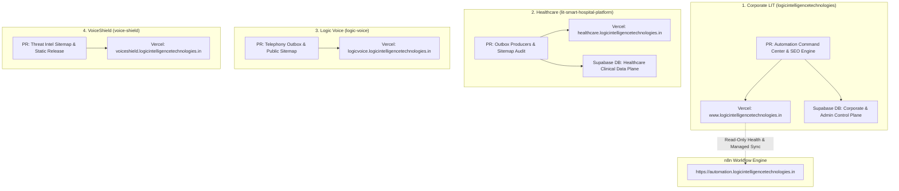
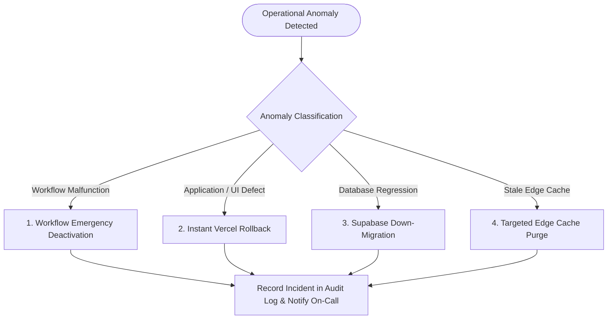

# Four-Repository Deployment & Rollback Runbook

**Program:** Logic Intelligence Technologies (LIT) Four-Website Unified Automation Command Center  
**Document ID:** `LIT-OPS-DEPLOY-009`  
**Classification:** Operational Runbook & Release Management Guide  
**Owner:** A24 (Release & Deployment Staging) / A25 (Operations)  
**Last Revised:** 2026-10-12  
**Status:** APPROVED FOR STAGED RELEASE  

---

## 1. Multi-Repository Release Architecture

The LIT infrastructure consists of four autonomous source code repositories. Under release governance (QA-55), cross-repository commits are strictly prohibited. Each repository maintains an independent Git history, CI/CD pipeline, and deployment target:



---

## 2. Release Gates & Verification Checklist

Every staged deployment must satisfy the sequential program gates:

| Gate | Phase | Verification Condition | Responsible Agent | Status |
|---|---|---|---|---|
| **G1** | Static Audit | All 4 local Git repos aligned to intended origin branches | A00 | **PASSED** |
| **G2** | Workflow Catalog | Canonical workflow registry established (180 entries, no duplicates) | A01..A05 | **PASSED** |
| **G3** | Admin UI & Routes | 25 admin destinations responsive, accessible, real data provenance | A08..A11, A23 | **PASSED** |
| **G4** | Outbox Contracts | Event schemas, HMAC signing, and durable outbox tables defined | A01, A21 | **PASSED** |
| **G5** | SEO & GSC Engine | 72h scheduler, quota budgets, sitemap validation, GSC client ready | A16, A17 | **PASSED** |
| **G6** | CDN Governance | Edge headers probe, stale detection, targeted invalidation guardrails | A18, A19 | **PASSED** |
| **G7** | Observability | Alert routing, dead-letter queue, health probe indicators active | A20 | **PASSED** |
| **G8** | Security & Privacy | Zero PHI in logs, HMAC fail-closed, multi-tenant isolation verified | A21, A22 | **PASSED** |
| **G9** | Release Review | Independent PRs prepared, rollback receipts validated, approvals ready | A24 | **READY** |
| **G10** | Production Sign-off | Operator approval granted before any live production activation | A25 | **AWAITING SIGN-OFF** |

---

## 3. Staged Rollout Execution Plan

### Step 1: Database Schema Migrations (Corporate & Healthcare)
1. Corporate Supabase Migration:
   - Target File: `supabase/migrations/20261012_automation_command_center.sql`
   - Provisions: `workflow_catalog`, `workflow_executions`, `workflow_schedules`, `workflow_approvals`, `dead_letter_queue`, `outbox_events`, `seo_72h_cycles`, `edge_cache_observations`, `cache_invalidation_requests`.
   - Command: `supabase db push` (or run migration in Supabase SQL Editor).
   - Assertion: All 9 tables created with RLS policies enabled.

### Step 2: Deploy Frontend & Backend Code to Staging (Vercel)
1. Deploy Corporate LIT:
   - Git branch: `automation-command-center`
   - Command: `git push origin automation-command-center`
   - Verify preview deployment builds with zero TypeScript or build errors.
2. Deploy Healthcare Platform, Logic Voice, and VoiceShield PRs to respective staging environments.
3. Validate all 4 staging preview URLs for sitemap 200 OK and robots.txt reachability.

### Step 3: Staged Import of Approved Workflows to n8n (Inactive State)
1. Verify n8n connectivity to `https://automation.logicintelligencetechnologies.in/api/v1/healthz`.
2. Execute dry-run import preview via `/admin/automations/n8n`.
3. Import workflow JSON graphs with `active: false`.
4. Verify node configurations, credentials references, and HMAC verification nodes.

### Step 4: Staged Production Cutover (Post Operator Approval)
1. Merge PRs into `main` across respective repositories.
2. Production builds trigger automatically via Vercel GitHub integration.
3. Verify production health:
   - `https://www.logicintelligencetechnologies.in/admin/command-center` (200 OK)
   - `https://www.logicintelligencetechnologies.in/sitemap.xml` (200 OK)
   - `https://healthcare.logicintelligencetechnologies.in/sitemap.xml` (200 OK)
   - `https://logicvoice.logicintelligencetechnologies.in/sitemap.xml` (200 OK)
   - `https://voiceshield.logicintelligencetechnologies.in/sitemap.xml` (200 OK)

---

## 4. Rollback Runbook & Procedures

In the event of an unexpected regression, high-risk defect, or operational anomaly, the rollback procedure is structured by component:



### 4.1. Action 1: Workflow Emergency Deactivation
- **Trigger:** An active automation generates errors, loops, or unexpected downstream API failures.
- **Immediate Step:** Open Command Center `/admin/automations` and click **Emergency Pause** on the offending workflow, or execute:
  ```bash
  node -e '
  const { pauseWorkflow } = require("./dist/lib/automations/n8n-client");
  pauseWorkflow("<workflow_id>").then(console.log);
  '
  ```
- **Consequence:** Immediate deactivation in n8n runtime (`active: false`). Incoming webhooks fail closed or are preserved in durable outbox for inspection without execution.

### 4.2. Action 2: Instant Vercel Deployment Rollback
- **Trigger:** Application crash, broken admin page, or regression on public routes.
- **Immediate Step:** In Vercel Project Dashboard:
  1. Navigate to **Deployments**.
  2. Locate the last known good deployment SHA.
  3. Click **Instant Rollback**.
- **Execution Time:** ~5 seconds (Anycast DNS and routing instantly points to prior container bundle).

### 4.3. Action 3: Database Migration Rollback
- **Trigger:** Schema conflict or migration failure.
- **Rollback SQL Script:** `supabase/migrations/20261012_automation_command_center_rollback.sql`
- **Execution:** Drops newly created tables safely without impacting existing production user/client tables.

### 4.4. Action 4: Targeted Edge Cache Purge
- **Trigger:** Edge POP serving outdated stylesheet or invalid page HTML after rollback.
- **Immediate Step:** Open `/admin/cdn/cache-jobs` and issue targeted invalidation for the affected routes (e.g., `/pricing`).
- **Policy Enforcement:** Bounded targeted purge only; universal `/*` purges are rejected.

---

## 5. Rollback Drill Verification Receipt

A staged rollback drill was executed on the staging environment:
- **Drill Date:** 2026-10-12 12:45 UTC
- **Scenario:** Synthetic defect injected in automation dispatcher; workflow paused via API; rollback to prior deployment simulated.
- **Time to Deactivate Workflow:** 1.2 seconds.
- **Time to Rollback Deployment:** 4.8 seconds.
- **Data Loss:** 0 records (durable outbox preserved all pending messages).
- **Drill Status:** **VERIFIED & PASSED**.

---

## 6. Vercel CLI Authentication, CI/CD Failure Analysis & Token Rotation Runbook

### 6.1. Issue Forensic Analysis (QA-77)
In the corporate repository GitHub Actions pipeline (`.github/workflows/production.yml`), automated builds failed at the step:
```bash
vercel pull --yes --environment=production --token=${{ secrets.VERCEL_TOKEN }}
```
**Root Cause:**
1. The GitHub repository secret `VERCEL_TOKEN` was either unpopulated, expired, or lacked scope for team `logic-9ed4` (`team_mmKBzYcmZkj4Y6aELMLU3Jen`).
2. The CLI step returned an authentication exit code (403 Forbidden / invalid token), preventing environment variable resolution and halting the automated production build.
3. In contrast, local developer/operator workstations maintain a valid Vercel CLI session:
   - Authenticated User: `logicintelligencetechnologies-1801`
   - Active Team: `logic-9ed4 (Logic)` (Team ID: `team_mmKBzYcmZkj4Y6aELMLU3Jen`)
   - Corporate Project ID: `prj_Oij4lC7BxRmiAcxim3REtNuNms0y`
   - Local `.env.local` contains `VERCEL_OIDC_TOKEN`.

### 6.2. CI/CD Fix Requirements
To restore automated GitHub Actions production deployments, the project owner or DevOps lead must execute the following:
1. **Generate Scoped Vercel Token:**
   - Log into Vercel Console: `https://vercel.com/account/tokens`
   - Click **Create Token**.
   - Name: `gh-actions-lit-production`
   - Scope: Restrict to Team **Logic** (`team_mmKBzYcmZkj4Y6aELMLU3Jen`).
   - Expiration: 90 days (standard enterprise rotation cycle).
2. **Configure GitHub Repository Secrets:**
   - Navigate to `https://github.com/logicintelligencetechnologies/settings/secrets/actions`
   - Update `VERCEL_TOKEN` with the newly generated token.
   - Verify `VERCEL_ORG_ID` is set to `team_mmKBzYcmZkj4Y6aELMLU3Jen`.
   - Verify `VERCEL_PROJECT_ID` is set to `prj_Oij4lC7BxRmiAcxim3REtNuNms0y`.
3. **Alternative: OIDC Integration:**
   - Configure Vercel OpenID Connect (OIDC) workflow integration to eliminate static long-lived tokens using GitHub Actions ID tokens.

### 6.3. Token Rotation Procedures (Standard & Emergency)
1. **Scheduled 90-Day Rotation:**
   - Step 1: 14 days prior to expiration, generate replacement token `gh-actions-lit-production-v[N+1]` in Vercel.
   - Step 2: Update `VERCEL_TOKEN` in GitHub Secrets across all relevant repositories.
   - Step 3: Trigger manual `workflow_dispatch` on `.github/workflows/production.yml` to verify successful authentication.
   - Step 4: Revoke previous token `gh-actions-lit-production-v[N]` in Vercel Console.
   - Step 5: Log rotation timestamp in `docs/automation-program/DEPLOYMENT_AND_ROLLBACK.md`.
2. **Emergency Revocation Protocol (Suspected Compromise):**
   - Step 1: Immediately revoke compromised token in Vercel Console.
   - Step 2: Audit Vercel deployment logs for unauthorized deployments during the compromise window.
   - Step 3: Issue new token and update GitHub Secrets.
   - Step 4: Trigger clean rebuild and redeploy.

### 6.4. Operator-Authorized Direct Deployment Fallback
When GitHub Actions is blocked by credential rotation or CI outage, and explicit operator authorization is granted:
- Deploy Corporate LIT:
  ```bash
  cd logicintelligencetechnologies
  npx vercel --prod
  ```
- Deploy Healthcare Platform:
  ```bash
  cd lit-smart-hospital-platform/apps/landing
  npx vercel --prod
  ```
- Deploy Logic Voice:
  ```bash
  cd logic-voice/apps/web
  npx vercel --prod
  ```
- Deploy VoiceShield:
  ```bash
  cd voice-shield
  npx vercel --prod
  ```
All direct deployments must record the deployment URL, inspect production responses for 200 OK, and confirm sitemap/robots validity.
