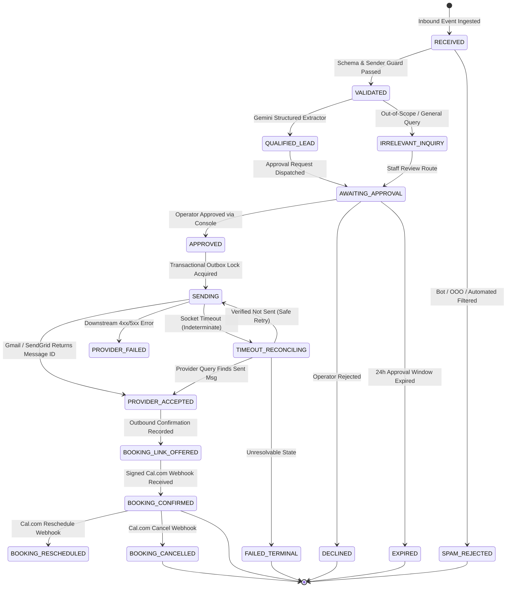
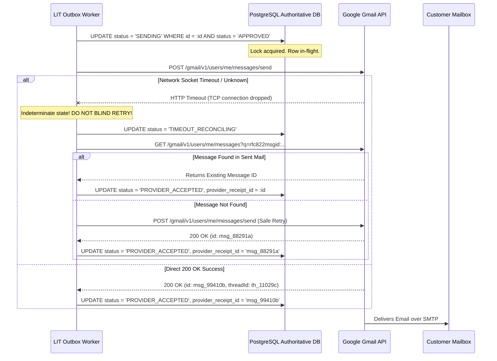

# Enterprise Enquiry Workflow State Machine & Provider Receipt Specification

**Program:** Logic Intelligence Technologies (LIT) Four-Website Unified Automation Command Center  
**Document ID:** `LIT-OPS-STATE-003`  
**Classification:** Technical Architecture Specification & State Machine Contract  
**Owner:** Worker 4 (Technical SEO, Infrastructure & Multi-Site Specialist / A24, A25)  
**Last Revised:** 2026-10-12  
**Status:** CANONICAL SPECIFICATION APPROVED  

---

## 1. Executive Summary

This specification defines the formal, transactional state machine governing the lifecycle of customer inquiries, AI lead qualification, human review, outbound email dispatch, and calendar booking synchronization across the LIT corporate ecosystem.

To eliminate the P0 architectural defects discovered in the reference sample (Issues C, D, E, and F), this state machine enforces **relational database authority, ACID transactional claims, two-phase dispatch reconciliation, and cryptographic provider receipts**. Under this model, an inquiry can never remain stranded in an ambiguous `processing` state, nor can a booking link be marked sent before provider confirmation.

---

## 2. Complete State Machine Lifecycle

The lifecycle of an inbound inquiry is modeled as a deterministic, finite state machine with 8 primary operational phases:



### State Definitions & Invariants

| State Name | Classification | Invariant Condition | Allowed Next Transitions |
|---|---|---|---|
| `RECEIVED` | Transient | Inbound payload recorded in outbox with SHA-256 body hash. | `VALIDATED`, `SPAM_REJECTED` |
| `VALIDATED` | Transient | Sender verified, MIME body parsed, PII minimized. | `QUALIFIED_LEAD`, `IRRELEVANT_INQUIRY` |
| `SPAM_REJECTED` | Terminal | Automated bot, out-of-office bounce, or rate-limited sender. | `[*]` |
| `IRRELEVANT_INQUIRY` | Transient | General inquiry not requiring sales consultation. | `AWAITING_APPROVAL`, `TERMINAL_ARCHIVED` |
| `QUALIFIED_LEAD` | Transient | Gemini extracted genuine requirements and meeting intent. | `AWAITING_APPROVAL` |
| `AWAITING_APPROVAL` | Persistent Wait | Cryptographic approval card rendered in Corporate Admin. | `APPROVED`, `DECLINED`, `EXPIRED` |
| `DECLINED` | Terminal | Staff member rejected automated reply. | `[*]` |
| `EXPIRED` | Terminal | No staff decision within 24 hours (fail-safe close). | `[*]` |
| `APPROVED` | Transient | Staff approved reply; single-use token consumed. | `SENDING` |
| `SENDING` | In-Flight Lock | Row locked by worker; outbound payload dispatched. | `PROVIDER_ACCEPTED`, `PROVIDER_FAILED`, `TIMEOUT_RECONCILING` |
| `TIMEOUT_RECONCILING` | Recovery | Indeterminate network timeout; querying provider logs. | `PROVIDER_ACCEPTED`, `SENDING`, `FAILED_TERMINAL` |
| `PROVIDER_ACCEPTED` | Persistent | Provider returned message receipt (`id`, `threadId`). | `BOOKING_LINK_OFFERED` |
| `PROVIDER_FAILED` | Terminal / DLQ | Non-retryable error recorded in dead-letter queue. | `[*]` |
| `BOOKING_LINK_OFFERED` | Persistent | Email delivered to customer; waiting for booking. | `BOOKING_CONFIRMED` |
| `BOOKING_CONFIRMED` | Active Event | Signed Cal.com webhook confirmed attendee & time. | `BOOKING_RESCHEDULED`, `BOOKING_CANCELLED` |
| `BOOKING_RESCHEDULED` | Active Event | Cal.com updated event start/end timestamps. | `BOOKING_RESCHEDULED`, `BOOKING_CANCELLED` |
| `BOOKING_CANCELLED` | Terminal | Cal.com event cancelled by host or attendee. | `[*]` |

---

## 3. Relational Database Authority & Unique Constraints

To prevent parallel execution race conditions (Issue C), all state transitions are stored in Supabase PostgreSQL under ACID transaction isolation:

```sql
-- Corporate Lead Inquiries Authoritative Table
CREATE TABLE IF NOT EXISTS public.enquiry_messages (
    id UUID PRIMARY KEY DEFAULT gen_random_uuid(),
    provider TEXT NOT NULL,                  -- 'gmail', 'corporate_web_form', 'api'
    mailbox_id TEXT NOT NULL,                -- 'contact@logicintelligencetechnologies.in'
    external_message_id TEXT NOT NULL,       -- Inbound Gmail Message-ID
    external_thread_id TEXT NOT NULL,        -- Inbound Gmail Thread-ID
    workflow_key TEXT NOT NULL,              -- 'LIT-ENQUIRY-001'
    sender_email TEXT NOT NULL,
    sender_name TEXT,
    subject TEXT,
    body_digest_sha256 TEXT NOT NULL,
    status TEXT NOT NULL DEFAULT 'RECEIVED',
    qualification_payload JSONB,
    approval_token_hash TEXT,
    approval_expires_at TIMESTAMPTZ,
    approved_by TEXT,
    approved_at TIMESTAMPTZ,
    provider_receipt_id TEXT,               -- Outbound Gmail Message ID
    provider_accepted_at TIMESTAMPTZ,
    calcom_booking_uid TEXT,
    created_at TIMESTAMPTZ NOT NULL DEFAULT timezone('utc'::text, now()),
    updated_at TIMESTAMPTZ NOT NULL DEFAULT timezone('utc'::text, now()),

    -- Non-negotiable composite unique constraint for exact-once deduplication
    CONSTRAINT uq_enquiry_message_claim 
        UNIQUE (provider, mailbox_id, external_message_id, workflow_key)
);
```

### Atomic Claim Protocol (QA-62)
When an inbound message arrives, the worker attempts an atomic insert:
```sql
INSERT INTO public.enquiry_messages (
    provider, mailbox_id, external_message_id, external_thread_id, 
    workflow_key, sender_email, sender_name, subject, body_digest_sha256
) VALUES ($1, $2, $3, $4, $5, $6, $7, $8, $9)
ON CONFLICT (provider, mailbox_id, external_message_id, workflow_key) 
DO NOTHING
RETURNING id;
```
If `RETURNING id` is empty, another worker has claimed the message. The current execution immediately exits with status `DUPLICATE_CLAIM_SUPPRESSED`.

---

## 4. Provider Receipt & Two-Phase Dispatch Policy

Under program rule **08A.3 (Issue E)**, software state must strictly distinguish between **internal intent**, **provider acceptance**, and **external delivery**:



### Invariant Rules
1. **No Optimistic Receipts:** A communication is never labeled `sent` or `booking_link_sent` based on API invocation alone. The provider receipt ID (`provider_receipt_id`) is mandatory.
2. **Anti-Duplicate Reconciliation:** If a timeout occurs during send, blind retry is prohibited. The reconciliation engine must query the provider's sent mailbox for the unique client reference ID before issuing a duplicate send call.
3. **Link Sent ≠ Booking Confirmed:** Offering a Cal.com booking link records status `BOOKING_LINK_OFFERED`. Status `BOOKING_CONFIRMED` requires a cryptographically verified webhook event from Cal.com.

---

## 5. Retry Semantics & Dead-Letter Queue Policy

| Failure Condition | Error Category | Retry Policy | Terminal Action |
|---|---|---|---|
| Gmail API Rate Limit (429) | Transient Rate | Exponential backoff (1s, 2s, 4s, 8s, max 3 retries) | Route to DLQ if backoff exhausted |
| Gmail Auth Token Expired (401) | Credential | Automatic OAuth token refresh and 1 immediate retry | Alert ops if refresh fails |
| Invalid Email Format (400) | Permanent Bad Request | No retry | Mark `VALIDATION_FAILED`, record in audit log |
| Recipient Mailbox Not Found (550) | Downstream Delivery | No retry | Mark `DELIVERY_BOUNCED`, suppress future sends |
| Database Connection Interruption | Infrastructure | Transaction rollback; retry in 500ms | Fail-closed; preserve outbox row |
| Gemini API Overloaded (503) | LLM Service | Linear backoff (2s, 5s) up to 2 retries | Fallback to manual staff review queue |
| Cal.com Webhook Signature Mismatch | Security Anomaly | No retry | Drop event, log security incident to SIEM |
