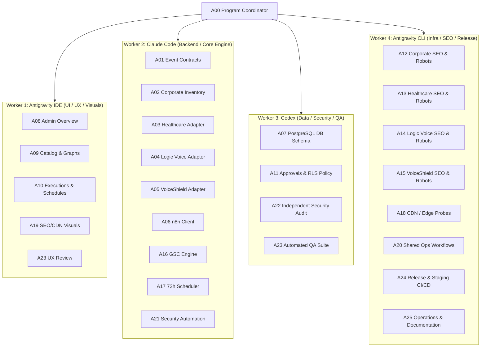

# Four-Worker Execution Architecture, File Lock Matrix & Coordination Protocol

**Program:** Logic Intelligence Technologies (LIT) Four-Website Unified Automation Command Center  
**Document ID:** `LIT-OPS-HANDOFF-006`  
**Classification:** Multi-Agent Coordination, Work Breakdown & Governance Protocol  
**Owner:** Worker 4 (Technical SEO, Infrastructure & Multi-Site Specialist / A24, A25)  
**Last Revised:** 2026-10-12  
**Status:** ACTIVE GOVERNANCE CONTRACT  

---

## 1. Executive Architecture: Mapping 26 Specialists to Four Execution Workers

Under program specification **Section 15A**, the 26 specialist engineering roles (A00–A25) are partitioned across **four distinct, autonomous development workers**. This structure eliminates workspace collisions, guarantees clear architectural boundaries, and enforces strict separation of concerns.

---

## 2. Worker Ownership & Boundary Matrix

| Worker ID | Primary Tooling | Specialist Roles | Primary Responsibilities | Strict Workspace & File Restrictions |
|---|---|---|---|---|
| **Worker 1** | Antigravity IDE | A08, A09, A10, A19, A23 (UX) | Corporate Admin Console, 25 working destinations, workflow graph visualizers, enquiry approval cards, responsive status/SEO/CDN dashboards. | Restricted exclusively to `src/app/admin/**` and Admin UI components in Corporate LIT. **Never** touches database credentials or backend services. |
| **Worker 2** | Claude Code | A01..A06, A16, A17, A21 (A00) | Canonical event schemas, n8n API client, outbox engines, GSC inspection engine, 72h scheduler engine, PEKIFLOW reference adapter. | Owns `src/lib/automations/**`, `src/lib/seo/**`, and workflow JSONs across repositories. **No UI ownership**. |
| **Worker 3** | Codex | A07, A11, A22, A23 (QA) | Database migrations, Supabase RLS policies, transaction idempotency claims, threat modeling, negative-path test suite (QA-01..78). | Owns `supabase/migrations/**`, SQL schemas, and `tests/**`. Read-only reviewer on application code. |
| **Worker 4** | Antigravity CLI | A12..A15, A18, A20, A24, A25 | GitHub Actions CI/CD pipelines, Vercel deployment repair, four-site technical SEO route fixes, edge/CDN probes, release runbooks, and V2 program documentation. | Owns infrastructure, CI/CD (`.github/**`), `sitemap.ts/xml`, `robots.ts/txt`, and `docs/automation-program/**`. |

---

## 3. Exclusively Locked File Paths Matrix (`LOCKS.md`)

To prevent merge conflicts and overwrites during concurrent execution, the following non-overlapping path locks are enforced:

| Workspace Path Pattern | Owning Worker | Lock Type | Description |
|---|---|---|---|
| `logicintelligencetechnologies/src/app/admin/**` | **Worker 1** | Exclusive Read/Write | Admin layout, navigation, command center, and 25 destination routes |
| `logicintelligencetechnologies/src/components/admin/**` | **Worker 1** | Exclusive Read/Write | Admin dashboard cards, graphs, approval widgets |
| `logicintelligencetechnologies/src/lib/automations/**` | **Worker 2** | Exclusive Read/Write | n8n client, workflow registry, event outbox dispatcher |
| `logicintelligencetechnologies/src/lib/seo/gsc-client.ts` | **Worker 2** | Exclusive Read/Write | Google Search Console API client & OAuth token refresher |
| `logicintelligencetechnologies/src/lib/seo/scheduler.ts` | **Worker 2** | Exclusive Read/Write | 72-hour slot-locking scheduler engine |
| `logicintelligencetechnologies/automation/n8n/**` | **Worker 2** | Exclusive Read/Write | Production n8n workflow definitions |
| `lit-smart-hospital-platform/automation/**` | **Worker 2** | Exclusive Read/Write | Healthcare workflow definitions (`HC-*`) |
| `logic-voice/automation/**` | **Worker 2** | Exclusive Read/Write | Logic Voice workflow definitions (`LV-*`) |
| `voice-shield/automation/**` | **Worker 2** | Exclusive Read/Write | VoiceShield workflow definitions (`VS-*`) |
| `logicintelligencetechnologies/supabase/migrations/**` | **Worker 3** | Exclusive Read/Write | PostgreSQL DDL, RLS policies, unique constraints |
| `logicintelligencetechnologies/tests/**` | **Worker 3** | Exclusive Read/Write | Unit tests, contract tests, security test suite |
| `logicintelligencetechnologies/.github/workflows/**` | **Worker 4** | Exclusive Read/Write | GitHub Actions workflows (CI, preview, production) |
| `lit-smart-hospital-platform/.github/**` | **Worker 4** | Exclusive Read/Write | Healthcare GitHub Actions pipelines |
| `logic-voice/.github/**` | **Worker 4** | Exclusive Read/Write | Logic Voice GitHub Actions pipelines |
| `voice-shield/.github/**` | **Worker 4** | Exclusive Read/Write | VoiceShield GitHub Actions pipelines |
| `logicintelligencetechnologies/src/app/sitemap.ts` | **Worker 4** | Exclusive Read/Write | Corporate sitemap generator (stable lastmod) |
| `logicintelligencetechnologies/src/app/robots.ts` | **Worker 4** | Exclusive Read/Write | Corporate robots.txt (private route disallow) |
| `lit-smart-hospital-platform/apps/landing/public/**` | **Worker 4** | Exclusive Read/Write | Healthcare public sitemap.xml & robots.txt |
| `logic-voice/apps/web/public/**` | **Worker 4** | Exclusive Read/Write | Logic Voice public sitemap.xml & robots.txt |
| `voice-shield/app/sitemap.ts` & `robots.ts` | **Worker 4** | Exclusive Read/Write | VoiceShield public sitemap.ts & robots.ts |
| `logicintelligencetechnologies/docs/automation-program/**` | **Worker 4** | Lead Author / Coordinator | Canonical program documentation and release runbooks |

---

## 4. Mandatory Inquiry Coordination Tickets (INQ-001 through INQ-006)

Under section **15A and 20A**, the adaptation of the PEKIFLOW inquiry and scheduling pattern is governed by six structured engineering tickets:

| Ticket ID | Title | Lead Worker | Dependencies | Acceptance Criteria |
|---|---|---|---|---|
| **INQ-001** | Reference Asset Audit & Quarantining | **Worker 4** | None | 7 assets fingerprinted (SHA-256); 27 nodes audited; Issues A..N documented; cleaning sample isolated from production. |
| **INQ-002** | Transactional Database Schema & Claim Engine | **Worker 3** | INQ-001 | Supabase table `public.enquiry_messages` created with composite unique constraint `(provider, mailbox_id, message_id, workflow_key)`. |
| **INQ-003** | Core Outbox Adapter & Two-Phase Dispatch | **Worker 2** | INQ-002 | Worker claims row, invokes Gmail API, captures provider receipt ID, transitions to `PROVIDER_ACCEPTED`. Prevents duplicate re-sends. |
| **INQ-004** | Cal.com Bi-directional Webhook Receiver | **Worker 2** | INQ-003 | Webhook endpoint `/api/webhooks/calcom` verifies HMAC-SHA256 signature; synchronizes `BOOKING_CONFIRMED`, `RESCHEDULED`, and `CANCELLED`. |
| **INQ-005** | Negative-Path & Concurrency QA Suite | **Worker 3** | INQ-002..4 | Execution of tests QA-57 through QA-78; verifies prompt injection defense, timeout recovery, and zero duplicate sends. |
| **INQ-006** | Admin Approvals Console & Visualization | **Worker 1** | INQ-002, 3 | `/admin/automations/approvals` UI renders inquiry cards, displays Gemini facts, supports single-use token approvals, and displays Cal.com booking state. |

---

## 5. Cross-Repository Branch & Pull Request Protocol

1. **Strict Repository Isolation (QA-55):**  
   Commits combining changes across multiple repositories in a single Git transaction are strictly rejected. Each repository maintains an independent branch and Pull Request:
   - Corporate LIT: `git checkout -b feature/automation-command-center-v2`
   - Healthcare Platform: `git checkout -b feature/seo-outbox-isolation-v2`
   - Logic Voice: `git checkout -b feature/telephony-sitemap-v2`
   - VoiceShield: `git checkout -b feature/threat-intel-sitemap-v2`
2. **Interface Contracts:**  
   Cross-repository communications occur exclusively via typed JSON contracts over HTTPS with HMAC SHA-256 signatures, validated by shared Zod schemas in `WORKFLOW_EVENT_SCHEMA.md`.
3. **Merge Coordination:**  
   Worker 4 verifies that all CI checks pass across the four PRs before requesting final operator approval for production merge.
