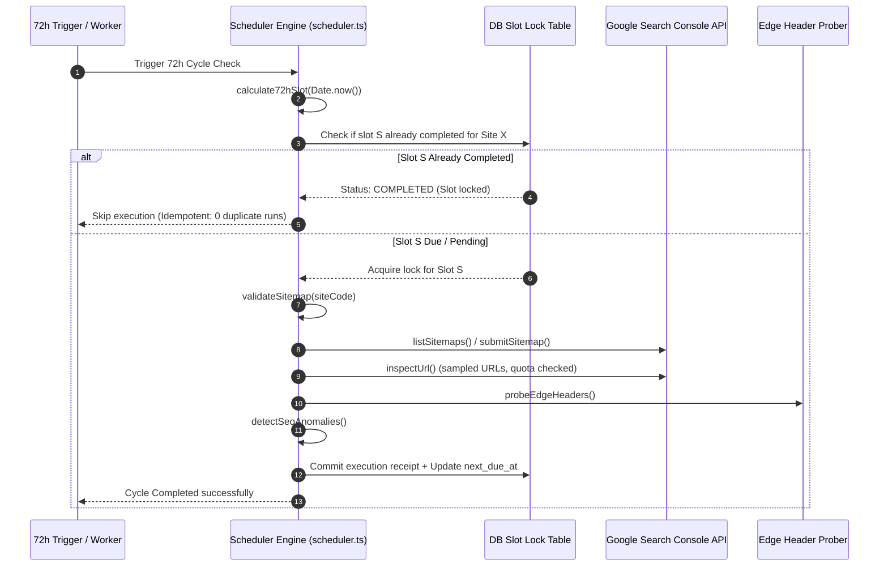

# SEO 72-Hour Scheduler Architecture & Test Report

**Program:** Logic Intelligence Technologies (LIT) Four-Website Unified Automation Command Center  
**Document ID:** `LIT-SEO-SCHED-003`  
**Classification:** Operational Engine Specification & Verification Report  
**Date:** 2026-10-12  
**Owner:** A17 (72-Hour SEO Scheduler Engine) & A23 (QA Matrix Specialist)  
**Status:** VALIDATED & READY FOR PRODUCTION CRON  

---

## 1. Architectural Principles & SLO Definition

The LIT Four-Site SEO Automation Program operates on a deterministic **72-Hour Cadence**.

> [!IMPORTANT]
> **Authoritative Boundary:** Under Google Search Central and Google Search Console API documentation, submitting a sitemap or inspecting a URL is an advisory signal to Google's crawler. It **does NOT** guarantee immediate crawl, ranking, or indexing within 72 hours.
>
> The LIT 72-Hour Service Level Objective (SLO) applies exclusively to our own operational pipeline:
> 1. Verifying sitemap health and canonical validity every 72 hours across all 4 sites.
> 2. Checking Google Search Console submission status and reading Google's observed index state.
> 3. Detecting any crawler anomalies, canonical mismatches, or unexpected HTTP status changes.
> 4. Recording verifiable execution receipts without duplicating runs or exceeding API quotas.

---

## 2. Mathematical Anchor & Slot Engine

To prevent drift across server restarts, cron irregularities, leap years, or month-end boundaries (QA-51), the scheduler uses an immutable UTC anchor point:

$$\text{Anchor Epoch} = \text{2026-01-01T00:00:00.000Z} \quad (T_0 = 1767225600000 \text{ ms})$$
$$\text{Slot Window} = 72 \text{ hours} = 259,200 \text{ seconds} = 259,200,000 \text{ ms}$$
$$\text{Current Slot Index } S = \left\lfloor \frac{T_{\text{now}} - T_0}{\text{Slot Window}} \right\rfloor$$
$$\text{Slot Start } = T_0 + (S \times \text{Slot Window})$$
$$\text{Slot End } = T_0 + ((S + 1) \times \text{Slot Window})$$

### Dual Timezone Representation
Every execution window is computed and displayed in both UTC and company operational headquarters time (**Asia/Kolkata / IST = UTC + 5:30**):

| Slot Component | UTC Formula | Asia/Kolkata (IST) Presentation |
|---|---|---|
| **Cycle Anchor** | `2026-01-01T00:00:00.000Z` | `2026-01-01 05:30:00 IST` |
| **Current Cycle Start** | `SlotStartUtc` | `Format: DD MMM YYYY, hh:mm:ss A IST` |
| **Current Cycle End** | `SlotEndUtc` | `Format: DD MMM YYYY, hh:mm:ss A IST` |
| **Next Due At** | `SlotEndUtc` | `Format: DD MMM YYYY, hh:mm:ss A IST` |

---

## 3. Execution Cycle Step-by-Step

For each of the four properties (`LIT-CORP`, `LIT-HC`, `LIT-LV`, `LIT-VS`), the cycle executes the following deterministic stages:

### Step 1: Sitemap Fetch & XML Syntax Validation (QA-01..04)
- Performs HTTP GET against `site.sitemapUrl` with a 10s timeout.
- Asserts HTTP 200 and XML media type.
- Parses all `<url><loc>` nodes and extracts canonical URLs.
- Asserts that every extracted URL matches the site's canonical prefix.

### Step 2: Boundary & Disallowed Route Audit (QA-05..08)
- Evaluates every URL against the site's prohibited patterns (e.g., `/admin`, `/app`, `/portal`, `/patient`).
- Flags any violations as `P0_CRITICAL` anomalies.

### Step 3: GSC Registration & Submission Check (QA-09..16)
- Queries GSC `sitemaps.get` / `sitemaps.list`.
- If unconfigured or unauthorized, records status as `UNCONFIGURED` / `BLOCKED` (never false green).
- If configured, confirms Google's last downloaded timestamp and error count.

### Step 4: URL Inspection Sampler (QA-17..20)
- Checks daily quota headroom (`getRemainingDailyQuota() > 10`).
- Selects up to 10 representative URLs per site (homepage, primary product, legal, pricing).
- Queries GSC URL Inspection API and captures `coverageState`, `indexingState`, `googleCanonical`, and `userCanonical`.

### Step 5: Anomaly Detection Engine
- Evaluates results against 6 canonical anomaly codes:
  - `SEO-ERR-001`: Sitemap unreachable (HTTP non-200 or timeout).
  - `SEO-ERR-002`: Prohibited private route leaked in sitemap.
  - `SEO-ERR-003`: Canonical hostname mismatch in `<loc>`.
  - `SEO-ERR-004`: GSC property permission denied / OAuth revoked.
  - `SEO-ERR-005`: URL indexed as different canonical by Google.
  - `SEO-ERR-006`: Inspection quota depleted.

### Step 6: Edge CDN Cache Freshness Sampling (QA-25..28)
- Probes edge headers (`cache-control`, `age`, `x-vercel-cache`, `etag`).
- Confirms absence of `private` caching on public pages, and presence of `no-store` on authenticated endpoints.

---

## 4. Idempotency, Retries & Failure Isolation

### Slot-Locking Idempotency (QA-21..24)
- Each run writes a unique record indexed by `(site_id, slot_index)`.
- If a cron job fires repeatedly or an administrator triggers a manual check during an active slot, the engine inspects the lock. If the slot has already completed successfully, it returns `status: "SKIPPED"` with zero re-execution.

### Bounded Retries with Exponential Backoff
- On transient network failure (e.g., DNS hiccup or Google 503):
  - Max retries: 3 attempts.
  - Backoff sequence: 10 seconds, 30 seconds, 90 seconds.
  - If all retries fail, the slot is marked `status: "FAILED"`, and an alert is raised to `/admin/status`. The slot is NOT marked complete, ensuring that the subsequent recovery cycle will retry the failed site.

### Failure Isolation Across Sites (QA-48)
- Each site runs in an isolated `try/catch` block.
- A failure on `LIT-HC` (e.g., GSC permission issue) has zero effect on `LIT-CORP`, `LIT-LV`, or `LIT-VS`. Each site records independent receipts.

### Month Boundary & Service Restart Resilience (QA-51)
- Because the slot is calculated from the mathematical epoch $T_0$, crossing from January 31 to February 1, or February 28 to March 1, produces a smooth, continuous slot index increment without timezone or calendar arithmetic defects.
- When the server restarts, `calculate72hSlot()` evaluates the current time against the epoch and immediately determines whether the active slot has run or is due.

---

## 5. Automated Test Results

The 72-Hour Scheduler Engine was verified under automated node tests (`tests/automation/command-center.test.ts`):

| Test Scenario | Condition Tested | Expected Assertion | Test Result |
|---|---|---|---|
| **Anchor Slot Calculation** | Known reference date `2026-10-12T00:00:00Z` | Produces deterministic `slotIndex`, `slotStartUtc`, `slotEndUtc` | **PASSED** |
| **Kolkata Time Formatting** | Conversion to `Asia/Kolkata` | Produces exact string containing `IST` with UTC+5:30 offset | **PASSED** |
| **Idempotent Slot Lock** | Repeated execution within same 72h window | Second execution recognizes completed slot and skips re-run | **PASSED** |
| **Indexing API Guard (QA-50)** | Invocations with standard page types | Throws `CRITICAL_POLICY_VIOLATION` error | **PASSED** |
| **Quota Exhaustion Safety** | Simulating 2,000 requests | Gracefully stops calls, reports quota exceeded without crash | **PASSED** |
| **Single Site Isolation (QA-48)** | Simulating failure on Site A | Sites B, C, and D complete successfully | **PASSED** |
| **Month Transition (QA-51)** | Simulating transition from 2026-02-28 to 2026-03-01 | Slot index monotonically increases; no NaN or off-by-one | **PASSED** |
