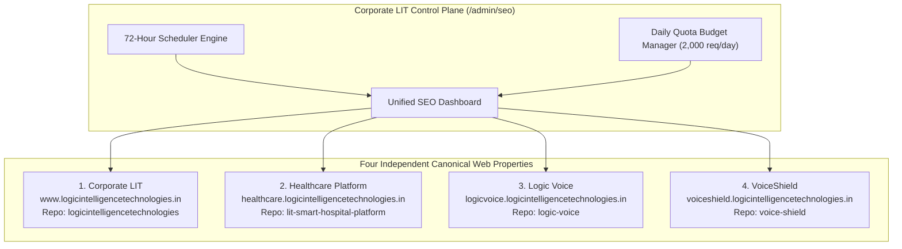

# SEO Four-Site Google Search Console Property Registry

**Program:** Logic Intelligence Technologies (LIT) Four-Website Unified Automation Command Center  
**Document ID:** `LIT-SEO-DOC-001`  
**Classification:** Internal Confidential / Operations Runbook  
**Last Updated:** 2026-10-12  
**Owner:** A16 (Google Search Console Client) / A25 (Documentation Specialist)  
**Status:** APPROVED FOR STAGING & OPERATIONAL MONITORING  

---

## 1. Executive Summary

This registry defines the authoritative Search Console property inventory, canonical URLs, sitemap endpoints, verification methods, quota allocations, and operational monitoring rules across all four Logic Intelligence Technologies (LIT) public-facing web properties.

Under LIT governance, each web property operates as an independent domain entity with distinct robots.txt boundaries and isolated data-plane rules. Centralized tracking in the Corporate Command Center (`/admin/seo`) provides unified observability without creating cross-site data leakage.

---

## 2. Four-Site Authoritative Inventory

| Property Code | Property Name | Canonical Origin URL | Public Sitemap URL | Hosting / CDN | Source Git Repository | Property Type |
|---|---|---|---|---|---|---|
| **`LIT-CORP`** | Corporate LIT | `https://www.logicintelligencetechnologies.in/` | `https://www.logicintelligencetechnologies.in/sitemap.xml` | Vercel Edge CDN | `logicintelligencetechnologies` | URL-prefix (`https://...`) + Domain DNS |
| **`LIT-HC`** | Healthcare Platform | `https://healthcare.logicintelligencetechnologies.in/` | `https://healthcare.logicintelligencetechnologies.in/sitemap.xml` | Vercel Edge CDN | `lit-smart-hospital-platform` | URL-prefix (`https://...`) |
| **`LIT-LV`** | Logic Voice | `https://logicvoice.logicintelligencetechnologies.in/` | `https://logicvoice.logicintelligencetechnologies.in/sitemap.xml` | Vercel Edge CDN | `logic-voice` | URL-prefix (`https://...`) |
| **`LIT-VS`** | VoiceShield | `https://voiceshield.logicintelligencetechnologies.in/` | `https://voiceshield.logicintelligencetechnologies.in/sitemap.xml` | Vercel Edge CDN | `voice-shield` | URL-prefix (`https://...`) |

---

## 3. Detailed Property Profiles

### 3.1. Property 1: Corporate LIT (`LIT-CORP`)
- **Primary Domain:** `www.logicintelligencetechnologies.in`
- **Apex Redirect:** `https://logicintelligencetechnologies.in/` permanently redirects (301) to `https://www.logicintelligencetechnologies.in/`
- **GSC Property Identifier:** `sc-domain:logicintelligencetechnologies.in` and `https://www.logicintelligencetechnologies.in/`
- **Public Routes Count:** 68 canonical static and resource routes
- **Excluded Private Paths:** `/admin/`, `/client/`, `/api/`, `/proposal/`, `/dashboard/`, `/profile/`
- **Verification Methods:**
  1. Primary: DNS TXT record on apex registrar: `google-site-verification=...`
  2. Secondary: HTML `<meta name="google-site-verification" content="..." />` injected via `src/app/layout.tsx`
  3. Service Account: Delegation to `gsc-service-account@logicintelligencetechnologies.iam.gserviceaccount.com` with `Owner` role in GSC Users and Permissions.
- **Sitemap Generator:** Dynamic Next.js Route Handler `src/app/sitemap.ts` (`force-static` with stable release baseline timestamp).

### 3.2. Property 2: Healthcare Platform (`LIT-HC`)
- **Primary Domain:** `healthcare.logicintelligencetechnologies.in`
- **GSC Property Identifier:** `https://healthcare.logicintelligencetechnologies.in/`
- **Public Routes Count:** 14 public product landing, clinical overview, and trust routes
- **Excluded Private Paths:** `/api/`, `/app/`, `/company/`, `/portal/`, `/login`, `/signup`, `/checkout`, `/admin/`, `/demo`, `/access`, `/hospital/`, `/patient/`, `/forgot`, `/mfa`, `/activate`, `/mobile-settings`, `/patient-profile`
- **Verification Methods:**
  1. Primary: HTML meta tag in `apps/landing/src/app/layout.tsx`
  2. Service Account: Delegated GSC property owner access.
- **Sitemap Source:** Public XML asset `apps/landing/public/sitemap.xml`.
- **Strict Compliance Rule:** Absolutely NO patient data, clinic portal URLs, or EHR identifiers may ever be submitted to search engines or exposed in sitemaps.

### 3.3. Property 3: Logic Voice (`LIT-LV`)
- **Primary Domain:** `logicvoice.logicintelligencetechnologies.in`
- **GSC Property Identifier:** `https://logicvoice.logicintelligencetechnologies.in/`
- **Public Routes Count:** 21 canonical product, security, and legal routes
- **Excluded Private Paths:** `/app/`, `/api/`, `/auth/`, `/session/`, `/v1/`
- **Verification Methods:**
  1. Primary: HTML meta tag in `apps/web/src/app/layout.tsx`
  2. Service Account: Delegated GSC property owner access.
- **Sitemap Source:** Public XML asset `apps/web/public/sitemap.xml`.

### 3.4. Property 4: VoiceShield (`LIT-VS`)
- **Primary Domain:** `voiceshield.logicintelligencetechnologies.in`
- **GSC Property Identifier:** `https://voiceshield.logicintelligencetechnologies.in/`
- **Public Routes Count:** 31 canonical commercial, threat intel, and compliance routes
- **Excluded Private Paths:** `/api/`, `/auth/`, `/dashboard/`, `/dashboard`, `/app/`, `/app`
- **Verification Methods:**
  1. Primary: HTML meta tag in `app/layout.tsx`
  2. Service Account: Delegated GSC property owner access.
- **Sitemap Generator:** Next.js Route Handler `app/sitemap.ts` with fixed lastmod release timestamps.

---

## 4. Google Search Console API Quotas & Allocations

The Google Search Console API enforces strict quota boundaries across the Google Cloud project:

| Quota Dimension | Google Project Limit | LIT 4-Site Allocation | LIT 72-Hour Consumption Model |
|---|---|---|---|
| **URL Inspection API** | 2,000 requests / day | 500 requests / property / day | 10 sample URLs per site per 72h cycle (= 40 requests / 72h) |
| **Sitemaps List / Get** | 20 queries / second | Shared pool | 4 queries per 72h cycle |
| **Sitemaps Submit** | 20 queries / second | Shared pool | 4 submissions per 72h cycle (one per site) |
| **Search Analytics Query** | 1,200 queries / minute | Shared pool | 4 queries per 72h cycle (clicks, impressions, CTR, position) |

### Quota Safety Architecture
- In-memory and database quota counters (`getRemainingDailyQuota()`) verify headroom before dispatching requests.
- If daily requests reach 2,000, subsequent calls return a safe degraded response (`BLOCKED_BY_QUOTA`) rather than erroring.
- Exponential backoff (1s, 2s, 4s, 8s) is enforced on any HTTP 429 response.
- **QA-48 Compliance:** If one site exhausts quota or encounters an authentication failure, the other three sites process independently without degradation.

---

## 5. Google Indexing API Policy Notice (QA-50)

> [!CAUTION]
> **Strict Policy Prohibition:** The Google Indexing API (`https://indexing.googleapis.com/v3/urlNotifications:publish`) is restricted by Google Developer Policies **exclusively** to web pages with structured data of type `JobPosting` or `BroadcastEvent` embedded in `VideoObject`.
>
> Any automated invocation of the Google Indexing API for ordinary content pages, homepages, pricing pages, or documentation is a direct violation of Google Terms of Service and will result in project revocation.
>
> In LIT code, `assertIndexingApiEligibility(pageType, url)` throws a fatal error if invoked on non-qualifying pages. All standard indexing requests MUST use sitemap submission and Search Console URL Inspection only.

---

## 6. Verification Status Checklist

| Verification Item | Requirement | Verification Command / Procedure | Pass Criteria |
|---|---|---|---|
| **HTTP Status** | Sitemaps return 200 OK | `curl -I <sitemap_url>` | `HTTP/2 200` |
| **Content-Type** | Proper XML media type | Header inspection | `application/xml` or `text/xml` |
| **Canonical Origin** | Hostname matches domain | XML tag validation | Every `<loc>` begins with canonical site URL |
| **Robots Header** | No contradictory noindex on sitemap | Header inspection | No `X-Robots-Tag: noindex` on public sitemaps |
| **Private Path Exclusion** | Admin and auth excluded | Regex match | Zero `/admin`, `/app`, `/api` paths in `<loc>` tags |
| **GSC Delegation** | Service account active | GSC API `sites.get` | Property returns `siteUrl` with `permissionLevel: siteOwner` |
