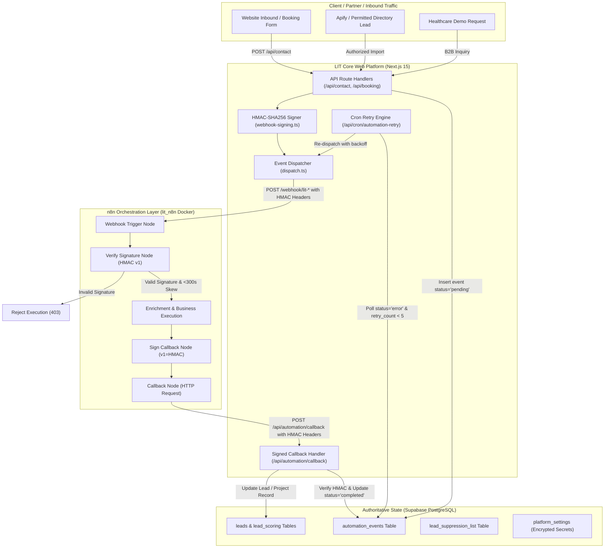
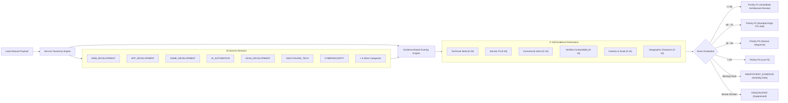
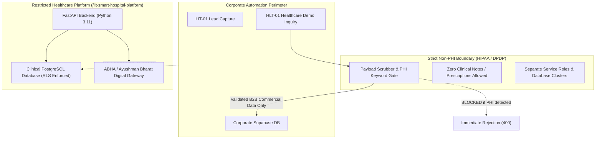

# ARCHITECTURE.md — Master n8n Automation Architecture

**Organization:** Logic Intelligence Technologies (LIT)  
**Lead System Engineer:** Vikash Saravanan  
**Document Version:** 2.0 (Enterprise Production Standard)

---

## 1. Architectural Philosophy & Responsibility Boundaries

Logic Intelligence Technologies operates on a **Decoupled Orchestration Architecture**:
- **Application Core (Next.js / TypeScript App Router):** Authoritative gatekeeper for authentication, role-based access control, cryptographic signing, financial transaction validation, and business rule enforcement.
- **Authoritative Data Layer (Supabase PostgreSQL):** Single source of truth for leads, projects, client records, audit snapshots, suppression lists, and compliance logs. Enforces Row-Level Security (RLS).
- **Orchestration Layer (n8n v2.1.4 Container):** Asynchronous workflow pipeline executor. Responsible for orchestrating multi-step API integrations, AI enrichment, calendar scheduling, notification routing, and monitoring.
- **Healthcare Perimeter (FastAPI + Isolated PostgreSQL):** Strictly isolated HIPAA/DPDP perimeter. Zero Protected Health Information (PHI) enters general orchestration payloads or execution logs.



---

## 2. Cryptographic Security & Zero-Trust Protocol

### 2.1 HMAC-SHA256 Payload Signature Scheme
Every outbound event dispatched from Next.js to n8n, and every inbound callback dispatched from n8n to Next.js, is signed using HMAC-SHA256:

$$\text{Signature} = \text{"v1="} + \text{HMAC-SHA256}(K_{\text{secret}}, \, T \,\|\, \text{"."} \,\|\, E_{\text{id}} \,\|\, \text{"."} \,\|\, R_{\text{body}})$$

Where:
- $K_{\text{secret}}$: Shared 256-bit secret stored in `platform_settings` / `$env.N8N_WEBHOOK_SECRET`.
- $T$: Unix timestamp in integer seconds (`x-lit-timestamp`).
- $E_{\text{id}}$: Unique event correlation UUID (`x-lit-event-id`).
- $R_{\text{body}}$: Exact UTF-8 stringified JSON payload.

### 2.2 Replay Protection Window
Both Next.js and n8n enforce a strict clock skew tolerance of **300 seconds** ($\pm 5 \text{ minutes}$):
```javascript
const nowSec = Math.floor(Date.now() / 1000);
if (Math.abs(nowSec - Number(ts)) > 300) {
  throw new Error('Signature timestamp outside tolerance window');
}
```
Any webhook with a timestamp older than 300 seconds or in the future by more than 300 seconds is rejected immediately without processing.

### 2.3 Constant-Time Comparison
To prevent timing side-channel attacks, signatures are compared strictly using constant-time byte buffers:
```typescript
crypto.timingSafeEqual(Buffer.from(expectedSignature), Buffer.from(receivedSignature));
```

---

## 3. Reliability, Idempotency & Dead-Letter Handling

### 3.1 Idempotency Key Guarantees
Every event generated in the system receives a deterministic UUID `eventId`. The database enforces uniqueness on `eventId` in `automation_events`:
- If n8n attempts to submit the same callback multiple times, the database ignores subsequent mutations or marks them as idempotent acknowledgments.
- No duplicate emails or project tasks can be created from repeated webhook delivery.

### 3.2 State Machine
Every automation event transitions through an audited lifecycle:
```
[PENDING] 
   │
   ├──> [DISPATCHED] (HTTP 2xx received from n8n webhook)
   │        │
   │        ├──> [PROCESSED / COMPLETED] (Signed callback received)
   │        └──> [ERROR] (Timeout or failure reported)
   │
   └──> [FAILED_TO_DISPATCH] (Network error or n8n unreachable)
            │
            └──> [RETRY_LOOP] (Automated cron re-drive, max 5 attempts)
                     │
                     └──> [DEAD_LETTER] (Escalated to admin dashboard)
```

### 3.3 Dead-Letter Queue & Automated Recovery
1. The cron runner at `/api/cron/automation-retry` executes every 5 minutes.
2. It queries `automation_events` for rows where `status IN ('error', 'failed_to_dispatch')` and `retry_count < 5`.
3. An exponential backoff calculation ($2^{\text{retry\_count}} \times 60 \text{ seconds}$) ensures struggling downstream services are not hammered.
4. Once `retry_count >= 5`, the event transitions to `DEAD_LETTER` state, triggering `OPS-04` reliability alerting.
5. Administrators can inspect payload details, examine error stacks, and manually re-drive failed events directly from `/admin/automations`.

---

## 4. Multi-Service Lead Intelligence Pipeline

Rather than assuming every lead is seeking a website, the platform evaluates incoming opportunities across **15 Technical Service Categories**:



---

## 5. Non-PHI Healthcare Isolation Boundary


