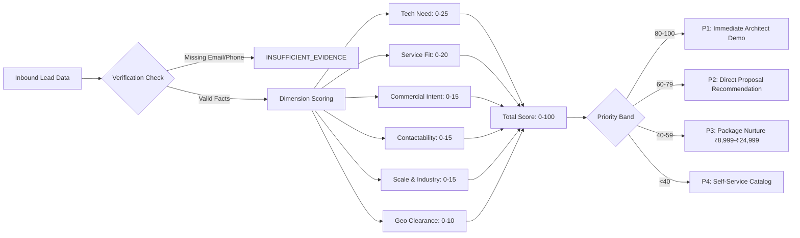

# Logic Intelligence Technologies — Lead Generation & Business Intelligence Engine

**Architecture & Governance Specification**  
**Document**: `docs/automation/LEAD_GENERATION.md`  
**Author**: Logic Intelligence Technologies Engineering Team  
**Lead System Engineer**: Vikash Saravanan  
**Status**: ACTIVE / PRODUCTION GOVERNANCE  

---

## 1. Executive Summary & Core Mission

The Logic Intelligence Technologies (LIT) Lead Generation and Business Intelligence Engine powers automated lead capture, enrichment, multi-service classification, evidence-based qualification, and outreach preparation. 

Unlike traditional agency funnels that assume every inbound lead merely requires a generic marketing website, LIT delivers engineering across **15 discrete technical domains**—spanning high-performance web platforms, cross-platform mobile apps, Unity/Unreal game development, enterprise AI agents, distributed SaaS platforms, and secure healthcare architectures.

The automation architecture enforces a **Zero-Fabrication Policy**: system nodes must never invent contact information, revenue numbers, technology stacks, or website audit scores. Where empirical data is absent, the system explicitly flags `INSUFFICIENT_EVIDENCE`.

---

## 2. Supported Lead Discovery Sources

All incoming business intelligence and lead opportunities enter through validated, authenticated ingestion paths:

| Source Identifier | Description | Ingestion Mechanism | Verification Gate |
| :--- | :--- | :--- | :--- |
| **`website_form`** | Inbound leads from `logicintelligencetechnologies.in` | Direct API -> `LIT-01` webhook | Turnstile captcha, honeypot, schema check |
| **`consultation_booking`**| Prospects scheduling technical discovery | Cal.com / Cal scheduling API -> `LIT-06` | Email MX verification, time validation |
| **`healthcare_demo`** | Hospital administrators requesting LIT Smart Hospital demos | Public Demo Route -> `HLT-01` | Non-PHI isolation, hospital domain check |
| **`authorized_csv`** | Curated B2B prospective lists (exhibitions, partner networks) | Admin CLI / Supabase Batch Import | Mandatory human approval, source attribution |
| **`apify_public_export`** | Public registered business registry crawls (MCA, Google Maps) | Apify Webhook -> `LIT-02` | Permitted public data only, no private scraping |
| **`referral_partner`** | Inbound referrals from existing clients or tech partners | Secure referral link / CRM | Partner ID verification, idempotency token |

### Strict Zero-Fabrication Constraints
1. **Never Invent Contacts**: No programmatic synthesis or brute-force guessing of emails (`first.last@company.com`) without authoritative DNS/MX or verified public directory proof.
2. **Never Fabricate Tech Stacks**: Wappalyzer or HTTP header inspections must provide explicit headers or script signatures (`__NEXT_DATA__`, `wp-content`, etc.) to attribute tech stack tags.
3. **Never Synthesize Revenue or Headcount**: Financial and employee estimates must reference authoritative registry filings (e.g., MCA India, SEC EDGAR, or public LinkedIn company headers). Missing values must remain `null`.

---

## 3. The 15 Canonical LIT Service Categories

Each incoming inquiry is mapped to one or more canonical service categories defined in `src/lib/leads/service-taxonomy.ts`:

```
                       ┌───────────────────────────────────────────────┐
                       │           INCOMING PROSPECT INQUIRY           │
                       └───────────────────────┬───────────────────────┘
                                               │
                        ┌──────────────────────┴──────────────────────┐
                        ▼                                             ▼
          ┌───────────────────────────┐                 ┌───────────────────────────┐
          │  DIGITAL & APP PLATFORMS  │                 │    AI & ENTERPRISE TECH   │
          ├───────────────────────────┤                 ├───────────────────────────┤
          │ 1. WEB_DEVELOPMENT        │                 │ 8.  AI_AUTOMATION         │
          │ 2. WEB_DESIGN             │                 │ 9.  AI_AGENTS             │
          │ 3. APP_DEVELOPMENT        │                 │ 10. DATABASE_ENGINEERING  │
          │ 4. MOBILE_DEVELOPMENT     │                 │ 11. API_INTEGRATION       │
          │ 5. GAME_DEVELOPMENT       │                 │ 12. ENTERPRISE_PLATFORM   │
          │ 6. CUSTOM_SOFTWARE        │                 │ 13. HEALTHCARE_TECH       │
          │ 7. SAAS_DEVELOPMENT       │                 │ 14. CYBERSECURITY         │
          │                           │                 │ 15. TECHNICAL_CONSULTING  │
          └───────────────────────────┘                 └───────────────────────────┘
```

### Taxonomy Details & Commercial Packaging

| Category | Display Name | Entry Pricing | Pricing Model | Delivery Window | Working Prototype Eligible |
| :--- | :--- | :--- | :--- | :--- | :---: |
| `WEB_DEVELOPMENT` | Web Development | ₹8,999 | Fixed / Custom | 3–14 days | YES |
| `WEB_DESIGN` | UI/UX & Web Design | ₹12,999 | Fixed / Milestone | 5–10 days | YES |
| `APP_DEVELOPMENT` | Application Development | ₹24,999 | Fixed / Milestone | 14–30 days | YES |
| `MOBILE_DEVELOPMENT` | Mobile App Development | ₹29,999 | Milestone-based | 21–45 days | YES |
| `GAME_DEVELOPMENT` | Game Development (Unity/Unreal) | ₹49,999 | Milestone-based | 30–90 days | YES |
| `CUSTOM_SOFTWARE` | Custom Software Engineering | ₹39,999 | Milestone / Quote | 21–60 days | YES |
| `SAAS_DEVELOPMENT` | SaaS Platform Architecture | ₹44,999 | Milestone-based | 30–75 days | YES |
| `AI_AUTOMATION` | AI Automation & Workflows | ₹18,999 | Fixed / Retainer | 7–21 days | YES |
| `AI_AGENTS` | Autonomous AI Agents & Voice | ₹29,999 | Milestone / Retainer | 14–30 days | YES |
| `DATABASE_ENGINEERING`| Database Engineering & BigQuery| ₹24,999 | Milestone / Retainer | 10–25 days | NO |
| `API_INTEGRATION` | API Integration & Webhooks | ₹14,999 | Fixed / Milestone | 5–15 days | YES |
| `ENTERPRISE_PLATFORM` | Enterprise System Modernization| ₹89,999 | Custom Quote | 45–120 days | YES |
| `HEALTHCARE_TECH` | Healthcare Technology Systems | ₹99,999 | Custom Quote | 45–120 days | YES |
| `CYBERSECURITY` | Security & Vulnerability Audit | ₹19,999 | Fixed / Retainer | 7–21 days | NO |
| `TECHNICAL_CONSULTING`| Architecture & Technical Advisory| ₹9,999 | Retainer / Hourly | On-demand | NO |

---

## 4. Evidence-Based 0–100 Lead Scoring Model

Lead qualification is executed programmatically in `src/lib/leads/scoring.ts` across **six objective empirical dimensions**:



### Dimension Weights & Thresholds

1. **Technical Need (0–25 points)**:
   - High technical specificity in problem statement (mentions latency, architecture, microservices, frameworks): `+15`
   - Expressed frustration with current software, bugs, or scalability limits: `+10`
   - Generic or vague requirement: `+5`
2. **Service Fit (0–20 points)**:
   - Exact match with 1 or more LIT core capabilities: `+12`
   - Alignment with high-tier platforms (LIT Healthcare, Logic Voice, SaaS): `+8`
3. **Commercial Intent (0–15 points)**:
   - Provided explicit budget matching or exceeding package pricing: `+8`
   - Immediate timeline defined (< 30 days): `+4`
   - Booked consultation or attended live demo: `+3`
4. **Verified Contactability (0–15 points)**:
   - Corporate business email (non-free domain with valid MX record): `+8`
   - Verified WhatsApp / Direct phone number with country dial code: `+4`
   - Identified decision-maker role (Founder, CTO, CEO, Director): `+3`
5. **Industry & Business Scale (0–15 points)**:
   - Regulated or high-value sector (Healthcare, FinTech, Manufacturing, E-Commerce): `+10`
   - Mid-market or enterprise scale (> 20 employees or established operations): `+5`
6. **Geographic / Jurisdiction Clearance (0–10 points)**:
   - Primary markets (India, United States, United Kingdom, UAE, Singapore, Australia, EU): `+10`
   - Non-sanctioned secondary regions: `+5`

---

## 5. Outreach Guardrails & Suppression Protocols

To ensure compliance with global telecommunications and privacy standards (including India DPDP 2023, US CAN-SPAM, and GDPR):

1. **Mandatory Human-in-the-Loop Review**:
   - Outbound sequences generated by `LIT-05` remain in status `DRAFT_PENDING_APPROVAL`.
   - No automated email or WhatsApp message may be dispatched until an authorized system engineer clicks **Approve** in the LIT Admin Console (`/admin/outreach`).
2. **Suppression Registry**:
   - Contacts requesting unsubscription or opt-out via `/unsubscribe` or incoming email keywords are instantly written to `email_suppressions` with status `PERMANENT`.
   - The n8n outreach workflow checks the suppression database prior to compiling any draft.
3. **Channel Rate Limits**:
   - Outbound emails per domain: Maximum 35 messages per mailbox per day.
   - Delay between outbound messages: Random jitter between 180 and 420 seconds.
   - Cooling-off period: Minimum 7 days between follow-up touches; maximum 3 touches per sequence.

---

## 6. Implementation Workflows

- **`LIT-01`**: `automation/n8n/workflows/LIT-01-website-lead-capture.json` (Real-time capture, validation, deduplication).
- **`LIT-04`**: `automation/n8n/workflows/LIT-04-ai-lead-qualification.json` (AI qualification, 0–100 scoring, priority tagging).
- **`LIT-06`**: `automation/n8n/workflows/LIT-06-consultation-scheduling.json` (Cal.com sync, meeting prep briefs).
- **`HLT-01`**: `automation/n8n/workflows/HLT-01-healthcare-demo-inquiry.json` (Zero-PHI healthcare demo routing).
