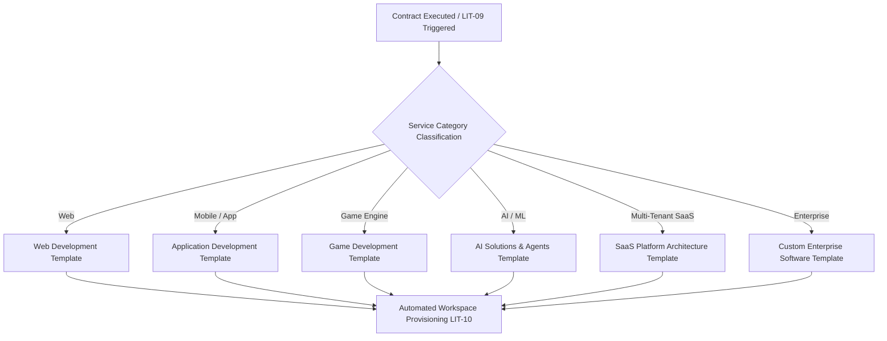

# Logic Intelligence Technologies — Service Delivery & Engineering Lifecycle

**Engineering Framework & Automation Specification**  
**Document**: `docs/automation/SERVICE_DELIVERY.md`  
**Author**: Logic Intelligence Technologies Engineering Team  
**Lead System Engineer**: Vikash Saravanan  
**Status**: ACTIVE / PRODUCTION GOVERNANCE  

---

## 1. Overview & Service Delivery Principles

Logic Intelligence Technologies operates on a rigorous, milestone-gated engineering delivery lifecycle. From the moment a commercial proposal is approved or a contract is executed, automated workflows orchestrate project workspace provisioning, sprint task planning, milestone tracking, continuous integration quality reporting, and client handover.

### Core Delivery Tenets
1. **Zero Unverified Commencements**: No development workspace is provisioned without a cryptographically verified signed contract or authorized initial milestone deposit.
2. **Deterministic Architecture Templates**: Each technical domain deploys from an immutable baseline repository template containing pre-configured CI/CD, linting, test runners, and telemetry.
3. **Transparent Client Visibility**: Progress reporting occurs automatically via the secure LIT Client Portal and scheduled WhatsApp / email summaries without requiring manual intervention.
4. **Milestone-Gated Acceptance**: Deliverables require dual-sign-off: internal automated quality validation (lint, security, test suites) followed by formal client sign-off before invoice closure.

---

## 2. Service-Specific Requirement Intake Templates

Automated intake workflow `LIT-09` enforces structured, domain-tailored technical specifications across LIT's core practice areas:

### 2.1 Web Development Template
* **Target Audience & Pages**: Information architecture, primary conversion pathways, total view count.
* **UI/UX & Design System**: Tailwind CSS, Figma tokens, Dark/Light theme specifications, typography scale.
* **Content Management**: Headless CMS (Supabase, Strapi, Sanity) vs. static markdown (MDX).
* **SEO & Core Web Vitals**: Target LCP (< 1.2s), CLS (< 0.05), FID (< 100ms), schema.org JSON-LD microdata.
* **Accessibility**: WCAG 2.1 AA compliance, ARIA landmark roles, keyboard navigation coverage.
* **Infrastructure**: Edge runtime (Vercel / Cloudflare Pages), custom SSL domain mapping, CDN caching headers.

### 2.2 Mobile & Application Development Template
* **Target Platforms**: iOS (Swift / React Native), Android (Kotlin / React Native), Web PWA.
* **Device Matrix**: Min iOS version, min Android API level, tablet / fold screen responsive profiles.
* **Authentication & Identity**: OAuth2, Apple Sign-in, Google Identity, biometric authentication (FaceID/TouchID).
* **Backend APIs & Data Sync**: GraphQL / REST endpoints, offline SQLite storage, background push sync.
* **Store Submission Artifacts**: Fastlane pipelines, App Store Connect keys, Google Play Console service account credentials.

### 2.3 Game Development Template (Unity / Unreal Engine)
* **Target Platforms**: Windows PC (Steam), Mobile (Google Play / App Store), WebGL / HTML5, Consoles.
* **Engine & Toolchain**: Unity LTS (URP/HDRP) or Unreal Engine 5.4+ (Lumen, Nanite), C# / C++ codebase.
* **Core Mechanics & Gameplay Loop**: Controls, state machines, physics simulations, inventory/progression data models.
* **Asset & Audio Pipelines**: 3D mesh polygon budgets, LOD levels, texture atlasing, FMOD / Wwise audio integration.
* **Performance Budgets**: Fixed frame rates (60fps mobile, 120fps PC), memory footprint caps (< 1.5GB mobile).
* **Playtesting & Release**: Automated build distribution via TestFlight / Steam Playtest keys.

### 2.4 AI Solutions & Autonomous Agents Template
* **Problem Definition & KPIs**: Target accuracy, F1 score, maximum latency threshold (< 800ms for voice/chat), cost per 1k tokens.
* **Model Selection**: Groq Llama-3 70B, Google Gemini 1.5 Pro/Flash, OpenAI GPT-4o, Anthropic Claude 3.5 Sonnet, or local Ollama.
* **RAG & Vector Storage**: pgvector on Supabase, Pinecone, chunking strategy (sliding window with overlap), semantic reranking.
* **Voice & Audio Pipeline**: Logic Voice low-latency STT (Deepgram / Whisper), Voice Shield biometric deepfake filter, ElevenLabs / Cartesia TTS.
* **Safety & Prompt Injection Guardrails**: Llama-Guard, strict output schema verification (Zod / JSON Schema), audit logging.

### 2.5 SaaS Platform Architecture Template
* **Tenancy Model**: Multi-tenant single database with PostgreSQL Row Level Security (`tenant_id`), or isolated schema.
* **Role-Based Access Control (RBAC)**: Owner, Admin, Manager, Member, Guest with granular policy tables.
* **Billing & Subscription Tiering**: Razorpay Subscriptions / Stripe Billing, webhooks, grace periods, usage metering.
* **API Extensibility**: Public API keys, rate limiting (Redis token bucket), developer webhooks.
* **Audit & Compliance**: Immutable audit trail of administrative mutations, SOC2 / DPDP compliance readiness.

### 2.6 Custom Enterprise Software Template
* **Business Workflow Modeling**: BPMN state machine mapping, multi-department approval chains, SLA timers.
* **Legacy Integrations**: SAP, Oracle, legacy SOAP/XML services, enterprise Active Directory / Okta SAML SSO.
* **High Availability & DR**: Multi-region failover, RPO (< 15 mins), RTO (< 1 hour), encrypted backups.
* **Stakeholder Sign-Off**: User Acceptance Testing (UAT) sign-off criteria, training documentation schedules.

---

## 3. Project Workspace Provisioning (`LIT-10`)

When a lead transitions to an active client, workflow `LIT-10` executes an 8-step idempotent provisioning sequence:

1. **Verify Authorization**: Confirm signed contract status (`status = 'SIGNED'`) and deposit payment verification.
2. **Create Project Record**: Initialize row in `projects` with unique UUID, client identifier, agreed budget, and delivery timeline.
3. **Initialize Repository**: Fork or scaffold from approved LIT template repository on GitHub with branch protections enabled (`main` requires PR and CI passage).
4. **Configure Secrets & CI/CD**: Inject environment secrets (Supabase tokens, Vercel project IDs, Sentry DSN) via GitHub API.
5. **Generate Client Portal Access**: Issue cryptographic magic link / credential invitation for the LIT Client Portal.
6. **Create Secure Communication Hub**: Provision dedicated private Slack/Discord channel or WhatsApp Business thread linking the client with the lead engineer.
7. **Post Internal Kickoff Briefing**: Publish structured technical summary to internal `#operations-briefings` Slack channel.
8. **Dispatch Client Welcome Packet**: Transmit branded PDF onboarding document containing project roadmap, milestone schedule, team roster, and escalation paths.

---

## 4. Milestone Tracking & Quality Gates (`LIT-11` & `LIT-12`)

Every project follows a standardized 4-milestone execution plan:

| Milestone | Focus | Quality Gates / Acceptance Criteria | Invoice Trigger |
| :--- | :--- | :--- | :--- |
| **M1: Architecture & Prototype** | System architecture, database schema, clickable interactive prototype | Design token review, OpenAPI contract spec approved | 30% Deposit |
| **M2: Core Functionality** | Backend APIs, auth, database migrations, essential business logic | Automated test suite > 80% coverage, lint passed, PR review | 30% Progress |
| **M3: Integration & QA** | End-to-end integration, performance tuning, security vulnerability scan | OWASP top 10 check passed, Lighthouse score > 90 | 25% Delivery |
| **M4: Final Acceptance** | Production launch, DNS handover, admin training, documentation | UAT sign-off signed, DNS mapped, zero high-severity bugs | 15% Final |

### Automated Quality Checks (`LIT-12`)
Automated quality workflows listen for GitHub Actions webhook events:
* **Static Analysis**: TypeScript compile (`tsc --noEmit`), ESLint zero errors.
* **Unit & Integration Tests**: Node.js test runner passing 100%.
* **Security Scanning**: `npm audit` zero critical/high vulnerabilities, automated credential leak detection.
* **Performance Profiling**: Bundle size budgets (< 250kb initial JS load for web).

---

## 5. Delivery Handover & Maintenance (`LIT-14` & `LIT-15`)

Upon successful completion of Milestone 4:
1. **Asset Transfer**: Transfer ownership of GitHub repositories, domain DNS records, cloud project ownership (Vercel, Supabase, AWS).
2. **Handover Certificate**: Generate cryptographic completion certificate signed by Founder & Lead System Engineer Vikash Saravanan.
3. **Transition to SLA Maintenance (`LIT-15`)**:
   - Enrollment in 24/7 uptime monitoring (`OPS-04`).
   - Scheduled quarterly dependency updates and security patches.
   - Monthly retainer renewal invoicing via automated webhook.
