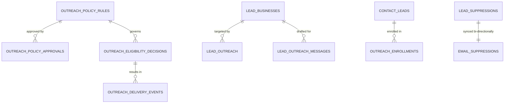

# Data Model & Migration Plan: Global Outreach Compliance
**Organization:** Logic Intelligence Technologies (LIT)  
**Date:** October 11, 2026  
**Document:** `docs/compliance/DATA-MODEL-AND-MIGRATION-PLAN.md`  
**Migration File:** `supabase/migrations/20261012090000_global_outreach_compliance.sql`  

---

## 1. Architectural Strategy

The compliance architecture separates broad jurisdiction status from granular scenario policy:
- **`lead_jurisdictions` (Preserved):** Retains macro-level country posture (`review_required`, `blocked`, `allowed`). Default seeded posture remains zero countries allowed.
- **`outreach_policy_rules` (Added):** Provides a 5-dimensional rule key: `(country_code, channel, recipient_class, purpose, region)`. This permits lawful exceptions (e.g. verified corporate subscribers in the UK under PECR Reg 22, or inbound solicited inquiries) without unsafely marking an entire country unconditionally `allowed`.
- **`outreach_policy_approvals` (Added):** Immutable audit log of human compliance signoffs with strict 180-day expiry timestamps.
- **`outreach_consent_evidence` (Added):** Audit repository for proof of express or inferred opt-in.
- **`outreach_eligibility_decisions` (Added):** Idempotent log of evaluation determinations evaluated at the dispatch boundary.
- **`outreach_delivery_events` (Added):** Transport events reflecting delivery, bounce, complaint, and unsubscribe.

---

## 2. Table Specifications & Schema Definitions



### Table 1: `outreach_policy_rules`
- `id` (UUID PK): Unique rule identifier.
- `country_code` (TEXT NOT NULL): ISO 3166-1 alpha-2 code.
- `region` (TEXT NULL): Sub-national jurisdiction (e.g. US State, CA Province).
- `channel` (TEXT NOT NULL): `email`, `sms`, `whatsapp`, `call`, `social_dm`.
- `recipient_class` (TEXT NOT NULL): `corporate_subscriber`, `sole_trader`, `individual_consumer`, `existing_customer`.
- `purpose` (TEXT NOT NULL): `cold_outreach`, `inbound_followup`, `transactional_service`.
- `policy_status` (TEXT NOT NULL): `permitted`, `review_required`, `restricted`, `blocked`.
- `requires_consent` (BOOLEAN NOT NULL): Whether prior express opt-in is legally mandatory.
- `allowed_legal_basis_types` (TEXT[] NOT NULL): Allowable grounds (e.g. `PECR_REG22`, `CAN_SPAM_COMMERCIAL`, `INBOUND_CONSENT`).
- `rule_version` (TEXT NOT NULL): Monotonically incremented version string.
- `official_source_urls` (TEXT[] NOT NULL): Authoritative regulator documentation links.
- `conditions` (JSONB NOT NULL): Technical requirements (e.g. `{"requires_postal_address": true, "max_frequency_days": 14}`).
- `valid_from` / `expires_at` (TIMESTAMPTZ): Temporal bounding; defaults to 180-day max review window.

### Table 2: `outreach_policy_approvals`
- Append-only audit record detailing the human compliance officer, their role, qualification/bar admission, signed decision reason, and approval timestamp.

### Table 3: `outreach_consent_evidence`
- Stores proof of opt-in including contact reference, source URI, IP address, user agent, timestamp, and token hash.

### Table 4: `outreach_eligibility_decisions`
- Recorded at every dispatch attempt. Captures rule ID, version, result (`permitted`, `review_required`, `blocked`, `suppressed`), reason codes, and timestamp.

---

## 3. Database Triggers & Synchronization

1. **Bi-Directional Suppression Sync:**
   - `trg_sync_email_to_lead_suppression`: After INSERT/UPDATE on `email_suppressions`, automatically inserts matching record into `lead_suppressions`.
   - `trg_sync_lead_to_email_suppression`: After INSERT/UPDATE on `lead_suppressions`, automatically inserts matching record into `email_suppressions`.
   - **Benefit:** Solves the split-brain vulnerability. Unsubscribing in one table immediately protects the other.
2. **Message Studio Approval Gate:**
   - `trg_outreach_message_gate` on `lead_outreach_messages`: Blocks updating status to `approved` or `sent` unless `blockers_pass = true`, business country is permitted, and no suppression exists.
3. **Legacy Campaign Enrollment Gate:**
   - `trg_outreach_enrollment_gate` on `outreach_enrollments`: Blocks updating status to `ACTIVE` if the email address is suppressed in either suppression table.
4. **Enhanced Lead Outreach Gate:**
   - `lead_enforce_outreach_gates()` on `lead_outreach`: Now checks both broad `lead_jurisdictions` allowlist OR active valid rule in `outreach_policy_rules`, and inspects both suppression tables.

---

## 4. Rollback Plan

If unexpected migration errors occur:
1. Triggers can be dropped safely without data loss:
   ```sql
   drop trigger if exists trg_sync_email_to_lead_suppression on email_suppressions;
   drop trigger if exists trg_sync_lead_to_email_suppression on lead_suppressions;
   drop trigger if exists trg_outreach_message_gate on lead_outreach_messages;
   drop trigger if exists trg_outreach_enrollment_gate on outreach_enrollments;
   ```
2. Policy tables are additive; existing tables (`lead_businesses`, `contact_leads`, `outreach_campaigns`) retain their primary keys and data intact.
3. Trigger `lead_enforce_outreach_gates()` can revert to its Phase 1 version using `supabase/migrations/20261010090000_lead_engine_phase1.sql`.
