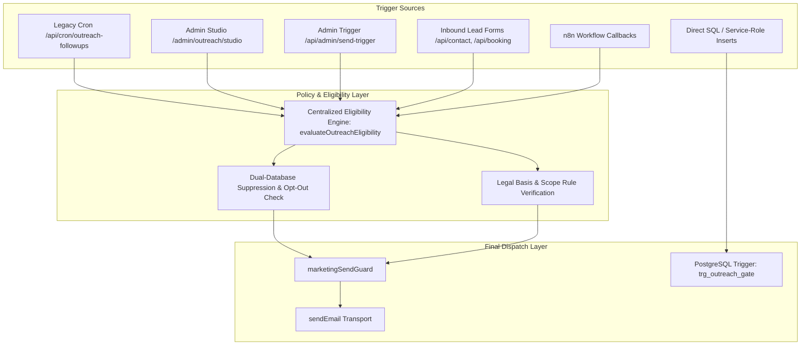

# Outreach Send Path Inventory & Enforcement Mapping
**Organization:** Logic Intelligence Technologies (LIT)  
**Date:** October 11, 2026  
**Document:** `docs/compliance/OUTREACH-SEND-PATH-INVENTORY.md`  

---

## 1. Overview of All Dispatch Pathways

This inventory maps every potential pathway in the Logic Intelligence Technologies codebase through which external communications (email, SMS, automated notices) can be triggered. For each pathway, it details the triggering mechanism, target audience, checks performed, failure modes, and required compliance gates.

---

## 2. Exhaustive Send Path Inventory

### Pathway 1: Legacy Automated Sequence Cron
- **Trigger Route:** `GET /api/cron/outreach-followups/route.ts`
- **Schedule / Frequency:** Periodic Vercel Cron invocation (`CRON_SECRET` Bearer auth).
- **Target Table:** `public.outreach_enrollments` (`status = 'ACTIVE'`, `next_send_at <= now()`).
- **Target Recipient:** Leads in `contact_leads`.
- **Pre-Audit Gates:** `marketingSendGuard()` checked email syntax, `email_suppressions`, and `contact_leads.lifecycle_stage`.
- **Vulnerabilities Identified:**
  - **No Jurisdiction Verification:** Never verified the country of the recipient.
  - **No Legal Basis Verification:** Did not verify whether unsolicited cold marketing is permitted in the recipient's country.
  - **Suppression Split-Brain:** Did not check `lead_suppressions`.
- **Unified Enforcement Mechanism:**
  - Wrap check with `evaluateOutreachEligibility()` requiring `channel='email'`, `purpose='cold_outreach'` or `'followup'`, and verified legal clearance.
  - Fail closed: if jurisdiction or legal basis cannot be verified, status transitions to `STOPPED` with reason `compliance_jurisdiction_blocked`.

---

### Pathway 2: Lead Intelligence Message Studio
- **Trigger Path:** `src/app/admin/outreach/studio/actions.ts`
- **Actor:** Authenticated admin with capability `outreach.manage`.
- **Target Tables:** `lead_businesses`, `lead_contacts`, `lead_outreach_messages`.
- **Pre-Audit Gates:** `runGates()` in `qa-gates.ts` (10 QA gates) and `lead.compliance.cleared` in `store.ts`.
- **Vulnerabilities Identified:**
  - `approveDraft()` updated `lead_outreach_messages.status = 'approved'`, but dispatch logic was not implemented.
  - `lead_outreach_messages` lacked a database trigger; only `lead_outreach` had `trg_outreach_gate`.
- **Unified Enforcement Mechanism:**
  - Implement explicit dispatch action requiring human confirmation.
  - Pre-flight re-check via `evaluateOutreachEligibility()` immediately prior to transport.
  - Add database trigger to `lead_outreach_messages` ensuring no message can reach status `'approved'` or `'sent'` unless eligibility is cleared.

---

### Pathway 3: Direct Admin Email & Admin Trigger
- **Trigger Routes:**
  - `sendAdminEmail` in `src/app/admin/actions.ts`
  - `POST /api/admin/send-trigger/route.ts`
- **Actor:** Authenticated staff with capability `emails.send` or bearer `CRON_SECRET`.
- **Target Recipient:** Arbitrary email address provided in request payload.
- **Pre-Audit Gates:** Syntax check, `requireAdminApi`, `isSuppressed()` for marketing categories.
- **Vulnerabilities Identified:**
  - Broadcast emails could be dispatched without jurisdiction attribution or legal basis validation.
- **Unified Enforcement Mechanism:**
  - Classify broadcast emails strictly as `category='marketing'`.
  - Validate recipient against global suppression lists and evaluate jurisdiction eligibility before queuing.

---

### Pathway 4: Customer-Initiated Inbound & Transactional Auto-Replies
- **Trigger Routes:**
  - `/api/contact/route.ts`
  - `/api/booking/route.ts`
  - `/api/free-demo/route.ts`
  - `/api/support/route.ts`
  - `/api/checklist/route.ts`
- **Nature of Communication:** Solicited, transactional, customer-initiated acknowledgments.
- **Pre-Audit Gates:** Zod payload validation, Upstash rate limiting, `sendEmail({ category: 'transactional' })`.
- **Compliance Status:**
  - Lawful globally under performance of contract / legitimate interest / explicit request.
  - Unsolicited marketing rules (e.g. CAN-SPAM commercial, UWG §7) do not apply to transactional direct acknowledgments.
- **Unified Enforcement Mechanism:**
  - Explicit classification as `category='transactional'` in transport logs.
  - Enforce anti-abuse rate limits and ensure transactional messages contain zero unsolicited promotional up-sells.

---

### Pathway 5: n8n Automation Workflows
- **Platform:** `https://automation.logicintelligencetechnologies.in/`
- **Dispatcher:** `dispatchAutomationEvent()` in `src/lib/automation/dispatch.ts`.
- **Pre-Audit Gates:** HMAC SHA-256 signature (`x-lit-signature`), timestamp freshness check, isolated webhook URLs.
- **Compliance Safeguards:**
  - **Groq-Only AI Policy:** Groq is restricted to summarizing research or drafting copy; it has zero authority to approve compliance or execute sends.
  - **No Live Dispatch Without Local Check:** Any outgoing communication dispatched by n8n must call back to `/api/automation/callback` or the eligibility engine to verify clearance before transport.

---

### Pathway 6: Direct SQL / Service-Role Insertion
- **Attack Vector:** Rogue worker, service-role credential leak, or unvalidated database migration attempting to insert into outreach tables.
- **Enforcement Mechanism:**
  - PostgreSQL row-level trigger `trg_outreach_gate` on `lead_outreach` and `lead_outreach_messages`.
  - Rejection with PostgreSQL exception if `outreach_status <> 'allowed'` or active suppression exists.
  - Cannot be bypassed by application code because triggers run inside the PostgreSQL transaction engine.

---

## 3. Universal Dispatch Guarantee

By wiring `evaluateOutreachEligibility()` into:
1. `marketingSendGuard()` (used by campaign cron);
2. Message Studio dispatch action;
3. `sendEmail()` (the universal transport bottleneck for all emails);
4. PostgreSQL triggers on all outreach tables (`lead_outreach`, `lead_outreach_messages`, `outreach_enrollments`),
the system guarantees **default-deny, zero-bypass compliance** across the entire lifecycle.
