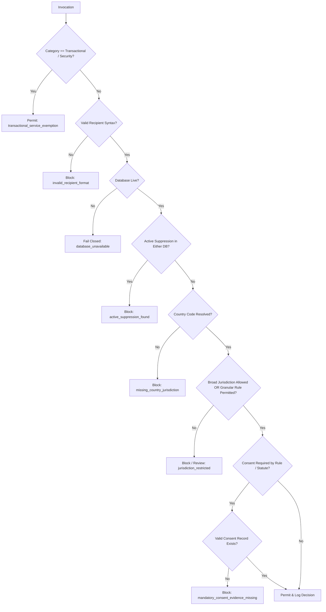

# Policy Engine Design: Centralized Eligibility Engine
**Organization:** Logic Intelligence Technologies (LIT)  
**Date:** October 11, 2026  
**Document:** `docs/compliance/POLICY-ENGINE-DESIGN.md`  
**Implementation:** `src/lib/outreach/eligibility.ts`  

---

## 1. Design Objectives

1. **Single Authoritative Gate:** Every pathway dispatching or scheduling marketing communications must evaluate `evaluateOutreachEligibility()`.
2. **Default-Deny:** In the absence of an explicit country clearance or documented legal basis rule, communication is refused.
3. **Channel-Specific Rules:** Email permission does not authorize telephone calls, SMS, WhatsApp, or automated direct messages.
4. **Dual-Database Suppression:** Simultaneously consults `email_suppressions` and `lead_suppressions`. If an address is suppressed anywhere, dispatch is halted.
5. **Fail-Closed Availability:** If the database or lookup service is unavailable, marketing outreach fails closed (`eligible: false`).

---

## 2. API Signature & Execution Pipeline

```typescript
export async function evaluateOutreachEligibility(
  params: EligibilityParams
): Promise<EligibilityResult>
```



---

## 3. Reason Codes Taxonomy

- `transactional_service_exemption`: Lawful non-marketing message (e.g. password reset, security alert, invoice receipt).
- `invalid_recipient_format`: Syntax malformed or domain missing.
- `database_unavailable_fail_closed`: Database connectivity lost; fails closed.
- `active_suppression_found`: Recipient email, phone, domain, or business ID is active on global suppression.
- `missing_country_jurisdiction`: Country ISO cannot be identified.
- `unlisted_jurisdiction_default_deny`: Target jurisdiction is unlisted or unverified.
- `jurisdiction_review_required_status`: Jurisdiction requires legal review before activation.
- `jurisdiction_restricted_status`: Cold outreach is restricted by statute (e.g. UWG §7 in Germany, CASL in Canada).
- `jurisdiction_blocked_status`: Prohibited communication channel.
- `mandatory_consent_evidence_missing`: Statutory regime requires prior opt-in, but no valid evidence record was found.
- `policy_cleared`: Cleared for dispatch under approved policy rule or jurisdiction allowlist.

---

## 4. Integration Verification

- **Legacy Cron (`/api/cron/outreach-followups`):** Evaluates `marketingSendGuard()`, which now directly executes `evaluateOutreachEligibility()`. If country is restricted or unlisted, status transitions to `STOPPED` and `sendEmail()` is never called.
- **Universal Transport (`src/lib/email/send-email.ts`):** Evaluates `evaluateOutreachEligibility()` for all `category === "marketing"` dispatches as an unbypassable defense-in-depth gate.
- **Campaign Enrollment (`src/lib/outreach/campaigns.ts`):** Evaluates `evaluateOutreachEligibility()` before enrolling any lead into an automated sequence.
- **PostgreSQL Triggers (`trg_outreach_gate`, `trg_outreach_message_gate`, `trg_outreach_enrollment_gate`):** Guarantees zero-bypass protection at the database transaction layer.
