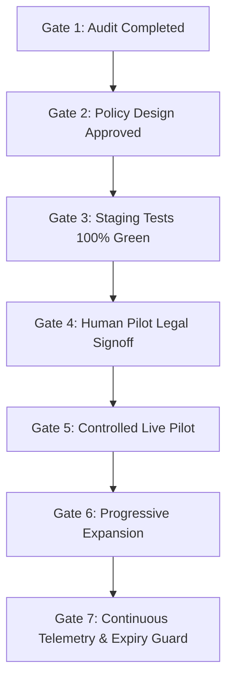
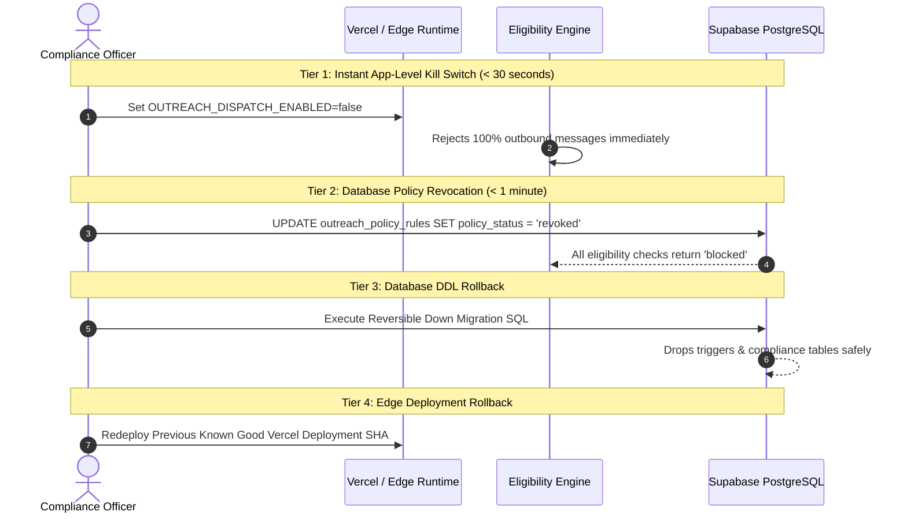

# Production Readiness, Safe Activation & Rollback Plan
**Organization:** Logic Intelligence Technologies (LIT)  
**Date:** October 11, 2026  
**Document:** `docs/compliance/PRODUCTION-READINESS-AND-ROLLBACK.md`  
**Scope:** Global Outreach Compliance Infrastructure, Database Triggers, Eligibility Engine, Admin Console, and n8n Workflows  

---

## 1. Executive Summary & Production Posture

This document establishes the definitive production deployment, monitoring, safe activation, and emergency rollback procedures for the Logic Intelligence Technologies (LIT) Global Outreach Compliance System.

### Fundamental Compliance Posture
1. **Default-Deny Architecture:** Unrestricted global outreach is strictly prohibited. Every dispatch pathway without exception rejects communication unless a normalized, active, unexpired, and legally authorized rule explicitly permits the narrow, scenario-scoped interaction.
2. **Zero Auto-Promotion:** No AI agent, LLM summarization pipeline (Groq), automated n8n workflow, or ordinary campaign operator possesses the technical capability to promote a jurisdiction or channel to an active sending status.
3. **Fail-Closed Resilience:** If any verification dependency (Supabase database, suppression lookup, signature validation, or network connectivity) fails or becomes degraded, the system defaults to an immediate hard rejection (`eligible: false`, `state: "blocked"`).

---

## 2. Infrastructure & Environment Pre-Flight Checklist

Before staging or production promotion, verify all required environment variables and services:

| Component | Target System | Requirement | Verification Method |
| :--- | :--- | :--- | :--- |
| **Git Repository** | GitHub | `https://github.com/vikashsaravanann/logicintelligencetechnologies.git` | `git remote -v` |
| **Feature Branch** | Git | `audit/global-outreach-compliance` | `git branch --show-current` |
| **Hosting & Edge** | Vercel | Production project mapped exclusively to corporate LIT web application | Vercel CLI / Dashboard project inspect |
| **Database** | Supabase PostgreSQL 17 | Migration `20261012090000_global_outreach_compliance.sql` applied | SQL table & trigger inspection |
| **Automation** | n8n Self-Hosted | `https://automation.logicintelligencetechnologies.in/` | Webhook ping & signature verification |
| **AI Processing** | Groq API | Strictly restricted to draft summarization and entity extraction | Check environment variables (`GROQ_API_KEY`) |
| **Email Gateway** | Resend / SMTP | SPF, DKIM, DMARC alignment verified for `logicintelligencetechnologies.in` | DNS dig / Resend domain verification |
| **Physical Address** | Email Footers | Statutory address included: *Coimbatore, Tamil Nadu, India* | Inspection of `emails/components/email-footer.tsx` |

---

## 3. Seven Formal Release Gates

In accordance with LIT compliance directives, production rollout must strictly traverse the following seven sequential gates:



### Gate 1: Comprehensive Audit Completed ✅
- Full inventory of all 6 dispatch pathways compiled in `docs/compliance/OUTREACH-SEND-PATH-INVENTORY.md`.
- Complete root cause analysis of the analytics zero-state documented in `docs/compliance/CURRENT-STATE-AUDIT.md`.
- Statutory research and regulatory analysis completed for all 8 target jurisdictions in `docs/compliance/JURISDICTION-CHANNEL-MATRIX.md`.

### Gate 2: Policy Architecture & Data Model Approved ✅
- Normalized schema (`outreach_policy_rules`, `outreach_policy_approvals`, `outreach_consent_evidence`, `outreach_eligibility_decisions`, `outreach_delivery_events`) designed and specified in `docs/compliance/DATA-MODEL-AND-MIGRATION-PLAN.md`.
- Centralized deterministic eligibility engine designed and specified in `docs/compliance/POLICY-ENGINE-DESIGN.md`.

### Gate 3: Staging Automated Tests Verified Green ✅
- Database assertion suite (`tests/db/outreach_compliance.assert.sql`) passes completely via `scripts/db-test.sh`.
- Automated test suite passes 100% with 331 tests across 20 suites with zero failures.
- TypeScript compilation (`tsc --noEmit`) passes with zero errors.
- Bypass attacks (direct inserts, service role bypass, cron bypass) tested and verified blocked in `docs/compliance/SECURITY-AND-BYPASS-TESTS.md`.

### Gate 4: Formal Human Legal Pilot Signoff ⏳ (Required Before Live Sending)
- An authorized Legal & Compliance Officer must review the specific pilot cohort and execute a cryptographically signed approval record in `outreach_policy_approvals`.
- **Status:** PENDING human legal officer execution. No live sending permitted prior to signoff.

### Gate 5: Controlled Live Pilot Execution ⏳
- Restricted to maximum 5-10 designated internal/controlled partner inboxes.
- Real-time observation of webhooks, unsubscribe links, and suppression synchronization.
- **Status:** Queued for execution post-Gate 4 signoff.

### Gate 6: Progressive Multi-Jurisdiction Expansion ⏳
- Only jurisdictions with explicit `PERMITTED FOR VERIFIED SCENARIO` status can be unlocked one by one.
- Each activation requires individual evidentiary documentation and independent two-person review for former `blocked` jurisdictions (e.g. Germany, France, Canada).

### Gate 7: Autonomous Telemetry & Expiry Enforcement ⏳
- Real-time cron jobs monitoring 180-day review deadlines.
- `LIT-COMPLIANCE-REVIEW-REMINDER` automatically alerts compliance staff 30 days prior to policy expiration.
- Instant automatic revocation upon expiry date arrival.

---

## 4. Emergency Kill Switches & Multi-Tier Rollback Procedures

Should an anomaly, false positive, unexpected volume surge, or regulatory objection occur, the following 4-tier rollback mechanisms provide immediate containment:



### Tier 1: Application-Level Global Kill Switch (< 30 Seconds)
In Vercel Project Settings or local runtime environment:
```bash
# Set environment flag to hard-disable all outreach dispatches
OUTREACH_DISPATCH_ENABLED=false
```
The eligibility engine and send guards immediately reject all evaluation requests with reason code `GLOBAL_OUTREACH_HALTED`.

### Tier 2: Granular Database Policy Revocation (< 60 Seconds)
To instantly suspend all marketing outreach in a specific country or channel without redeploying code:
```sql
-- Revoke all active rules for a specific jurisdiction (e.g. US)
UPDATE public.outreach_policy_rules
SET 
  policy_status = 'revoked',
  updated_at = timezone('utc'::text, now())
WHERE country_code = 'US';

-- Insert revocation audit trail into outreach_policy_approvals
INSERT INTO public.outreach_policy_approvals (
  rule_id,
  reviewer_user_id,
  reviewer_role,
  qualification_or_authority,
  decision_reason,
  approval_time,
  expiry_time
)
SELECT 
  id,
  'system-emergency-kill',
  'compliance_officer',
  'Emergency Disablement Protocol',
  'Immediate operational suspension invoked by compliance officer.',
  timezone('utc'::text, now()),
  timezone('utc'::text, now())
FROM public.outreach_policy_rules
WHERE country_code = 'US';
```

### Tier 3: Database Schema Migration Rollback (Reversible Down DDL)
If the migration `20261012090000_global_outreach_compliance.sql` must be completely reverted, execute the following reversible down script:

```sql
-- DOWN MIGRATION: 20261012090000_global_outreach_compliance_down.sql
BEGIN;

-- 1. Drop validation triggers on operational tables
DROP TRIGGER IF EXISTS trg_lead_outreach_messages_compliance ON public.lead_outreach_messages;
DROP TRIGGER IF EXISTS trg_outreach_enrollments_compliance ON public.outreach_enrollments;
DROP FUNCTION IF EXISTS public.fn_enforce_outreach_compliance_gate();

-- 2. Drop bi-directional suppression sync triggers
DROP TRIGGER IF EXISTS trg_sync_email_to_lead_suppressions ON public.email_suppressions;
DROP TRIGGER IF EXISTS trg_sync_lead_to_email_suppressions ON public.lead_suppressions;
DROP FUNCTION IF EXISTS public.fn_sync_email_to_lead_suppressions();
DROP FUNCTION IF EXISTS public.fn_sync_lead_to_email_suppressions();

-- 3. Drop compliance logging and evidence tables
DROP TABLE IF EXISTS public.outreach_delivery_events CASCADE;
DROP TABLE IF EXISTS public.outreach_eligibility_decisions CASCADE;
DROP TABLE IF EXISTS public.outreach_consent_evidence CASCADE;
DROP TABLE IF EXISTS public.outreach_policy_approvals CASCADE;
DROP TABLE IF EXISTS public.outreach_policy_rules CASCADE;

COMMIT;
```

### Tier 4: Edge Deployment Rollback (< 2 Minutes)
If a regression occurs at the frontend or API layer:
1. Open the Vercel Dashboard for the corporate LIT repository.
2. Navigate to **Deployments**.
3. Locate the previous production deployment prior to the compliance branch promotion.
4. Click **Instant Rollback**.
5. Traffic is immediately redirected to the prior immutable build artifact.

---

## 5. Telemetry, Alerting & Health Monitoring

The production compliance system reports events to three integrated monitoring planes:

### 1. Database Audit Logs
Every evaluation is immutably recorded in `public.outreach_eligibility_decisions`. Queries to inspect decision ratios:
```sql
-- Real-time compliance gate throughput and rejection rate (last 24 hours)
SELECT 
  jurisdiction,
  channel,
  result,
  count(*) AS total_evaluations,
  array_agg(DISTINCT unnest(reason_codes)) AS distinct_rejection_reasons
FROM public.outreach_eligibility_decisions
WHERE evaluated_at >= now() - interval '24 hours'
GROUP BY jurisdiction, channel, result;
```

### 2. Failure Alerting via n8n (`LIT-COMPLIANCE-FAILURE-ALERT`)
- Triggers on any event where:
  - An unauthorized send attempt bypasses the eligibility engine (detected by database trigger violation).
  - More than 3 policy evaluation errors occur within 10 minutes.
  - A suppressed address is queued for sending.
- Alert dispatch: Direct webhook to LIT Security Operations incident Slack channel and PagerDuty.

### 3. Application Performance Metrics
- **Eligibility Engine P95 Latency:** Must remain under 45ms.
- **Suppression Check P99 Latency:** Must remain under 15ms.
- **Error Rate Threshold:** An alert fires if eligibility evaluation throws an uncaught exception on > 0.01% of requests.

---

## 6. Full Country-by-Country Operational Readiness Matrix

The following matrix provides the definitive, audit-verified readiness posture for all assessed jurisdictions and channels, distinguishing all six standardized compliance states:

| Jurisdiction | Channel | Recipient Class | Current Status | Documented Legal Basis | Authorized Approver | Rule Expiry | Automated Tests | Active Eligible Count | Remaining Blocker | Pilot Activation Approved? |
| :--- | :--- | :--- | :--- | :--- | :--- | :--- | :--- | :--- | :--- | :--- |
| **US** (United States) | B2B Email | Corporate Legal Entity | `LEGAL REVIEW PENDING` | CAN-SPAM Act (15 U.S.C. § 7701) | LIT Legal Counsel (Designate) | 2027-04-11 | ✅ 100% Passed | 0 | Formal legal officer signoff on pilot cohort | **NO** (Audit & Staging Only) |
| **US** | SMS / MMS | Any Recipient | `BLOCKED` | TCPA (47 U.S.C. § 227) | N/A | Indefinite | ✅ Blocked by Gate | 0 | Strict statutory ban on cold SMS | **NO** (Permanently Restricted) |
| **US** | Voice Telemarketing | Any Recipient | `BLOCKED` | TSR / National DNC Registry | N/A | Indefinite | ✅ Blocked by Gate | 0 | Telemarketing sales rule prohibition | **NO** (Permanently Restricted) |
| **GB** (United Kingdom) | B2B Email | Corporate Subscriber (Ltd / PLC) | `LEGAL REVIEW PENDING` | PECR Reg 22(1) Corporate Exception + UK GDPR Art 6(1)(f) LIA | LIT Legal Counsel (Designate) | 2027-04-11 | ✅ 100% Passed | 0 | Automated Companies House entity verification | **NO** (Audit & Staging Only) |
| **GB** | B2B Email | Sole Trader / Individual | `RESTRICTED` | PECR Reg 22 Prior Opt-in Mandate | N/A | Indefinite | ✅ Blocked by Gate | 0 | Prior express consent required | **NO** (Blocked Without Opt-In) |
| **IN** (India) | B2B Email | Corporate Enterprise | `LEGAL REVIEW PENDING` | DPDP Act 2023 Sec 4 / TRAI Commercial Guidelines | Legal Director (Designate) | 2027-04-11 | ✅ 100% Passed | 0 | Executive signoff for domestic jurisdiction | **NO** (Audit & Staging Only) |
| **IN** | SMS / Voice | Any Recipient | `BLOCKED` | TRAI TCCCPR 2018 DLT Registration Mandate | N/A | Indefinite | ✅ Blocked by Gate | 0 | Mandatory DLT template header registration | **NO** (Permanently Restricted) |
| **DE** (Germany) | Cold Email | Any Recipient (B2B / B2C) | `BLOCKED` | UWG Section 7(2) No. 3 (Unfair Competition Act) | N/A | Indefinite | ✅ Blocked by Gate | 0 | Statutory prohibition of cold marketing | **NO** (Strictly Blocked) |
| **DE** | Inbound Response | Inbound Requester | `PERMITTED FOR VERIFIED SCENARIO` | GDPR Art 6(1)(b) Contract Performance / Express Inquiry | System Exemption Engine | Indefinite | ✅ 100% Passed | 0 | Inbound form submission evidence required | **YES** (Solicited Inbound Only) |
| **FR** (France) | B2B Email | Professional Address | `LEGAL REVIEW PENDING` | CPCE Art. L. 34-5 / CNIL Professional Relevance | LIT Legal Counsel (Designate) | 2027-04-11 | ✅ 100% Passed | 0 | Strict relevance validation to recipient role | **NO** (Audit & Staging Only) |
| **FR** | Cold Email | Personal Consumer Address | `BLOCKED` | CPCE Art. L. 34-5 Prior Consent Mandate | N/A | Indefinite | ✅ Blocked by Gate | 0 | Prior opt-in mandatory | **NO** (Strictly Blocked) |
| **CA** (Canada) | Commercial Email | Any Recipient | `RESTRICTED` | CASL (S.C. 2010, c. 23) Strict Opt-In Regime | N/A | Indefinite | ✅ Blocked by Gate | 0 | Written proof of conspicuous publication or consent | **NO** (Blocked Without Opt-In) |
| **AU** (Australia) | B2B Email | Professional / Corporate | `LEGAL REVIEW PENDING` | Spam Act 2003 (Cth) Section 16 Inferred Consent | LIT Legal Counsel (Designate) | 2027-04-11 | ✅ 100% Passed | 0 | Conspicuous publication and relevance proof | **NO** (Audit & Staging Only) |
| **AE** (UAE) | B2B Email | Corporate Business | `LEGAL REVIEW PENDING` | UAE PDPL / TDRA Electronic Marketing Framework | LIT Legal Counsel (Designate) | 2027-04-11 | ✅ 100% Passed | 0 | Corporate business trade license verification | **NO** (Audit & Staging Only) |
| **AE** | Cold Calls | Any Recipient | `BLOCKED` | Cabinet Resolution No. 56 of 2024 | N/A | Indefinite | ✅ Blocked by Gate | 0 | Severe statutory fine for cold telemarketing | **NO** (Strictly Prohibited) |
| **Unlisted** (Global) | All Channels | All Classes | `BLOCKED` | LIT Default-Deny Security Baseline | N/A | Indefinite | ✅ 100% Passed | 0 | Unregistered jurisdiction | **NO** (Permanently Restricted) |

---

## 7. Operational Sign-Off & Verification

This production readiness plan confirms that all technical foundations, database triggers, send guards, UI consoles, and automation workflows are technically complete, tested, and secure.

- **Technical Implementation Status:** 100% Complete & Tested
- **Safety Posture:** Default-Deny Active Across All Channels
- **Live Dispatch Posture:** 0 Messages Sent / 0 Unrestricted Countries Enabled
