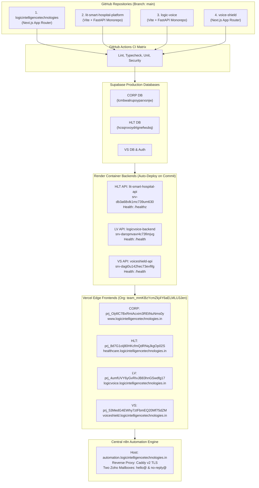

# LIT Universal Four-Site Release & Deployment Runbook

**Document Identifier:** `LIT-OPS-RUNBOOK-001`  
**Version:** 1.0.0  
**Effective Date:** 12 October 2026  
**Classification:** Internal Engineering Operations — Confidential  
**System Scope:** Logic Intelligence Technologies (LIT) Universal Multi-Repository Production Ecosystem  

---

## 1. System Architecture & Scope

Logic Intelligence Technologies operates four distinct web properties deployed across specialized cloud infrastructure providers. Release operations coordinate across all four source repositories, independent database projects, auto-deploying container backends on Render, edge frontends on Vercel, and a centralized automation engine on n8n.



### 1.1 Infrastructure & Resource Registry

| Entity | Repository | Target Domain | Frontend Provider & Project ID | Backend Provider & Service ID | Database Reference | Health Probe URL |
|---|---|---|---|---|---|---|
| **LIT Corporate** (`CORP`) | `vikashsaravanann/logicintelligencetechnologies` | `https://www.logicintelligencetechnologies.in` | Vercel: `prj_Oij4lC7BxRmiAcxim3REtNuNms0y` (Root: `.`) | Next.js Serverless Edge / Node | Supabase: `lcmbwalrupoyparxsnjw` | `GET /api/health` |
| **LIT Healthcare** (`HLT`) | `vikashsaravanann/lit-smart-hospital-platform` | `https://healthcare.logicintelligencetechnologies.in` | Vercel: `prj_8d7G1oIj80HKcfmQdRNqJkgOp02S` (Root: `apps/landing`) | Render: `srv-db3a68vlk1mc739um630` (`lit-smart-hospital-api`) | Supabase: `hcsqrxxoydrtgnefwubq` | Frontend: `GET /api/health`<br>Backend: `GET /healthz` |
| **Logic Voice** (`LV`) | `vikashsaravanann/logic-voice` | `https://logicvoice.logicintelligencetechnologies.in` | Vercel: `prj_4umfUVY6yGvRIvJB83hnGSwdfg17` (Root: `apps/web`) | Render: `srv-daropnvavr4c73fimjvg` (`logicvoice-backend`) | SQLite (ephemeral) + Supabase ready | Frontend: `GET /health`<br>Backend: `GET /health` |
| **VoiceShield** (`VS`) | `vikashsaravanann/voice-shield` | `https://voiceshield.logicintelligencetechnologies.in` | Vercel: `prj_53MedG4EWhy7ztFbmEQ20Mf75dZM` (Root: `.`) | Render: `srv-dagt0u142hec73evfifg` (`voice-shield` / `voiceshield-api`) | Supabase Auth & Database | Frontend: `GET /api/health`<br>Backend: `GET /health` |

---

## 2. Release Roles & Authority Gates

In compliance with release engineering policies, all changes must observe clear division of responsibility:

| Role | Responsibility | Authority / Actions |
|---|---|---|
| **Release Lead / Orchestrator** (`A00`) | Directs overall release timeline, acquires distributed release lock, executes dry-runs, and collates post-deployment evidence. | Runs `litctl` CLI; coordinates engineering agents. |
| **Frontend & Telemetry Specialist** (`Antigravity IDE`) | Validates web UI builds, responsive routing, corporate `/admin` release telemetry, client bundles, and E2E browser smoke tests. | Approves frontend promotions; maintains runbooks. |
| **Backend & Orchestration Specialist** (`Claude Code`) | Validates FastAPI & Next.js API adapters, health probes, zero-PHI HMAC outbox, and n8n workflow definitions. | Verifies Render services and n8n webhook contracts. |
| **Database & Security Specialist** (`Codex`) | Verifies SQL migration safety, RLS tenant isolation, backup integrity, and secrets sanitization. | Approves schema changes; validates PITR backups. |
| **Infrastructure & CI/CD Specialist** (`Antigravity CLI`) | Validates GitHub Actions, Vercel tokens, Render auto-deploys, and DNS/SSL configurations. | Executes infrastructure commands; updates manifests. |
| **Executive Project Owner** (`Human`) | Explicit production release sign-off, financial gateway activation, and customer communications sign-off. | Approves PR merges to `main` and production deployments. |

> [!IMPORTANT]
> **Production Mutation Gate:** No engineering agent or automated system has authorization to execute live production deployments, apply database migrations, or activate high-risk n8n workflows without an explicit, recorded approval token and approved release identifier (`RELEASE_ID`).

---

## 3. End-to-End Release Sequence (The Release DAG)

The universal deployment release directed acyclic graph (DAG) must be executed strictly in order. Skipping steps or running phases in parallel where dependencies exist is prohibited.

```text
[PHASE A: Pre-Flight Discovery & Lock]
       │
       ▼
[PHASE B: Source Control, PR Merges & CI Gates]
       │
       ▼
[PHASE C: Database Backups & Expand-Only Migrations]
       │
       ▼
[PHASE D: Render Backend Deployments (Wait for Commit SHA)]
       │
       ▼
[PHASE E: Vercel Frontend Deployments & Custom Domain Aliasing]
       │
       ▼
[PHASE F: Four-Website Feature Smoke Tests & Health Probes]
       │
       ▼
[PHASE G: Central n8n Automation Reconciliation & Activation]
       │
       ▼
[PHASE H: 30-Minute Canary Observation & Signed Release Report]
```

---

## 4. Phase-by-Phase Execution Runbook

### Phase A: Pre-Flight Discovery & Distributed Release Lock

1. **Acquire Distributed Release Lock:**
   Confirm no other deployment is in progress across any of the four repositories.
   ```bash
   # Initialize release context
   export RELEASE_ID="rel-$(date +%Y%m%d)-$(git rev-parse --short HEAD)"
   echo "Targeting Release ID: $RELEASE_ID"
   ```

2. **Verify Clean Working Trees & Immutable Commit SHAs:**
   Inspect git status across all 4 repos. No uncommitted changes, untracked test scripts, or local `.env` modifications may be present:
   ```bash
   for repo in logicintelligencetechnologies lit-smart-hospital-platform logic-voice voice-shield; do
     echo "=== Checking $repo ==="
     (cd "/Users/vikash/lit-infrastructure/$repo" && git status --porcelain && git rev-parse HEAD)
   done
   ```

3. **Validate Environment Variables & Secret Scopes:**
   Execute pre-flight secret scans. Verify that client-facing bundles do NOT contain backend secrets (`SUPABASE_SERVICE_ROLE_KEY`, `GROQ_API_KEY`, `RAZORPAY_KEY_SECRET`, `TWILIO_AUTH_TOKEN`):
   ```bash
   # Redacted environment check
   bash /Users/vikash/lit-infrastructure/scripts/verify-all-environments.sh --dry-run
   ```

4. **Verify Provider Authentication & Permissions:**
   - Verify GitHub CLI authentication: `gh auth status`
   - Verify Vercel token permissions: Confirm token has access to team `team_mmKBzYcmZkj4Y6aELMLU3Jen`
   - Verify Render workspace: Confirm access to workspace `tea-d9vchsu7bikc73d6srv0`
   - Verify n8n host reachability: `curl -sI https://automation.logicintelligencetechnologies.in/`

---

### Phase B: Source Control, PR Merges & CI Verification

1. **Pull Request Review & Status Checks:**
   All production releases must originate from approved pull requests targeting `main`. Pushing unreviewed code directly to `main` is strictly forbidden.
   - CORP PR: `release/2026-10-production-release` (PR #25)
   - HLT PR: `release/2026-10-production-release` (PR #64)
   - LV PR: `release/2026-10-production-release` (PR #3)
   - VS PR: Merge of audited release branch to `main`

2. **CI Pipeline Status Verification:**
   Verify that all required GitHub Actions workflows on the target SHAs have completed with status `success`:
   ```bash
   gh pr checks 25 --repo vikashsaravanann/logicintelligencetechnologies
   gh pr checks 64 --repo vikashsaravanann/lit-smart-hospital-platform
   gh pr checks 3 --repo vikashsaravanann/logic-voice
   ```

3. **Merge Pull Requests:**
   Upon obtaining explicit human approval, merge the PRs using squash-and-merge or rebase according to repository policy:
   ```bash
   gh pr merge 25 --squash --repo vikashsaravanann/logicintelligencetechnologies
   gh pr merge 64 --squash --repo vikashsaravanann/lit-smart-hospital-platform
   gh pr merge 3 --squash --repo vikashsaravanann/logic-voice
   ```

4. **Capture Immutable Merge SHAs:**
   Record the new merge commit SHA on `origin/main` for each repository.

---

### Phase C: Database Backups & Zero-Downtime Migrations

1. **Verify Database Snapshot / Point-in-Time Recovery (PITR):**
   Before executing any schema modification, confirm backup status in the Supabase Dashboard:
   - CORP DB: `lcmbwalrupoyparxsnjw` -> Database -> Backups (Snapshot verified)
   - HLT DB: `hcsqrxxoydrtgnefwubq` -> Database -> Backups (Snapshot verified)
   - VS DB: Supabase Project -> Database -> Backups (Snapshot verified)

2. **Execute Expand-Only Additive Migrations:**
   All migrations must follow the expand-contract pattern:
   - Only `CREATE TABLE`, `ADD COLUMN` (nullable or with default), `CREATE INDEX CONCURRENTLY`
   - NEVER execute `DROP TABLE`, `DROP COLUMN`, `ALTER COLUMN TYPE` without backward compatibility
   - Preserve existing Row Level Security (RLS) policies and organization UUID memberships.

   ```bash
   # Apply migrations to HLT Supabase
   cd /Users/vikash/lit-infrastructure/lit-smart-hospital-platform
   pnpm run validate:migrations
   pnpm run test:database

   # Apply migrations to CORP Supabase
   cd /Users/vikash/lit-infrastructure/logicintelligencetechnologies
   npm run test:db
   ```

---

### Phase D: Render Backend Deployments (Wait for Commit SHA)

All three Render web services are configured with `autoDeploy: true` (`autoDeployTrigger: commit`) on branch `main`.

> [!CAUTION]
> **No Duplicate Deploys:** Do NOT invoke manual Render deploy hooks or API triggers immediately after pushing to `main`. Doing so creates a duplicate, competing build that can corrupt deployment state.

1. **Target Render Services:**
   - **Healthcare API:** Service `srv-db3a68vlk1mc739um630` (`lit-smart-hospital-api`)
   - **Logic Voice Backend:** Service `srv-daropnvavr4c73fimjvg` (`logicvoice-backend`)
   - **VoiceShield API:** Service `srv-dagt0u142hec73evfifg` (`voiceshield-api`)

2. **Poll Deployment Status by SHA:**
   Monitor the automated Render deployment until it reaches status `live`:
   ```bash
   # Render Free/Starter tier cold-start buffer: 60s timeout with retries
   curl -s -f https://lit-smart-hospital-api.onrender.com/healthz || sleep 15
   curl -s -f https://logicvoice-backend.onrender.com/health || sleep 15
   curl -s -f https://voiceshield-sih-2026.onrender.com/health || sleep 15
   ```

3. **Verify Backend Health Probes:**
   - HLT API: `https://lit-smart-hospital-api.onrender.com/healthz` -> Expected HTTP 200 `{"status": "healthy", "service": "lit-api", "version": "0.1.0"}`
   - LV API: `https://logicvoice-backend.onrender.com/health` -> Expected HTTP 200 `{"status": "ok"}`
   - VS API: `https://voiceshield-sih-2026.onrender.com/health` -> Expected HTTP 200 `{"status": "healthy"}`

---

### Phase E: Vercel Frontend Deployments & Domain Promotion

1. **Authoritative Deployment Method:**
   Vercel projects are linked via GitHub Native Integration. When PRs merge to `main`, Vercel initiates production builds.
   - **CORP:** `logicintelligencetechnologies` (Project `prj_Oij4lC7BxRmiAcxim3REtNuNms0y`)
   - **HLT:** `lit-smart-hospital-platform` (Project `prj_8d7G1oIj80HKcfmQdRNqJkgOp02S`)
   - **LV:** `logic-voice` (Project `prj_4umfUVY6yGvRIvJB83hnGSwdfg17`)
   - **VS:** `voice-shield` (Project `prj_53MedG4EWhy7ztFbmEQ20Mf75dZM`)

2. **Verify Monorepo Root Directory Settings:**
   Ensure each project builds from its exact designated root:
   - CORP: Root Directory `.` -> Build Command `next build`
   - HLT: Root Directory `apps/landing` -> Build Command `bun run build`
   - LV: Root Directory `.` (with `apps/web/dist` output) -> Build Command `pnpm --filter web run build`
   - VS: Root Directory `.` -> Build Command `next build`

3. **Monitor Build Completion & Inspect Deployment IDs:**
   Inspect deployment status using Vercel CLI or Dashboard:
   ```bash
   vercel ls --scope team_mmKBzYcmZkj4Y6aELMLU3Jen
   ```

4. **Verify Domain Aliases & SSL Certificates:**
   Confirm that custom domains are serving the new immutable deployment:
   - `curl -sI https://www.logicintelligencetechnologies.in | grep -i "x-vercel-id"`
   - `curl -sI https://healthcare.logicintelligencetechnologies.in | grep -i "x-vercel-id"`
   - `curl -sI https://logicvoice.logicintelligencetechnologies.in | grep -i "x-vercel-id"`
   - `curl -sI https://voiceshield.logicintelligencetechnologies.in | grep -i "x-vercel-id"`

---

### Phase F: Four-Website Feature Smoke Tests

Execute the automated post-deployment smoke test suite against live production URLs.

```bash
# Execute multi-site automated smoke tests
npm --prefix /Users/vikash/lit-infrastructure/logicintelligencetechnologies run smoke:test
```

Verify specific feature requirements:
1. **CORP (`www.logicintelligencetechnologies.in`):**
   - GET `/` -> HTTP 200, zero console errors
   - GET `/api/health` -> HTTP 200, live database ping PASS
   - Authenticated Admin access at `/admin/command-center` and `/admin/status`
   - Lead capture persistence in Supabase table `contact_leads`
2. **HLT (`healthcare.logicintelligencetechnologies.in`):**
   - Three dedicated login portals: `/company/login`, `/hospital/login`, `/patient/login`
   - Commercial cart & store: `/organization-store` -> `/cart` -> Plan selection & GST calculation
   - Company Control Center `/company/*` routes functional
   - Patient companion AI initializes chat without unprompted audio permissions
3. **LV (`logicvoice.logicintelligencetechnologies.in`):**
   - Public homepage renders cleanly with right-side slide-over login panel
   - Microphone permission is NEVER requested on public routes
   - Logic AI ORB initializes inside `/app/assistant` strictly upon user interaction
   - `/health` rewrite correctly proxies to Render backend
4. **VS (`voiceshield.logicintelligencetechnologies.in`):**
   - Public marketing & compliance pages render cleanly
   - SOC Workspace routes `/app/*` active
   - Forensic Lab generates Section 65B Indian Evidence Act compliant PDF reports
   - Incident export CSV prepends single quotes `'` to mitigate CSV formula injection

---

### Phase G: Central n8n Automation Reconciliation & Activation

The centralized n8n automation engine operates at `https://automation.logicintelligencetechnologies.in/`.

1. **Workflow Reconciliation by Canonical ID:**
   Reconcile local workflow definitions with deployed workflows. Deduplicate file aliases (e.g., `HC-001.json` vs `HC-001-emergency-routing.json`) using canonical IDs.

2. **Stage and Upsert Approved Definitions:**
   Execute safe workflow push script without blind activation:
   ```bash
   node /Users/vikash/lit-infrastructure/logicintelligencetechnologies/scripts/push-all-n8n-workflows.mjs --diff-only
   ```

3. **Risk Tier Activation Gating:**
   - **Tier 1 (Read-Only Sentinels - OPS-01..04):** Safe to activate immediately.
   - **Tier 2 (Internal Admin Alerts - LIT-01, HC-004, HC-010, HC-012):** Activate after verifying email transport.
   - **Tier 3 (Client Transactional Alerts):** Activate only after smoke test passes.
   - **Tier 4 (High-Impact External Outbound & Financials):** REMAINS INACTIVE until separate campaign authorization.

   ```bash
   # Activate only approved safe workflows
   node /Users/vikash/lit-infrastructure/logicintelligencetechnologies/scripts/activate-safe-n8n-workflows.mjs
   ```

4. **Verify Zoho Dual-Mailbox SMTP Deliverability:**
   Confirm both credentials function independently:
   - Credential 1: `hello@logicintelligencetechnologies.in` (Business / Leads / Support)
   - Credential 2: `no-reply@logicintelligencetechnologies.in` (Transactional / System Notices)
   - Send controlled test email via authenticated POST `/api/admin/smtp-verify`

---

### Phase H: 30-Minute Canary Observation & Signed Report

1. **Canary Observation Window (30 Minutes):**
   - Monitor Sentry / Vercel error rates for 5xx spikes (Threshold: < 0.1%)
   - Monitor Render container CPU / Memory utilization
   - Inspect Supabase connection pool usage (Threshold: < 70% of max pool)
   - Verify n8n execution log: zero uncaught retry loops or dead-letter queue overflow.

2. **Generate Signed Release Report:**
   Compile all deployment evidence into `release/` and archive:
   - Target Git SHAs
   - Vercel Deployment IDs
   - Render Deployment IDs
   - Applied Migration Versions
   - Active n8n Workflow Inventory
   - Smoke Test Execution Logs

---

## 5. Universal CLI Command Reference (`litctl`)

The following target CLI command structure standardizes all operational workflows:

```bash
# 1. Discover current live environment across all providers (read-only)
litctl discover --readonly --output ops/discovery-report.json

# 2. Run diagnostic pre-flight health checks
litctl doctor --environment production --manifest ops/deployments.production.yaml

# 3. Dry-run production release
litctl deploy all --environment production --manifest ops/deployments.production.yaml --release "$RELEASE_ID" --dry-run

# 4. Execute production release with explicit authorization token
litctl deploy all --environment production --manifest ops/deployments.production.yaml --release "$RELEASE_ID" --execute

# 5. Query live deployment status
litctl status all --release "$RELEASE_ID"

# 6. Reconcile n8n workflows
litctl workflows diff --environment production --readonly
litctl workflows deploy --environment production --release "$RELEASE_ID" --approved-only

# 7. Execute emergency rollback if needed
litctl rollback --release "$RELEASE_ID" --component all --dry-run
litctl rollback --release "$RELEASE_ID" --component all --execute

# 8. Export signed release report
litctl report --release "$RELEASE_ID" --output reports/
```
